# Developer Guide

> Adapted from the [Address Book Level 3 Developer Guide](https://se-education.org/addressbook-level3/DeveloperGuide.html).

## Table of Contents

- [Acknowledgements](#acknowledgements)
- [Setting up and getting started](#setting-up-and-getting-started)
- [Design](#design)
  - [Architecture](#architecture)
  - [UI component](#ui-component)
  - [Logic component](#logic-component)
  - [Model component](#model-component)
  - [Storage component](#storage-component)
  - [Common classes](#common-classes)
- [Implementation](#implementation)
  - [Inventory management](#inventory-management)
  - [Session scheduling](#session-scheduling)
  - [Session preparation](#session-preparation)
  - [Contact management](#contact-management)
  - [Loan tracking](#loan-tracking)
  - [Student request tracking](#student-request-tracking)
  - [Broken-item tracking](#broken-item-tracking)
  - [Validation and error handling](#validation-and-error-handling)
- [Documentation, logging, testing, and DevOps](#documentation-logging-testing-and-devops)
- [Appendix: Requirements](#appendix-requirements)
- [Appendix: Instructions for manual testing](#appendix-instructions-for-manual-testing)

## Acknowledgements

- [Address Book Level 3](https://se-education.org/addressbook-level3/) — used as the structure and documentation style reference.
- [Gradle](https://gradle.org/) — used for build automation, dependency management, and test execution.
- [JUnit 5](https://junit.org/junit5/) — used for automated unit and integration tests.
- [Java logging API](https://docs.oracle.com/en/java/javase/25/docs/api/java.logging/module-summary.html) — used for diagnostic logging.

## Setting up and getting started

### Prerequisites

- Java Development Kit (JDK) 25.
- A terminal and a Java-compatible IDE such as IntelliJ IDEA.
- Internet access for the first Gradle build, when dependencies are downloaded.

The project is intended to run on Windows, macOS, and Linux. The exact JDK version should be used because the project
is configured for Java 25.

### Importing and building

1. Clone or download the repository.
2. Open the repository root, the directory containing `build.gradle`, in the IDE.
3. Import the project as a Gradle project.
4. Verify the JDK used by Gradle and the IDE is Java 25.
5. Build the application:

   ```text
   Windows: .\gradlew.bat check shadowJar
   macOS/Linux: ./gradlew check shadowJar
   ```

### Running Bob

After building, run the generated JAR:

```text
java -jar build/libs/bob.jar
```

Bob prints a banner, asks for the user's name, and then accepts one command per line. Enter `Bye` to exit.

### Running tests

- Run the complete automated test and Checkstyle suite with `check`.
- Run the text UI tests with `text-ui-test\runtest.bat` on Windows or `sh text-ui-test/runtest.sh` on macOS/Linux.
- The feature-specific manual test cases are recorded in [`test/ui-test-plan.md`](../test/ui-test-plan.md).

## Design

Bob is a command-line application with a simple component structure:

```text
User
  |
  v
Bob / Ui  <-->  Parser  <-->  Model managers
                              |-- Inventory
                              |-- SessionManager
                              |-- ContactManager
                              |-- RequestManager
                              `-- LoanManager
                                      |
                                      `-- Inventory
```

`Bob` starts the application and wires the components together. `Ui` contains shared display text, `Parser` validates
and dispatches commands, and the model classes store the current application state in memory.

### Architecture

The application uses a lightweight layered architecture:

- **UI** — reads command-line input and displays output.
- **Logic** — parses commands, validates their formats, and dispatches operations.
- **Model** — stores inventory, sessions, preparations, contacts, requests, and loans.
- **Storage** — not implemented; all data is intentionally in memory for the current version.
- **Common classes** — shared domain objects, exceptions, and display constants.

`Bob.main` creates one `Parser`, one instance of each model manager, and a shared `Inventory` for the duration of the
process. The parser receives these objects when handling each command. This keeps the managers independent while allowing
loans and preparations to query or update inventory.

### UI component

The UI is implemented by [`Bob`](../src/main/java/seedu/bob/Bob.java) and [`Ui`](../src/main/java/seedu/bob/Ui.java).

- `Bob` displays the banner and greeting, reads input using `Scanner`, and separates command responses.
- `Ui` renders loan confirmations and listings and stores the divider and complete `help` message.
- The UI does not contain business rules; it delegates command handling to `Parser`.
- The application exits when the user enters `Bye` in any letter case.

### Logic component

The logic component is implemented by [`Parser`](../src/main/java/seedu/bob/Parser.java).

For every input line, `Parser`:

1. separates the command word from its arguments;
2. selects the command handler;
3. checks prefixes, argument order, and value formats;
4. constructs domain objects where necessary;
5. invokes the relevant model manager; and
6. passes loan operation results and listing rows to `Ui` for rendering.

Commands use fixed prefix orders, such as `n/NAME c/CATEGORY q/QUANTITY`. A shared prefix matcher separates values from
later arguments. Consequently, a value containing a standalone token such as `a/b` is currently interpreted as another
prefix and is rejected.

Expected command errors are converted into user-facing messages. Unexpected runtime failures are logged and replaced by a
generic safe error message so that one malformed command does not terminate the application.

### Model component

The model is composed of domain objects and managers:

- [`Inventory`](../src/main/java/seedu/bob/Inventory.java) stores categories and `InventoryItem` objects.
- [`SessionManager`](../src/main/java/seedu/bob/SessionManager.java) stores sessions in chronological order.
- [`Session`](../src/main/java/seedu/bob/Session.java) validates dates, times, and scheduling conflicts.
- [`Preparation`](../src/main/java/seedu/bob/Preparation.java) stores per-session requirements through `PreparationItem`.
- [`ContactManager`](../src/main/java/seedu/bob/ContactManager.java) stores contacts.
- [`RequestManager`](../src/main/java/seedu/bob/RequestManager.java) stores deadline-sorted student requests.
- [`Request`](../src/main/java/seedu/bob/Request.java) validates request details and holds the fulfillment status.
- [`LoanManager`](../src/main/java/seedu/bob/LoanManager.java) stores active loans and shares the inventory with loans.
- [`Loan`](../src/main/java/seedu/bob/Loan.java) stores an independent item snapshot, quantity, borrower values, and due date.
- `LoanAdditionResult` and `LoanListEntry` carry immutable operation/query results to the loan UI.

Managers expose operations rather than their mutable internal collections. Where a collection is returned for querying,
the implementation returns an immutable snapshot. Domain classes maintain invariants such as positive quantities,
nonblank names, and conflict-free sessions.

### Storage component

There is no storage component in the current version. Inventory, sessions, preparations, contacts, requests, and
loans are created when Bob starts and are discarded when the process exits. Persistence and data migration are future work.

### Common classes

The `seedu.bob.exception` package contains checked domain exceptions for invalid commands, indices, quantities, dates,
stock, and session conflicts. `Ui.DIVIDER` and `Ui.HELP_MESSAGE` are shared display constants. `InventoryItem` and
`PreparationItem` are small value objects used by their respective managers.

## Implementation

### Inventory management

`Inventory` stores items in insertion-ordered categories. Item names are unique within a category, ignoring case, while
the same name may occur in different categories. `add-i` creates a category when needed, and `delete-i` removes a
positive quantity. Removing all units removes the item and then removes an empty category.

Inventory operations validate all inputs before changing state. Loan deductions use the same private quantity-deduction
path as `delete-i`, ensuring depleted items and categories are handled consistently. Inventory listing uses one-based item
indices within each category.

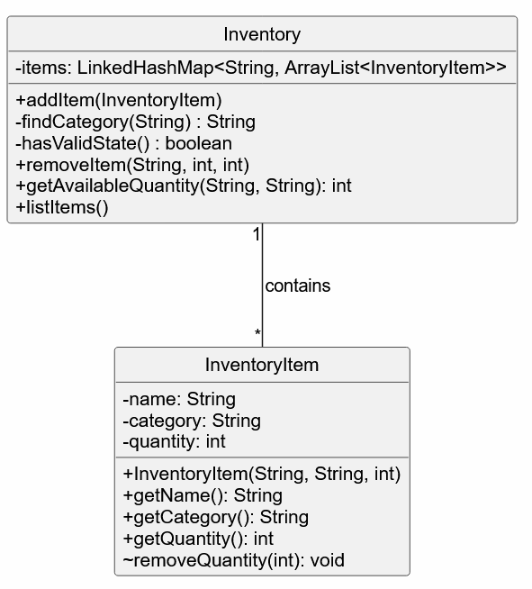

*Figure 1: Inventory categories and their stored items.*

#### Detailed inventory addition design

Inventory addition registers usable stock through `add-i n/NAME c/CATEGORY [q/QUANTITY]`.
The quantity defaults to one when `q/` is omitted. See the [User Guide](UserGuide.md#add-an-item-add-i)
for command syntax and user-facing examples.

#### Responsibilities and storage

| Component | Responsibility in addition |
| --- | --- |
| `Parser` | Checks prefix order, extracts and trims values, validates the quantity, constructs the item, and invokes inventory addition. It prints expected command errors. |
| `InventoryItem` | Holds a name, category, and positive quantity. Its constructor independently rejects null or blank names/categories and nonpositive quantities. |
| `Inventory` | Resolves the category, rejects duplicate names, stores the item, and prints the success confirmation. |

`Inventory` stores a `LinkedHashMap<String, ArrayList<InventoryItem>>`. Each key is a category's stored display name;
its list contains that category's items. The map and lists preserve insertion order, making subsequent listings
predictable. `findCategory` scans category names using `equalsIgnoreCase`, so `Tools` and `TOOLS` share a category
while retaining the first stored category spelling. Item names are also compared ignoring case within that category.

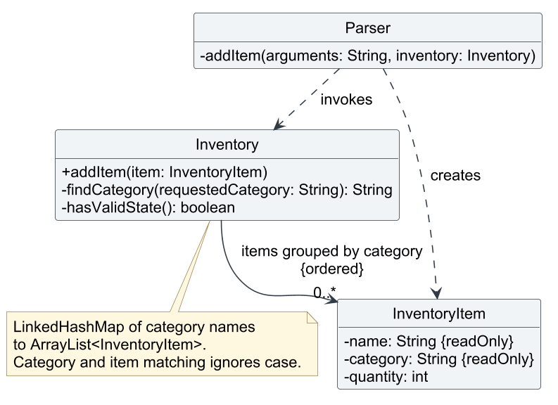

*Figure 1a: Selected inventory-addition relationships. Parser dependencies represent temporary use, while Inventory
retains item references grouped by category. Collection implementation classes and unrelated operations are omitted.*

The association uses no composition diamond: `addItem` stores the supplied object, rather than creating an exclusively
owned copy. An item's name and category are final; its quantity can change through package-level stock operations.
Other features query the same inventory, so newly added stock is available to preparation checks, requests, and loans.

#### Example walkthrough

Starting with an empty inventory, consider:

```text
add-i n/Screws c/Fasteners q/100
```

1. `Parser#addItem` accepts the prefix sequence `n/`, `c/`, `q/` and extracts the three values.
2. `parseQuantity` converts `100` into a positive integer. The parser constructs an `InventoryItem`.
3. `Inventory#addItem` calls `findCategory`. Since Fasteners does not exist, it creates an empty category list.
4. The duplicate scan finds no matching item, so the new item is appended.
5. Inventory checks its state with an assertion, logs the addition at `FINE`, and prints:

```text
Successfully added: 100x Screws to the inventory
```

Repeating the command with `n/screws c/FASTENERS q/20` raises `DuplicateItemException`. The original quantity stays
at 100; `add-i` does not replenish an existing entry. Adding `n/Screws c/Spares q/20` creates a separate entry instead.

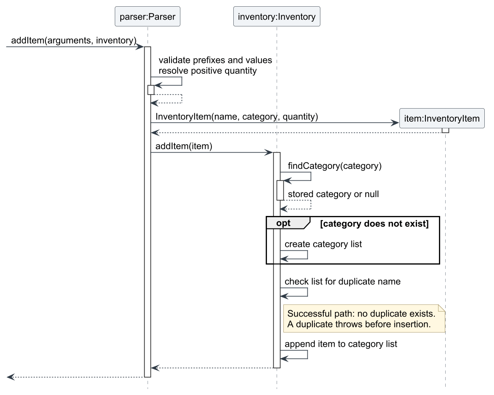

*Figure 1b: Successful addition after command dispatch. Internal actions use descriptive labels; routine getters,
logging, assertions, and console output are omitted. The duplicate check precedes insertion into the category list.*

#### Validation and failure behaviour

| Boundary | Rule and result |
| --- | --- |
| Prefix parsing | Only `n/ c/` or `n/ c/ q/`, in that order, is accepted. Missing, repeated, reordered, or unexpected prefixes cause `CommandFormatException`. |
| Text values | The parser trims surrounding whitespace and rejects blank names/categories. Direct constructor calls validate these fields but do not trim them. |
| Quantity parsing | An explicit quantity must parse as a positive Java `int`, up to `Integer.MAX_VALUE`. Blank, non-integer, out-of-range, zero, and negative values cause `InvalidQuantityException`. |
| Domain construction | `InventoryItem` rejects invalid fields with `IllegalArgumentException`, protecting callers outside the parser too. |
| Inventory insertion | A null item causes `NullPointerException`; an existing name in the resolved category causes `DuplicateItemException`. |

Expected command failures are printed by the parser. Malformed input fails before inventory insertion, and duplicate
rejection leaves existing stock unchanged. Creating a new category happens before its duplicate scan; that new list
is empty, so a duplicate cannot occur on that path. These guarantees concern normal validation failures in the
single-threaded application, not recovery from process termination.

After successful insertion, `hasValidState` asserts that categories are nonblank and nonempty, items have positive
quantities and matching categories, and no category contains duplicate item names. Assertions detect programming
errors; input validation still operates when assertions are disabled. Addition and duplicate rejection produce
`FINE` diagnostic records without changing normal console output.

#### Design considerations and alternatives

| Decision | Rationale and trade-off |
| --- | --- |
| Group items by category | A map of lists directly supports category-based listing and indices. A flat list would require regrouping for display. |
| Preserve insertion order | `LinkedHashMap` keeps category order predictable; `HashMap` would not guarantee it. Items remain in list insertion order. |
| Match names ignoring case | Capitalization differences do not accidentally create duplicate stock. Linear scans keep the implementation simple; normalized lookup keys could improve lookup for a larger inventory. |
| Reject duplicates rather than merge quantities | Accidental repeated commands cannot silently increase existing stock. A dedicated restocking command could make intentional increases explicit. |
| Create categories automatically | Adding the first item requires no separate category-management command. A category typo can consequently create a new category. |
| Validate at parser and domain boundaries | The parser gives command-specific feedback; constructor checks also protect direct callers such as tests. |

#### Verification and limitations

`InventoryTest` covers successful addition, null input, case-insensitive duplicates, unchanged stock after duplicate
rejection, and identical names in different categories. `InventoryItemTest` covers constructor validation, while
`InventoryLoggingTest` checks diagnostic records. The [UI test plan](../test/ui-test-plan.md) records malformed-prefix,
blank-field, and invalid-quantity cases. These references describe existing checks; run the tests after changing
the implementation rather than assuming the documentation proves correctness.

Inventory exists only in memory and is lost when Bob exits. Addition does not rename entries or restock existing
ones. Categories and names are free text; case-insensitive matching does not correct spelling differences.
Matching scans categories and then the selected list. With assertions enabled, the additional invariant check also
compares pairs of items within each category, which is suitable for the expected small data set.

Editable diagram sources: [class diagram](diagrams/inventory-add-class.puml) and
[addition sequence](diagrams/inventory-add-sequence.puml). Both reuse `loan-style.puml`; regenerate their PNGs in
`docs/images/` when changing the sources.

### Session scheduling

`Session` parses dates in `d MMMM yyyy` format and times in `HHmm` format. Dates cannot be in the past, times must be
valid, and the end time must be later than the start time. `SessionManager` rejects overlapping sessions at the same
location, ignoring location capitalization, but permits overlapping sessions at different locations.

Sessions are sorted by date, start time, and name. Because sorting can change positions, users should run `list-s` before
using a session index. Deleting a session also discards its preparation.

#### Detailed scheduling design

Lab session scheduling supports adding, listing, and deleting sessions through the `add-s`, `list-s`, and `delete-s`
commands. Responsibilities are divided between three classes:

- **Parser** validates command syntax, extracts arguments, and dispatches scheduling operations.
- **Session** validates individual session details and defines ordering and conflict detection.
- **SessionManager** maintains the schedule, rejects conflicting additions, and retrieves or removes sessions using
  displayed indices.

`SessionManager` stores sessions in an `ArrayList<Session>`, sorted after each successful addition. Displayed indices are
one-based list positions and can change after additions or deletions. Each `Session` owns a `Preparation` object, so
preparation remains associated with the same session when its position changes.

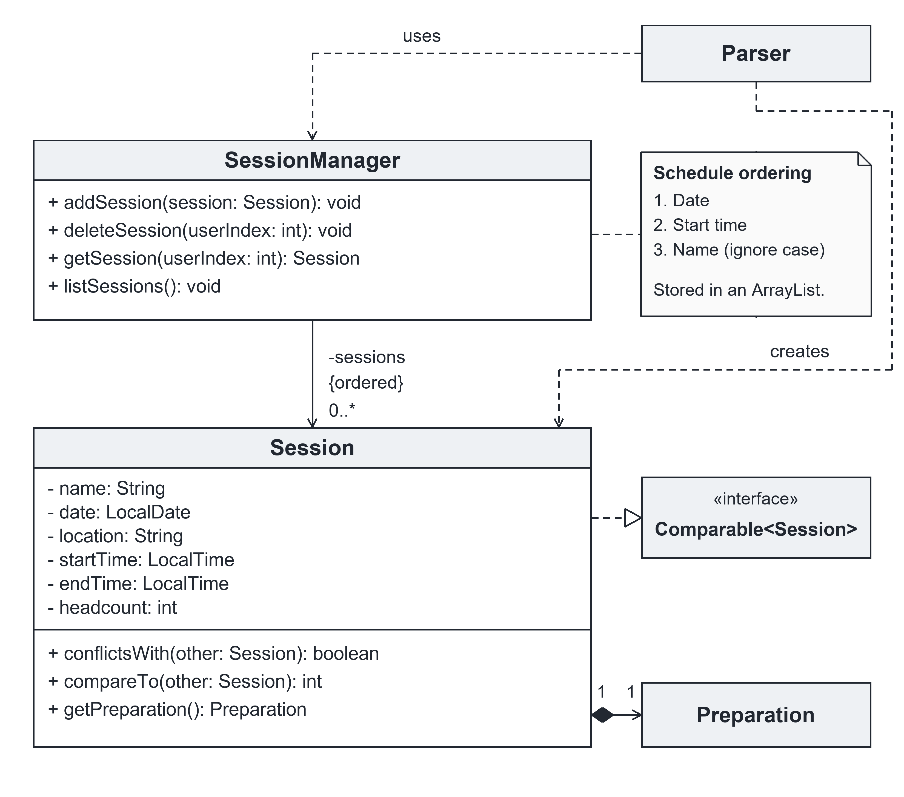

*Figure 2: Main scheduling classes and relationships. Selected members are shown; constructors, routine getters, and
preparation internals are omitted.*

##### Key operations

- `SessionManager#addSession(Session session)` rejects conflicts before insertion, then adds the session and sorts the schedule.
- `Session#conflictsWith(Session other)` checks for overlapping times on the same date at the same location.
- `Session#compareTo(Session other)` orders sessions by date, then start time, then name ignoring capitalization.
- `SessionManager#getSession(int userIndex)` validates a displayed index and retrieves its session.
- `SessionManager#deleteSession(int userIndex)` validates and retrieves the session through `getSession()` before removing it.
- `SessionManager#listSessions()` displays numbered sessions in stored order, or an empty-schedule message.

##### Example walkthrough

Assume that 5 November 2099 is a future date.

**Step 1: Initialize an empty schedule**

At startup, `Bob` creates a `SessionManager` containing an empty `ArrayList<Session>`. Calling `list-s` displays the
empty-schedule message.

**Step 2: Add an afternoon session**

The user enters:

`add-s n/Embedded Systems Lab d/5 November 2099 l/Room-A s/1300 e/1500 p/18`

`Parser` checks the prefixes, extracts values, converts the headcount, and constructs a validated `Session`. The manager
finds no existing sessions, inserts the candidate, sorts the list, and prints confirmation. Embedded Systems Lab receives
index 1.

**Step 3: Add an earlier session and reorder the schedule**

The user enters:

`add-s n/Digital Design Lab d/5 November 2099 l/Room-A s/0900 e/1100 p/24`

The sessions share a date and location, but their times do not overlap. The manager accepts the addition and calls
`Collections.sort()`, which uses `Session#compareTo()`.

| Displayed index | Session | Time |
| --- | --- | --- |
| 1 | Digital Design Lab | 0900–1100 |
| 2 | Embedded Systems Lab | 1300–1500 |

Embedded Systems Lab moves to index 2; its session and preparation objects remain unchanged.

**Step 4: Reject a conflicting session**

The user enters:

`add-s n/Circuit Lab d/5 November 2099 l/Room-A s/1000 e/1200 p/12`

Construction succeeds, but `Session#conflictsWith()` detects a conflict with Digital Design Lab because:

- Their dates match.
- Their locations match, ignoring capitalization.
- Each session starts before the other ends.

The manager throws `SessionConflictException` before insertion. `Parser` displays the error, and the schedule remains
unchanged. These time comparisons are strict, so sessions meeting exactly at an endpoint are allowed.

**Step 5: Associate preparation with a session**

The user enters:

`add-p s/2 i/Breadboard c/Equipments q/2`

`Parser` retrieves Embedded Systems Lab through `getSession(2)` and accesses its `Preparation` object. With 18 attendees,
the requirement is 36 breadboards. This records a requirement without reserving inventory. Preparation calculates required
quantities, while Parser compares these requirements with inventory availability.

**Step 6: Delete another session without losing preparation**

The user enters:

`delete-s 1`

`deleteSession()` retrieves Digital Design Lab through `getSession(1)`, converts the displayed index to a zero-based
position, and removes it.

Embedded Systems Lab becomes index 1 while retaining its requirement of 36 breadboards. Calling `list-p s/1` accesses
that same preparation. Calling `delete-s 2` now fails because only one session remains.

##### Interactions during session addition

The sequence diagram shows successful addition. Construction precedes conflict checking; every comparison returns `false`
before insertion and sorting. Descriptive labels summarize routine implementation details.

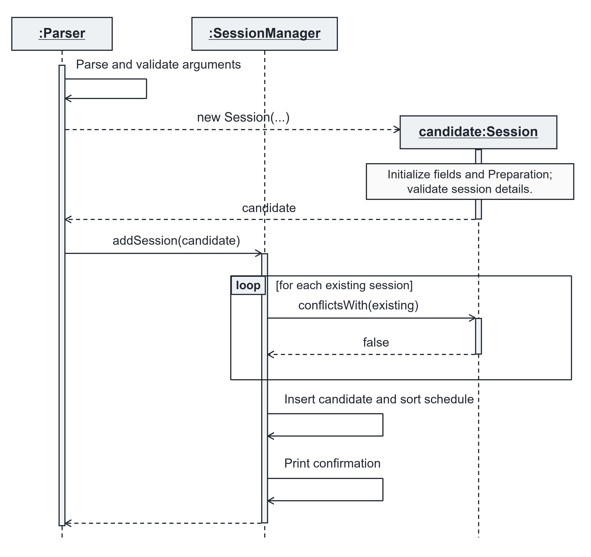

*Figure 3: Successful session addition. The loop checks each stored session and is skipped when the schedule is empty.*

If parsing or construction fails, the manager is not asked to add the session. If a conflict is detected, addition stops
before insertion, sorting, and success confirmation.

##### Design considerations

**Aspect 1: Representing and ordering the schedule**

**Current approach:** Store sessions in an `ArrayList` and sort after each successful addition.

Stored and displayed positions remain consistent, simplifying retrieval and deletion. The tradeoff is scanning existing
sessions for conflicts and sorting after insertion, which is sufficient for a small schedule.

**Alternative:** Preserve insertion order and sort a separate copy for display.

This avoids sorting the stored list, but displayed indices would require mapping back to the original collection. Keeping the
stored list sorted avoids this additional mapping.

**Aspect 2: Associating preparation with sessions**

**Current approach:** Each `Session` owns its `Preparation` object.

Sorting moves session references without changing their associated preparation. Deleting another session therefore cannot
transfer requirements to the wrong session. This intentionally couples a session with its preparation.

**Alternative:** Maintain preparation separately using session indices.

Both collections would require synchronization after sorting or deletion. Storing preparation inside the session avoids
this dependency on changing positions.

##### Scheduling validation, assertions, and logging

| Component | Responsibility |
| --- | --- |
| `Parser` | Command structure, required prefix order, numeric conversion, and positive numeric arguments. |
| `Session` | Nonblank name and location, positive headcount, valid date and time values, date not before today, and start time before end time. |
| `SessionManager` | Rejecting null additions, checking scheduling conflicts, and validating indices against the current schedule. |

Expected command errors are reported through exceptions before the relevant insertion or deletion occurs.

When Java assertions are enabled, `hasValidState()` checks for nonnull sessions and pairwise absence of conflicts after
additions and deletions. It does not verify sorting. Assertions supplement ordinary validation; user-input checks do not
depend on them.

`SessionManager` uses `java.util.logging.Logger` to record attempted and successful additions and deletions at `INFO`
level, and conflicts or invalid indices at `WARNING` level.

The public `Session` constructor uses the system's default time zone. A package-private overload accepts a `Clock`
so tests can check today, yesterday, and time-zone boundaries deterministically. Null date and time strings receive
the same validation exceptions and messages as malformed strings.

##### Scheduling limitations

- Sessions cannot span midnight. Date checks occur during construction; sessions are not automatically removed afterward,
  and today's start time is not compared with the current clock time.
- There is no command to edit a session. Deleting and recreating one produces a new session with empty preparation.
- The schedule exists only in memory and is not preserved after the application exits.

### Session preparation

Session preparation helps a lab technician work out what a session needs and whether current stock is enough. It
supports adding a per-attendee requirement (`add-p`), removing part or all of a requirement (`delete-p`), and listing
requirements against live stock (`list-p`). Every successful preparation command ends by displaying the updated list, so
shortages are visible immediately.

#### Detailed preparation design

Preparation divides responsibilities as follows:

- **Parser** validates prefixes, resolves the session, supplies its headcount, and renders the preparation list.
- **Session** owns exactly one `Preparation`, created with the session.
- **Preparation** stores required totals in insertion order, merges repeated items, and validates every change.
- **PreparationItem** is an immutable value holding an item name, category, and total required quantity.
- **Inventory** answers availability queries through `getAvailableQuantity()` without reserving or changing stock.

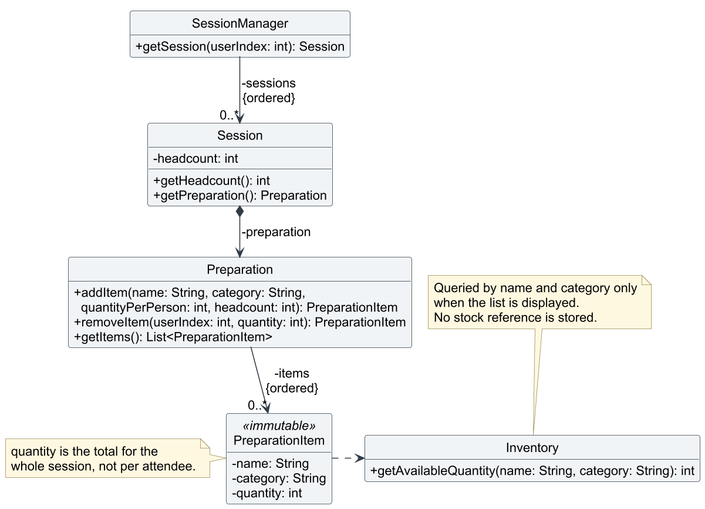

*Figure 4: Selected preparation classes. The filled diamond shows that a session owns its preparation. The dashed arrow
shows that items are matched against inventory only when the list is displayed; no reference to stock is stored.
Parser, UI, constructors, and private helpers are omitted.*

Because the `Preparation` lives inside its `Session`, the requirements move with the session when the schedule is
re-sorted or another session is deleted. A preparation keyed by session index would instead attach requirements to the
wrong session after renumbering.

`PreparationItem` is immutable. Each change replaces the stored item with a new one, and `getItems()` returns a
`List.copyOf()` snapshot. Code that reads the list therefore cannot change the stored requirements by accident.

#### Key operations

- `Preparation#addItem(String name, String category, int quantityPerPerson, int headcount)` validates the input,
  multiplies the per-attendee quantity by the headcount, and adds the result to any existing requirement with the same
  name and category (ignoring case). It returns the updated item.
- `Preparation#removeItem(int userIndex, int quantity)` subtracts a **total** quantity from the item at a one-based
  position. The item is removed when its required total reaches zero. It returns the item as it was before the removal.
- `Preparation#getItems()` returns an immutable snapshot in displayed order.
- `Inventory#getAvailableQuantity(String name, String category)` returns matching stock, or zero when the item or
  category does not exist.

#### Example walkthrough

Start with this inventory and a session of 10 attendees, shown as session 1 by `list-s`:

```text
add-i n/Wire c/Components q/15
add-s n/Practice Lab d/8 October 2099 l/Room-A s/0900 e/1000 p/10
```

**Step 1: Add a requirement**

```text
add-p s/1 i/Wire c/Components q/2
```

`Parser` reads the headcount (10) from session 1 and calls `addItem("Wire", "Components", 2, 10)`. No matching item
exists, so `Preparation` appends a `PreparationItem` with a total of 20. The list shows 15 available and a shortfall of
5. Inventory still holds 15 Wire, because preparation only reads stock.

**Step 2: Add the same item again with different capitalisation**

```text
add-p s/1 i/wire c/components
```

The quantity defaults to 1 per attendee. `findItemIndex()` matches the existing row ignoring case, so the total becomes
30 and the spelling from the first addition (`Wire [Components]`) is kept. No duplicate row is created.

**Step 3: Remove part of a requirement**

```text
delete-p s/1 i/1 q/12
```

Unlike `add-p`, `q/` here is a total, not a per-attendee quantity. The requirement drops from 30 to 18. Asking to
remove more than 18 is rejected without changing the preparation.

**Step 4: Stock changes elsewhere**

```text
add-l n/Wire c/Components q/5 b/Alex Tan t/91234567 d/8 October 2099
list-p s/1
```

Assuming there are no existing loans, this creates loan 1 and reduces usable stock from 15 to 10 Wire.
`list-p` queries inventory again, so the shortfall increases from 3 to 8 without changing the preparation.
Returning the loan with `return 1` restores stock to 15 and the shortfall to 3.
Adding the same inventory entry with `add-i` would be rejected as a duplicate; it does not top up stock.

| After operation | Required Wire | Available Wire | Displayed warning |
| --- | --- | --- | --- |
| Step 1: `add-p ... q/2` | 20 | 15 | Shortfall: 5 |
| Step 2: `add-p ...` (default 1) | 30 | 15 | Shortfall: 15 |
| Step 3: `delete-p ... q/12` | 18 | 15 | Shortfall: 3 |
| Step 4: `add-l ... q/5` | 18 | 10 | Shortfall: 8 |

#### Interactions during preparation addition

The sequence below shows a successful `add-p` command after `Bob` passes the input to `Parser`. The reference frame
summarises prefix validation and number parsing. Print statements, assertions, and logging are omitted.

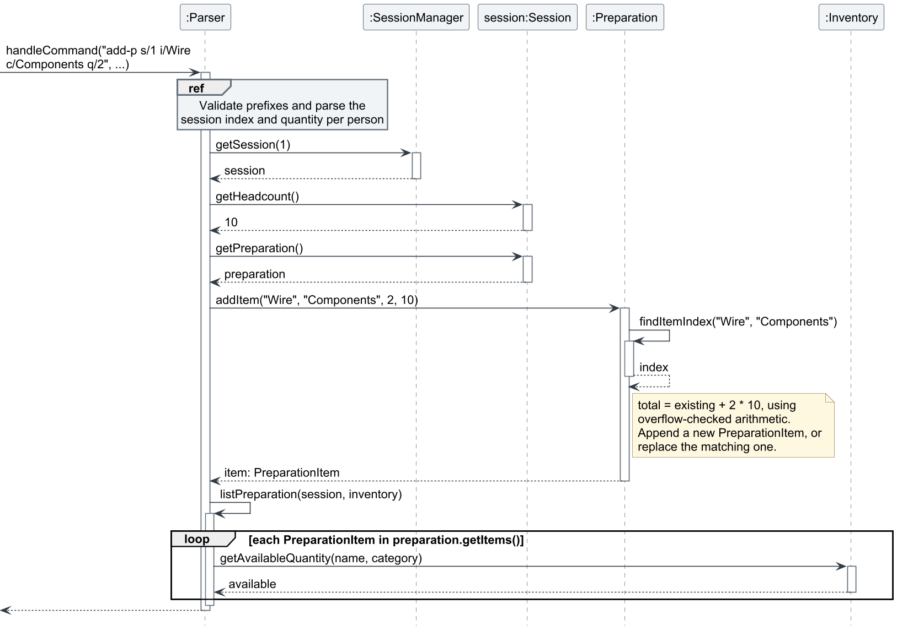

*Figure 5: The headcount is read from the session before `addItem()` is called. After the change, `listPreparation()`
queries inventory once per required item.*

If the session index is invalid, `getSession()` throws before the preparation is touched. If the quantity is invalid
or the new total would exceed `Integer.MAX_VALUE`, `addItem()` throws before changing its list. The overflow check uses
`Math.multiplyExact()` and `Math.addExact()`, so an oversized request cannot silently wrap around to a negative total.

#### Calculating availability and shortfalls

For each required item, `listPreparation()` looks up the live stock. When the available quantity is below the required
total, it prints the row with a shortfall of `required - available`. Listing changes neither the preparation nor the
inventory.

An item is matched by name **and** category. Wire stored under `Tools` does not count towards Wire required under
`Components`. A missing item counts as zero available, so a requirement can be recorded before the stock is bought.

#### Design considerations and alternatives

**Aspect 1: Where to store preparation**

**Current approach:** Each `Session` owns a `Preparation` object.

Requirements stay with the correct session when indices change, and deleting a session deletes its requirements. No
extra lookup structure is needed.

**Alternative:** Keep a separate map from session index (or session name) to requirements. Indices change after sorting
and deletion, and session names are not unique, so the map would need its own key and cleanup logic.

**Aspect 2: Reserving stock**

**Current approach:** Preparation does not reserve stock. It reads availability each time it is displayed.

This is simple, never leaves inventory and preparation out of sync, and reflects loans and stock changes immediately.
The cost is that two sessions needing the same item can both appear sufficient even when stock covers only one of them.

**Alternative:** Deduct or reserve stock when a requirement is added. This would prevent double counting between
sessions, but every preparation, session deletion, and loan would then need matching release and rollback rules.

**Aspect 3: Storing the total or the per-attendee quantity**

**Current approach:** Store the total (`quantityPerPerson × headcount`) when the item is added.

Repeated additions with different per-attendee quantities merge naturally into one total, and `delete-p` can remove an
exact number of units (for example, spares that are no longer needed).

**Alternative:** Store the per-attendee quantity and multiply at display time. Totals would then follow headcount
changes automatically, but repeated additions with different per-attendee quantities could not be merged into one
value. The current approach is sufficient because sessions do not yet support editing the headcount.

**Aspect 4: Identifying an item**

**Current approach:** Match by name and category together, ignoring case, and keep the first spelling.

This matches how `Inventory` identifies stock, so the comparison in `list-p` is consistent with what inventory holds.

**Alternative:** Use inventory item IDs. This would survive renaming, but inventory does not have permanent IDs, and
requirements must be allowed for items that are not yet in stock.

#### Preparation validation, assertions, and testing

| Component | Responsibility |
| --- | --- |
| `Parser` | Exact prefix order, optional `q/` for `add-p`, and positive integer conversion of indices and quantities. |
| `SessionManager` | Valid one-based session index. |
| `Preparation` | Nonblank name and category, positive quantity and headcount, valid item index, removal not exceeding the requirement, and overflow-safe totals. |
| `Inventory` | Case-insensitive stock lookup that never changes stock. |

After every successful change, `Preparation` asserts that no stored item is blank or non-positive and that no two items
share the same name and category. User-input errors are reported with exceptions, so they still work when assertions
are disabled.

`PreparationTest` covers headcount multiplication, case-insensitive merging, partial and full removal, invalid input,
and overflow. `ParserPreparationTest` covers category-specific shortages, recalculation after stock changes, and malformed or invalid
commands leaving state unchanged. Console
scenarios are recorded as `UI-PREP-*` in the [UI test plan](../test/ui-test-plan.md).

#### Preparation limitations

- Stock is not reserved, so several sessions can rely on the same units.
- Totals are fixed when added and do not follow later headcount changes.
- Item indices are list positions, so they shift after an item is fully removed.
- `listPreparation()` prints directly from `Parser`, rather than through `Ui` as loan tracking does. Moving it into
  `Ui` would make the output easier to test and keep display code in one place.
- Preparation, like all application data, exists only in memory and is discarded on exit.

#### Preparation diagram sources

Editable PlantUML sources: [class diagram](diagrams/preparation-class.puml) and
[addition sequence](diagrams/preparation-add-sequence.puml). They reuse [loan-style.puml](diagrams/loan-style.puml)
so all implementation diagrams share one style.

### Contact management

`add-c`, `list-c`, and `delete-c` follow the same structure as sessions: `Contact` is the validated data class,
`ContactManager` owns the list and prints confirmations, and `Parser` dispatches the commands. `delete-c` takes a
single index on the command line, like `delete-s`.

The user guide did not specify the rules below. They are design decisions made when implementing the feature and
can be changed in `Contact` (validation) or `Parser` (`ADD_CONTACT_PREFIXES`):

| Decision | Rule | Rationale |
| --- | --- | --- |
| Phone format | Digits only, no length check | Accepts local and international numbers. Rejecting separators keeps one canonical form. A length check would wrongly reject some valid numbers. |
| Email format | Contains `@`, no whitespace | Catches obvious typos without a full email grammar. |
| Duplicate contacts | Allowed | Two suppliers can share a name or switchboard number. Unlike `add-i`, a contact has no natural unique key. |
| Optional fields | `e/` before `r/`; a supplied value must not be blank | Matches the fixed prefix order used by every other command. |
| Empty list | `list-c` shows `No contacts saved.` | Matches `list-s`, which shows `No sessions scheduled.` |

Known limitation: prefixes are detected by a shared pattern (a single letter followed by `/` at the start of a
word), so a value containing a word such as `a/b` cannot be entered. This affects every command, not only contacts.

### Loan tracking

Loan tracking supports recording loans (`add-l`), listing active or overdue loans (`list-l [overdue]`), correcting an
incorrect record (`delete-l INDEX`), and recording a full return (`return INDEX`). Each accepted loan deducts available
stock; either removal command restores the entire loan quantity before removing the record.

### Detailed loan tracking design

At startup, `Bob` creates one `LoanManager` using the same `Inventory` instance as inventory and preparation commands.
This gives all features a consistent view of available stock. Loan tracking divides responsibilities as follows:

- **Parser** validates command syntax, constructs domain objects, invokes the manager, and passes results to the UI.
- **Loan** captures item details, quantity, borrower name and phone, and a strictly parsed due date.
- **LoanManager** maintains active loans, coordinates stock changes, and evaluates overdue status using its `Clock`.
- **Inventory** locates items case-insensitively, validates stock changes, and removes or recreates depleted entries.
- **Ui** renders successful results, warnings, listing rows, and empty states.

`LoanManager` stores an `ArrayList<Loan>` in insertion order. Each addition creates an independent record, even when its
item and borrower match another loan. The displayed index is a one-based position in the full active list.

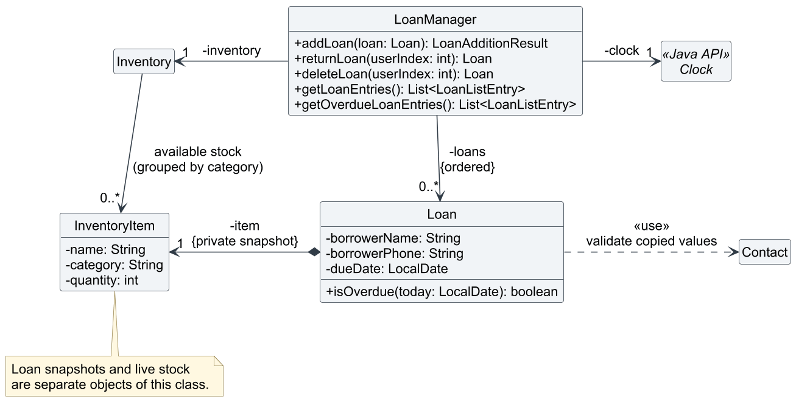

*Figure 6: Selected loan classes and navigable relationships. The filled diamond shows that a loan owns its private item
snapshot. The dashed dependency on `Contact` is used during construction; no contact reference is retained. Parser, UI,
result classes, constructors, routine getters, and inventory internals are omitted.*

The `InventoryItem` owned by a loan is a separate object from live inventory stock. `Loan` exposes only its values, so
deducting, deleting, or restoring stock cannot change the recorded loan quantity. Borrower values are copied into final
strings and validated through `Contact`; borrowers are not registered in `ContactManager`. These snapshots preserve the
details of a loan even when the source inventory entry disappears or a source contact changes.

#### Key operations

- `LoanManager#addLoan(Loan loan)` deducts stock, appends the loan, and returns a `LoanAdditionResult` with its addition-time
  overdue flag. The UI uses that flag for the backlog warning.
- `Inventory#lendItem(String name, String category, int quantity)` validates and deducts available units. It shares the
  private deduction path with `delete-i`, including cleanup of depleted items and empty categories.
- `LoanManager#getLoanEntries()` and `getOverdueLoanEntries()` return immutable `LoanListEntry` rows containing a loan,
  its full-list index, and its query-time overdue flag.
- `Loan#isOverdue(LocalDate today)` returns whether its due date is strictly before the supplied date.
- `LoanManager#returnLoan(int userIndex)` and `deleteLoan(int userIndex)` delegate to the private
  `removeLoanAndRestoreStock()` method and return the removed loan for their distinct UI confirmations.
- `Inventory#restoreStock(String name, String category, int quantity)` merges matching stock or recreates a missing item
  or category. It rejects integer overflow before changing stock.

#### Example walkthrough

Start with an empty loan list and the following inventory command:

```text
add-i n/Multimeter c/Equipment q/5
```

**Step 1: Record the first loan**

```text
add-l n/Multimeter c/Equipment q/2 b/Alex Tan t/91234567 d/30 October 2099
```

`Parser` validates the prefixes and quantity, constructs a borrower `Contact`, and constructs a `Loan`. The loan copies
the borrower's values, parses the due date, and creates its item snapshot. Construction does not alter stock.
`LoanManager#addLoan()` then asks inventory to deduct two units before appending the record. Inventory now holds three
units, while loan 1 independently records two.

**Step 2: Keep a repeated loan separate**

```text
add-l n/Multimeter c/Equipment q/1 b/Alex Tan t/91234567 d/31 October 2099
```

The second addition creates loan 2 with its own quantity and due date. The manager does not merge it into loan 1.

**Step 3: Reject an excessive request**

```text
add-l n/Multimeter c/Equipment q/3 b/Sam Lee t/92345678 d/31 October 2099
```

Only two units are available. `Inventory#lendItem()` rejects the request before deduction, and the manager never appends
the candidate loan. `Parser` displays the error; no success confirmation or overdue warning is displayed.

**Step 4: Return a loan and renumber the list**

```text
return 1
```

The manager restores the first loan's two units before removing that record. The second loan becomes index 1 without
changing its recorded quantity or due date. Users should refresh `list-l` after removal before choosing another index.

**Step 5: Correct an incorrect record**

```text
delete-l 1
```

This uses the same restoration path as a return but displays a correction confirmation. All five units are available
again, and the active loan list is empty. Neither removal command changes supplier contacts nor session requirements.

| After operation | Available Multimeters | Active loans, in displayed order |
| --- | --- | --- |
| Initial inventory addition | 5 | None |
| First loan | 3 | 1: two units, due 30 October 2099 |
| Second loan | 2 | 1: two units; 2: one unit, due 31 October 2099 |
| Rejected three-unit request | 2 | Unchanged |
| `return 1` | 4 | 1: one unit, due 31 October 2099 |
| `delete-l 1` | 5 | None |

Preparation queries `Inventory#getAvailableQuantity()` when displayed, so its availability and shortfall figures reflect
each successful deduction and restoration. Preparation does not reserve stock or change a loan.

#### Interactions during loan addition

The sequence below shows a successful `add-l` command after `Bob` passes the input to `Parser`. The validation reference
frame summarizes syntax checks and construction; collection internals, routine getters, assertions, and logging are
omitted. `Ui` is shown by its class name because its display methods are static.

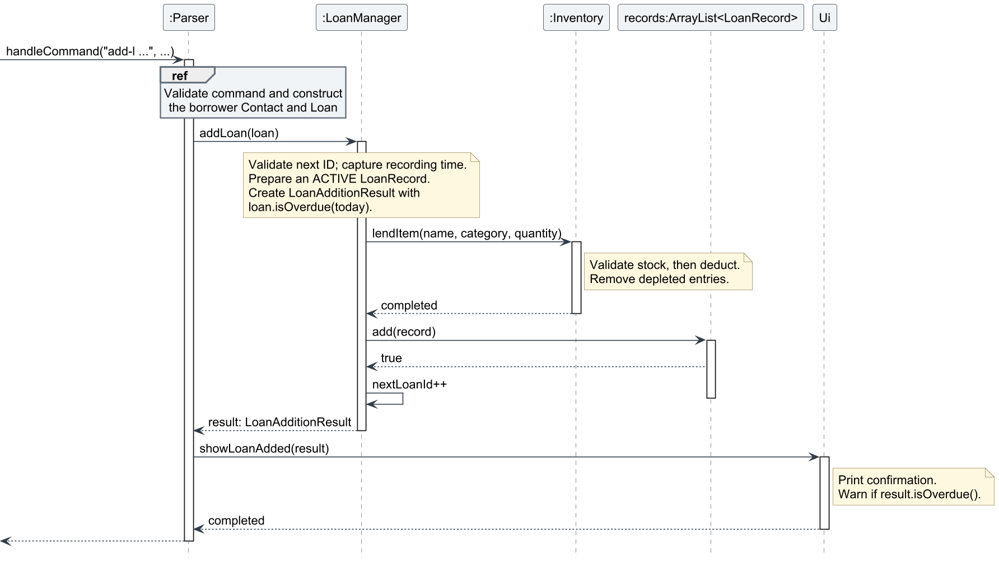

*Figure 7: Stock deduction succeeds before the loan is appended. The manager returns data to Parser, which invokes Ui.*

If command parsing or domain construction fails, the manager is never called. If inventory rejects lending, execution
stops before `loans.add(loan)`. The manager computes the addition result's overdue flag before deduction, but returns it
only after successful insertion; a rejected backlog request therefore produces no overdue warning.

#### Interactions during a full return

`returnLoan()` and `deleteLoan()` share `removeLoanAndRestoreStock()`. The sequence shows `return 1` using a valid index
and successful restoration. A correction follows the same model interaction, followed by `Ui.showLoanDeleted()`.

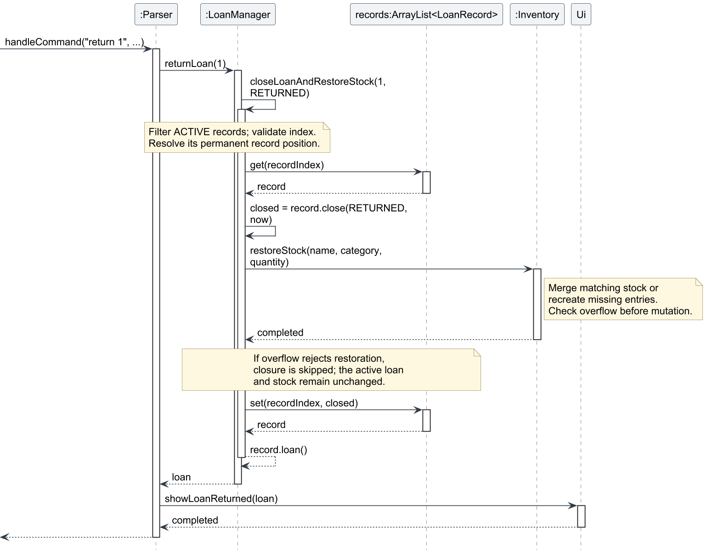

*Figure 8: The selected record is retrieved, its units are restored, and only then is it removed from the active list.*

Restoration matches the item name and category ignoring case. If the entry has disappeared after lending all its stock,
inventory recreates it; otherwise, the quantity is increased. If adding the quantity would exceed `Integer.MAX_VALUE`,
restoration throws before mutation and the active loan remains available for retry. An invalid index fails before any
stock operation. This ordering preserves state for expected validation failures in the single-threaded command loop.

#### Overdue evaluation and filtered indices

Due dates are parsed strictly with English month names using `d MMMM uuuu` internally, displayed to users as
`d MMMM yyyy`. Impossible dates are rejected. Past dates are accepted for entering existing backlog loans. A loan is
overdue only when `dueDate.isBefore(today)`; a loan due today remains on time.

`LoanManager` uses `Clock.systemDefaultZone()` by default and accepts an injected clock for tests. Each addition or
listing query reads one local date. The immutable `Loan` stores its due date, while each `LoanListEntry` captures the
overdue status and position for that query. A later query recalculates the flags, including after midnight, without
rewriting an earlier snapshot. `Ui` renders supplied flags rather than consulting the clock again.

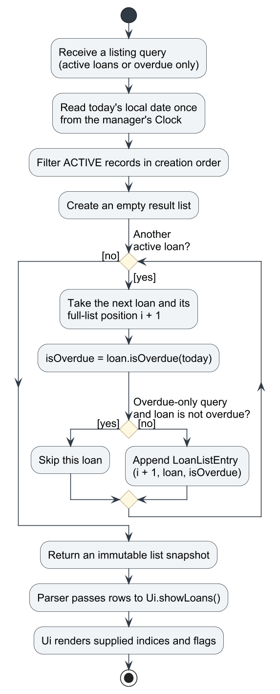

*Figure 9: Listing evaluates every loan against one date. Filtering retains full-list positions and changes no stock or
active records.*

For example, when only loans 2 and 4 are overdue, `list-l overdue` displays indices **2** and **4**, rather than 1 and 2.
`return 4` therefore selects the same record in both views. After removal, later indices shift with the full list, so
query snapshots are descriptions of a past view rather than permanent identifiers.

#### Design considerations and alternatives

**Aspect 1: Representing loan details**

**Current approach:** Keep separate loan records with private item snapshots and copied borrower values.

This preserves quantities and borrower details when live inventory or source contacts change. Repeated loans can have
different due dates and be returned independently. The cost is storing some duplicate values.

**Alternative:** Retain live item/contact references or merge loans by item and borrower. References use less duplicate
data but couple recorded details to later changes. Merging also needs rules for different due dates and partial returns.
Independent snapshots are simpler for the supported full-return workflow.

**Aspect 2: Coordinating inventory and loan changes**

**Current approach:** `LoanManager` coordinates both operations, deducting before insertion and restoring before removal.
Inventory owns matching, quantity validation, and cleanup. Both return and correction reuse one restoration path.

This prevents expected stock errors from leaving an accepted record without a matching stock change. It also avoids
duplicating inventory rules in the parser.

**Alternative:** Change the loan list first and roll back on a stock error. That adds rollback paths and another source
of state inconsistency. A database transaction would offer stronger guarantees if persistence or concurrent access is
introduced, but the application currently processes commands sequentially in memory.

**Aspect 3: Identifying loans in filtered views**

**Current approach:** Keep an insertion-ordered list and carry its one-based positions into filtered result rows.

The same index selects the same active record in either view, without maintaining a second index map. Positions can
change after removal, so users must obtain a fresh listing.

**Alternative:** Assign permanent loan IDs and store records in a map. IDs remain stable after deletion but require ID
generation and a different command/display convention. Full-list positions match the project's session and contact
commands and are sufficient for this version.

**Aspect 4: Determining overdue status**

**Current approach:** Recalculate status at each query using an injected `Clock`, then capture it in immutable results.

This handles date rollover and makes boundary tests deterministic. Evaluating once per query also prevents rows in one
listing from being compared against different dates if midnight occurs during rendering.

**Alternative:** Store a permanent overdue flag inside each loan, or let the UI read the system date for each row. A
stored flag needs scheduled updates; UI evaluation mixes date rules with presentation and makes tests depend on wall
clock time. Query snapshots keep time decisions in the manager.

**Aspect 5: Displaying command results**

**Current approach:** Return `LoanAdditionResult`, `Loan`, or `List<LoanListEntry>` to `Parser`, which calls `Ui`.

The model can be tested without capturing console output, and the UI can render the same captured flags and positions
even if the clock or active list later changes. The tradeoff is two small result classes.

**Alternative:** Print directly from `LoanManager`. This reduces result objects but couples state changes and queries to
console formatting. Keeping rendering in `Ui` makes the loan model easier to reuse and test.

**Aspect 6: Restoring missing inventory entries**

**Current approach:** Inventory stores available stock, while active `Loan` records separately store outstanding
quantities. When a loan is returned, `Inventory.restoreStock()` recreates its item or category if necessary.

An inventory entry can disappear simply because all available units have been lent out. Recreating the entry allows
those units to be returned without requiring the user to manually recreate the item first. The loan's independent
snapshot preserves the name, category, and quantity needed for restoration.

Under this model, `delete-i` removes available units; it does not cancel outstanding loans or permanently retire an
item type. For example, starting with five Multimeters, lending two leaves three available. Deleting those three
removes the inventory entry, but the two loaned units remain recorded. Returning that loan recreates the entry with
**two units**, without restoring the three intentionally deleted units.

**Alternative:** Track total quantity and quantity on loan within each inventory entry, deriving availability as:

`available quantity = total quantity − quantity on loan`

This would retain entries while units remain on loan and provide a clearer view of all stock held by the lab. However,
it would require maintaining additional quantity invariants across inventory deletion, lending, returns, and
corrections, and changing the existing removal of zero-available entries.

The current approach keeps available-stock management simple and uses individual loan records to track outstanding
quantities.

**Limitation:** The application does not distinguish removing available stock from permanently retiring an item type.
If permanent retirement is required, explicit retirement rules and handling for outstanding loans would be needed.
The alternative above could provide a suitable foundation for that extension.

#### Loan validation, assertions, and testing

| Component | Responsibility |
| --- | --- |
| `Parser` | Exact prefix order, positive integer conversion, plain removal indices, and the optional lowercase `overdue` filter. |
| `Loan` / `Contact` | Nonblank item and borrower details, digits-only phone, positive quantity, and a valid due date. |
| `LoanManager` | Nonnull dependencies/records, valid full-list indices, clock-based overdue queries, and operation ordering. |
| `Inventory` | Valid identifiers, matching stock, positive quantities, sufficient available stock, and overflow-safe restoration. |

Assertions check valid records and the exact stock and list-size changes after successful mutations. User-input checks
use exceptions and remain active when assertions are disabled. The existing validation/error-handling and logging
sections below describe the shared failure boundary and diagnostic configuration.

`LoanTest` covers domain validation and snapshot isolation. `LoanManagerTest` covers separate records, immutable query
results, full returns, corrections, replenished stock, and overflow preservation. `LoanOverdueTest` covers date boundaries,
timezones, midnight rollover, one clock read per query, and filtered indices. `ParserLoanTest` and `LoanUiTest` cover
command handling and rendered results. Additional assertion, logging, and inventory-validation tests cover defensive
checks. Console scenarios are recorded as `UI-LOAN-*` in the [UI test plan](../test/ui-test-plan.md).

#### Loan tracking limitations

- Returns and corrections always restore the complete quantity. Partial returns, loan editing, and return history are
  not supported.
- Loan indices are list positions, so previously captured indices can become stale after removal.
- Stock is matched by case-insensitive name/category, without a permanent item identifier.
- Due dates have day precision and use the manager clock's timezone; no automatic notifications are sent.
- Loans, like all application data, exist only in memory and are discarded on exit.

#### Diagram sources

Editable PlantUML sources: [class diagram](diagrams/loan-tracking-class.puml),
[addition sequence](diagrams/loan-add-sequence.puml), [return sequence](diagrams/loan-return-sequence.puml), and
[listing activity](diagrams/loan-overdue-activity.puml). They share [loan-style.puml](diagrams/loan-style.puml).

The section follows the walkthrough and design-alternatives format of the
[AB3 implementation example](https://se-education.org/addressbook-level3/DeveloperGuide.html#proposed-implementation).
See the [SE-EDU PlantUML tutorial](https://se-education.org/guides/tutorials/plantUml.html) for editing and image export.
Export PNGs into `docs/images/` after changing a source so the guide's images remain in sync.

### Student request tracking

`add-r`, `delete-r`, `list-r`, and `mark-r` follow the same structure as the other features: `Request` validates and
formats one request, `RequestManager` owns the deadline-sorted list and prints confirmations, and `Parser` dispatches
the commands. `Request` is the counterpart of `Contact`, while `RequestManager` mirrors `ContactManager` and
`SessionManager`.

A request records the student's name, item name, quantity, deadline, and status. Unlike a preparation item, a request
does not name a category. Availability is therefore calculated by
`Inventory#getTotalAvailableQuantity(String name)`, which adds the stock of that item name across all categories.
Adding a request does not reserve stock. `RequestManager#listRequests(Inventory)` calls this method whenever the list
is displayed, so later inventory changes are reflected immediately. Fulfilling a request is the stock-changing
operation: `Inventory#deductTotalAvailableQuantity(String name, int quantity)` checks the total first, then deducts it
across categories in inventory display order.

`add-r` builds a `Request`, adds it to the manager, and sorts the list by deadline. `delete-r INDEX` and
`mark-r INDEX STATUS` use the same one-based positions shown by `list-r`. Because the list is sorted, deleting or
marking always acts on the row the user sees. `mark-r` accepts `prepared` or `fulfilled` in any capitalization. A new
request starts as `pending`. Marking `prepared` changes only the status. Marking `fulfilled` is a one-way operation: it
deducts the requested total from available stock, is rejected when stock is insufficient, and cannot be repeated or
reversed.

For example:

```text
add-r n/Alice i/Wire q/20 d/8 October 2099
list-r
mark-r 1 prepared
```

`add-r` prints a confirmation, `list-r` shows the pending request with current availability, and `mark-r` changes the
status shown by the next `list-r`. Marking `prepared`, adding, and deleting requests do not change inventory stock;
marking `fulfilled` deducts the requested quantity.

| Decision | Rule | Rationale |
| --- | --- | --- |
| Deadline format | `d MMMM yyyy`, English month names with an initial capital; today or later | Reuses the session date format and keeps deadlines unambiguous. |
| Deadline ordering | Earliest deadline first; ties sorted by student name, then item name | Gives a stable list order, so indices do not change between identical listings. |
| Item category | Not recorded | The requirement lists only student, item, quantity, and deadline. Availability and fulfillment both work across categories with the same item name. |
| Duplicate requests | Allowed | The same student may request the same item again for a different deadline or quantity. |
| Status changes | `mark-r` sets `prepared` or `fulfilled`; `fulfilled` is final | A fulfilled request has already changed stock, so allowing it to return to `prepared` would leave status and inventory inconsistent. |
| Inventory effect | `fulfilled` deducts; other request commands are read-only | Recording a request stays flexible, while handover is explicit and checked against current stock. `delete-r` never restores stock. |

#### Detailed request addition design

Request addition records a student's requirement through
`add-r n/STUDENT_NAME i/ITEM q/QUANTITY d/DEADLINE`. All four arguments are mandatory and must appear in that order.
See the [User Guide](UserGuide.md#add-a-request-add-r) for user-facing examples.

#### Responsibilities and storage

| Component | Responsibility in addition |
| --- | --- |
| `Parser` | Checks the exact prefix sequence, extracts trimmed values, parses a positive quantity, constructs a request, and passes it to the manager. Expected command exceptions are printed as user-facing errors. |
| `Request` | Validates nonblank student/item names, a positive quantity, and a real deadline on or after today. Holds immutable request details and an initially `pending` status. Implements `Comparable<Request>` for ordering. |
| `RequestManager` | Stores request references in an `ArrayList<Request>`, sorts after every addition, checks its invariant, and prints the confirmation and list-refresh reminder. |
| `Inventory` | Provides a read-only availability total when requests are listed. It is not consulted or changed during addition. |

`Bob` creates one request manager for the running process. The manager stores the supplied request reference rather
than copying it. It exposes individual requests through `getRequest`, but does not expose its internal list.
Student name, item name, quantity, and deadline cannot change after construction; changing status does not affect
the comparison keys, so it does not require re-sorting.

`Request#compareTo` orders by deadline, then student name, then item name. Both name comparisons ignore case.
Quantity and status are not tie-breakers. `Collections.sort` is stable, so requests with equal comparison keys
retain their relative insertion order. Duplicates remain separate records rather than being merged.

#### Addition walkthrough

Assume the list already contains a request from student Bob for two Batteries by 9 October 2099, and the
computer's date is no later than 8 October 2099. Enter:

```text
add-r n/Alice i/Wire q/20 d/8 October 2099
```

1. `Parser#addRequest` checks that `findPrefixes` returns exactly `n`, `i`, `q`, `d`, then extracts the values.
2. `parseQuantity` converts `20` to a positive Java `int`.
3. The `Request` constructor trims and validates names and parses the deadline with a strict English
   `d MMMM uuuu` formatter. It rejects impossible dates and dates before `LocalDate.now(clock)`.
4. After successful construction, `RequestManager#addRequest` rejects null input, appends the request, and calls
   `sortRequests`. Alice becomes request 1 because her deadline is earlier; Bob becomes request 2.
5. The manager asserts that its list contains only nonnull requests in comparison order, logs the addition at
   `FINE`, and prints:

```text
Successfully added request: Alice - 20x Wire by 8 October 2099
Request list updated. Run list-r to see the latest order.
```

The following sequence summarizes a successful addition after command dispatch. Prefix extraction, assertions,
logging, and console rendering are condensed into descriptive steps.

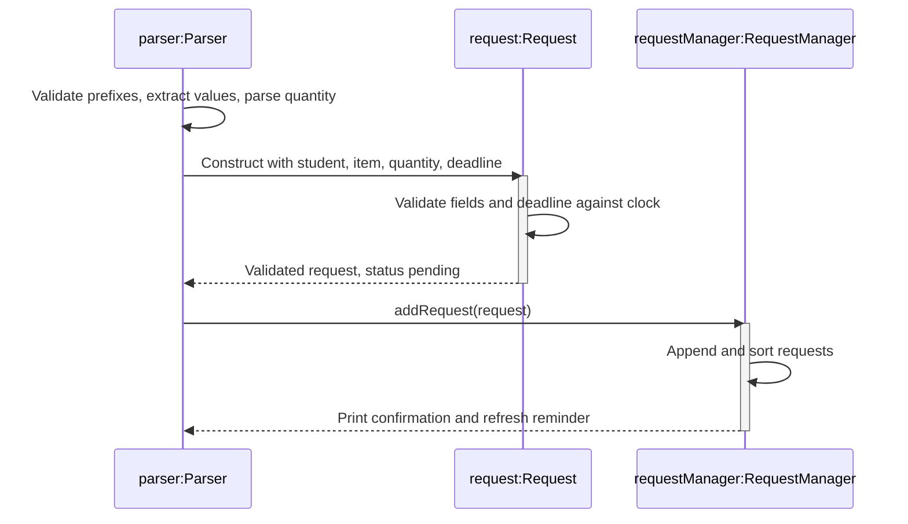

Addition succeeds even if no Wire exists. A request can be recorded while stock is short, but fulfillment checks the
total before changing anything. `getTotalAvailableQuantity` matches the complete item name ignoring case across all
categories, accumulates using a `long`, and caps the displayed total at `Integer.MAX_VALUE`. Each request is checked
independently; two requests may both show sufficient stock for the same units, and the first fulfilled request consumes
the stock that the second one needs.

#### Detailed request fulfillment design

`mark-r INDEX fulfilled` is the only request command that changes inventory. `prepared` is a status-only change.

1. `Parser` validates the index and status, normalizes the status, and passes the shared inventory to
   `RequestManager#markRequest`.
2. `RequestManager` retrieves the request and rejects an already fulfilled request with `RequestException`.
3. For `fulfilled`, the manager calls `Inventory#deductTotalAvailableQuantity(name, quantity)`. Inventory checks the
   total before mutation and throws `InsufficientStockException` when the requested quantity is too large.
4. If stock is sufficient, inventory deducts from categories in display order, removing empty items and categories as
   needed.
5. Only after deduction succeeds, the request status becomes `fulfilled` and the manager prints the confirmation.

Because a request does not record a category, deduction uses the same total shown by `list-r`. Two requests can both
appear fulfillable; the first fulfillment consumes stock and the second is rejected if the remainder is insufficient.
An insufficient or already-fulfilled attempt leaves both status and inventory unchanged. Fulfillment is final:
`delete-r` removes the request but does not restore stock, and there is no unfulfill command.

#### Validation and failure behavior

| Boundary | Rule and result |
| --- | --- |
| Prefix parsing | Missing, repeated, reordered, or extra prefixes cause `CommandFormatException`. Prefix-like standalone tokens inside names are also interpreted as prefixes. |
| Quantity parsing | Blank, non-integer, zero, negative, and values above `Integer.MAX_VALUE` cause `InvalidQuantityException`. There is no default quantity for requests. |
| Request construction | Null or blank names cause `CommandFormatException`; nonpositive quantities cause `InvalidQuantityException`. Null, blank, malformed, or past deadlines cause `InvalidRequestDeadlineException`. |
| Date boundary | Impossible calendar dates are rejected by strict parsing. Today is accepted. The public constructor uses the system's default time zone; a package-private constructor accepts a `Clock` for repeatable tests. |
| Manager insertion | A null request causes `NullPointerException` before the list is modified. Duplicate requests are accepted. |
| Fulfillment | The request must not already be fulfilled, and total available stock must cover its quantity. Insufficient stock causes `InsufficientStockException`; a repeated or reversed fulfillment causes `RequestException`. Both leave status and inventory unchanged. |

The parser finishes construction before calling the manager. Invalid command values therefore leave the request
list unchanged. Fulfillment checks stock before any deduction, so a rejected handover leaves inventory unchanged too.
These guarantees cover expected validation failures, rather than recovery from unexpected runtime failures or process
termination. Assertions detect programming errors and do not replace input validation. Creation, rejection, and status
changes emit `FINE` diagnostics without changing normal console output.

#### Design considerations and alternatives

| Decision | Rationale and trade-off |
| --- | --- |
| Sort an `ArrayList` on addition | Keeps displayed and stored indices aligned for listing, deletion, and marking. Sorting on display would require translating displayed positions; a priority queue would not directly support indexed commands. |
| Allow duplicate requests | Preserves separately recorded requirements. Merging by student and item could combine requests with different quantities or deadlines unintentionally. |
| Read availability on listing | Reflects inventory changes without maintaining a cached stock count. Adding a request does not reserve stock, so requests can be recorded before stock arrives. |
| Deduct on fulfillment across categories | Uses the same total that `list-r` displays. Requiring a category would break the documented request format. Deducting in display order keeps the result deterministic. |
| Make fulfillment final | Reversing fulfillment would require restoring stock and deciding which category receives it. Rejecting the change keeps status and stock consistent. |
| Inject a clock for model tests | Tests can verify deadlines due today and in the past without depending on the wall clock. The normal command path still uses the local calendar date. |

#### Verification and limitations

`RequestTest` covers trimmed fields, invalid quantities and dates, clock-based deadline boundaries, initial status,
comparison ordering, and status changes. `RequestManagerTest` covers sorting, tie-breakers, null input, indices,
availability display, fulfillment deductions, insufficient stock, and one-way status changes. `ParserRequestTest`
covers command formats, rejected inputs, confirmations, ordering, live stock checks, and failed fulfillment.
`RequestLoggingTest` verifies request diagnostics; the [UI test plan](../test/ui-test-plan.md) records console cases.

Requests exist only in memory. They have no persistent identifiers: adding or deleting a request can change the
indices used by `delete-r` and `mark-r`, so users must refresh `list-r`. Requests cannot be edited in place and are
not removed automatically after their deadline. Marking prepared records status only. Marking fulfilled deducts stock
and is final; deleting a fulfilled request does not restore stock, and there is no unfulfill command. Fulfillment also
does not create a loan; use the loan command instead when the handover is a loan.

### Broken-item tracking

`add-b`, `list-b`, and `delete-b` track damaged units separately from usable inventory. Recording damage deducts
usable stock; deleting a fully repaired or incorrectly recorded report restores its entire quantity. This is a
stock-changing operation, not a general-purpose record deletion. See the [User Guide](UserGuide.md#broken-item-tracking)
for command syntax and user-facing messages.

#### Responsibilities and relationships

`Bob` creates one `BrokenItemManager` with the same `Inventory` and `ContactManager` used by other features, and
passes it to `Parser`. `BrokenItem` validates and stores report details; `BrokenItemManager` coordinates reports
and stock; `Inventory` validates and performs quantity changes; `Ui` displays the returned results.

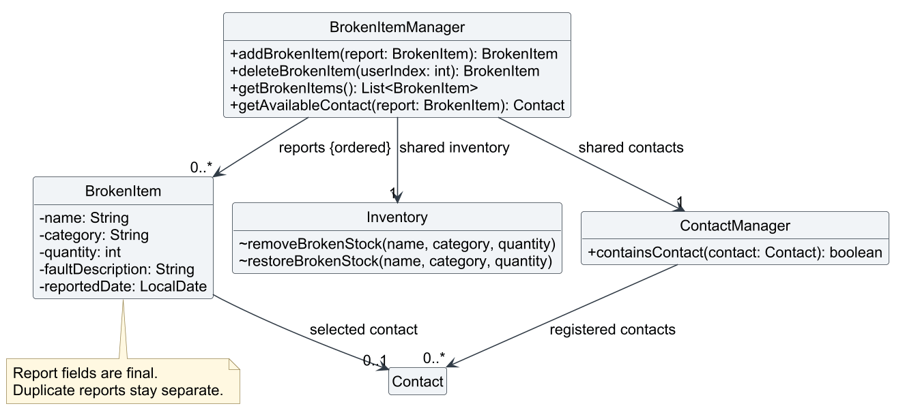

*Figure 10: Selected broken-item relationships. The manager stores reports in insertion order and shares inventory
and contacts with the application. A report may retain a reference to a contact that has since been deleted.*

| Operation | Implementation and state change |
| --- | --- |
| Add | `Parser` resolves the optional contact and constructs a validated `BrokenItem`. `BrokenItemManager#addBrokenItem` checks contact membership, calls `Inventory#removeBrokenStock`, then appends the report. |
| List | `getBrokenItems()` returns an unmodifiable snapshot. `Ui#showBrokenItems` displays one-based positions and resolves each contact through `getAvailableContact()`. No stock changes. |
| Delete | `deleteBrokenItem(index)` validates the position, calls `Inventory#restoreBrokenStock`, then removes the report. Remaining positions shift. |

#### Example and stock consistency

Assume five Multimeters in Equipment and no existing reports. Reporting two broken units leaves three usable
units and one report for two units. `list-b` changes neither quantity. After both units are repaired,
`delete-b 1` restores usable stock to five and removes the report. Reports for the same item remain separate,
so deleting one restores only that report's quantity.

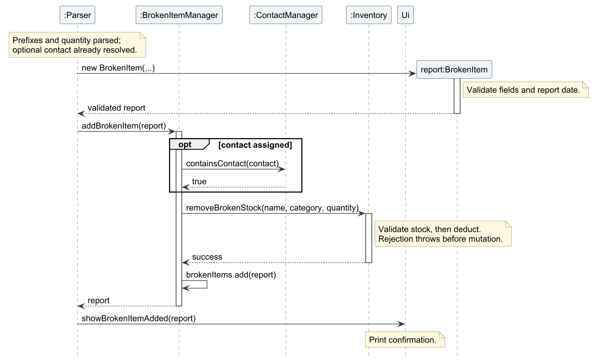

*Figure 11: Successful `add-b` after argument parsing and optional contact resolution. Report construction validates
details before stock changes; the manager appends the report only after stock deduction succeeds. Routine getters,
assertions, and logging are omitted.*

For deletion, the order is deliberately reversed: restore stock first, then remove the report. If restoration
would exceed `Integer.MAX_VALUE`, an exception leaves both stock and the report unchanged. Missing stock entries
or categories are recreated on successful restoration. These guarantees cover expected validation failures in
the single-threaded application; they are not database transactions or recovery from process failure.

Preparation and request availability read the shared inventory, so they reflect deductions and restorations
without updating a second stock total. Loans also use this inventory. Damaged units returned from a loan must
first be returned through the loan workflow, then reported with `add-b`; the two commands are not atomic.
`find-i` currently combines usable inventory and active loans only. It does not include broken quantities, and
an item with all units broken and none on loan may be absent from its results.

#### Validation and contact handling

- `Parser` requires prefixes in order (`n/ c/ q/ f/ d/`, optionally `m/`), nonempty values, and valid integers.
  `list-b` rejects arguments; `delete-b` requires one positive index within the current report list.
- `BrokenItem` strips surrounding whitespace, rejects blank fields and nonpositive quantities, and parses
  English dates strictly using `d MMMM uuuu`. Report dates may be today or earlier. An injected `Clock`
  supports deterministic date tests.
- The manager checks an assigned contact is still registered before deduction. Inventory matches item name
  and category ignoring case and rejects missing or insufficient stock before changing quantities.
- A report stores the selected `Contact` object. Membership uses identity, so renumbering contacts cannot
  redirect a report, and adding identical contact details does not revive a deleted link. Listing distinguishes
  `Not assigned` from `Unavailable (contact deleted)`; a deleted contact does not prevent stock restoration.
- Expected failures use the `CommandException` hierarchy, including `BrokenItemException` and
  `InvalidBrokenItemIndexException`. `Parser` prints their messages. Assertions check internal report validity
  and exact stock changes; FINE logging records diagnostics without adding normal console output.

#### Design choices and limitations

**Separate reports rather than a broken flag on inventory items.** A report preserves its quantity, fault,
reported date, and optional contact even if deduction removes the last usable inventory entry. A single flag
would not represent multiple faults or batches with different contacts.

**Store a contact reference rather than its displayed index.** This prevents accidental reassignment after
deletion or renumbering. Persistent contact IDs would be preferable if storage is introduced; object identity
is sufficient for the current in-memory application.

Reports cannot be edited, partially repaired, disposed of, or reassigned to another contact. Deletion restores
all units and keeps no repair history. Data is lost when the application exits. Future persistence or concurrent
commands would require coordinated storage of reports and inventory changes.

#### Verification and diagram sources

`BrokenItemTest` covers field validation and fixed-clock date boundaries. `BrokenItemManagerTest` covers exact
stock changes, invalid indices, missing stock, restoration overflow, contact deletion, snapshots, and interaction
with loans. `ParserBrokenItemTest` covers command syntax, unavailable dependencies, and stock visibility across
features. `ParserHelpTest` and the console regression fixture check the advertised commands.

Editable diagram sources: [class diagram](diagrams/broken-item-class.puml) and
[addition sequence](diagrams/broken-item-add-sequence.puml). They reuse `loan-style.puml`; regenerate the PNGs
in `docs/images/` after changing their sources.

### Validation and error handling

Validation is performed at the parser and domain boundaries:

- parser validation checks command names, prefix order, missing values, and integer syntax;
- domain constructors validate names, dates, times, quantities, and phone or email formats;
- managers validate indices, conflicts, stock levels, and state transitions; and
- assertions document internal invariants such as positive stored quantities and conflict-free schedules.

The parser catches expected `CommandException` subclasses and prints their messages. It logs unexpected runtime failures
with `java.util.logging` and prints a generic recovery message.

Loan validation uses the existing checked exception hierarchy. Invalid loan dates and malformed loan indices retain
their original parsing causes for debugging while preserving the existing user-facing messages. The loan stock helpers
also validate item names, categories, and positive quantities before modifying inventory, even when called directly.

Loan assertions check valid stored records and the exact inventory quantity and active-list size changes for successful
operations. Stock restoration is checked before removing a loan. Assertions identify internal programming errors;
expected invalid commands are always handled by exceptions. Assertion failures are not caught as recoverable user errors.
Use `java -ea -jar build/libs/bob.jar` for debugging; Gradle tests enable assertions, while normal launch is unchanged.

## Documentation, logging, testing, and DevOps

- [User Guide](UserGuide.md) — user-facing command formats, examples, and limitations.
- [UI test plan](../test/ui-test-plan.md) — command-by-command manual and console test cases.
- [README](../README.md) — setup, Gradle, testing, and Checkstyle instructions.

The project uses Gradle and the Gradle wrapper for reproducible builds. Java code follows the SE-EDU Java coding standard,
and `check` runs compilation, automated tests, and Checkstyle. Changes should be developed on a feature branch and
verified with `check` before review. The repository currently has no persistence or release automation beyond the Gradle
build and the project's CI configuration.

Logging is intended for diagnostics rather than user interaction. `Bob`, `Parser`, `Inventory`, `SessionManager`, and
`LoanManager` log lifecycle events, rejected operations, and unexpected failures at suitable levels.

Loan lifecycle, overdue-list queries, stock changes, and expected rejections use `FINE`, matching inventory diagnostics.
Messages include item/category, quantities, due dates, indices, or active counts as appropriate. They omit borrower
names, phone numbers, and raw commands. Expected loan command errors retain their exception causes in debug records;
unexpected runtime failures are logged once at the existing parser `SEVERE` boundary. Default logging is unchanged.

To inspect loan diagnostics, save this configuration as `build/loan-debug-logging.properties` after building:

```properties
handlers=java.util.logging.ConsoleHandler
.level=INFO
java.util.logging.ConsoleHandler.level=FINE
seedu.bob.LoanManager.level=FINE
seedu.bob.Inventory.level=FINE
seedu.bob.Parser.level=FINE
```

Then launch a debug session with:

```text
java -ea -Djava.util.logging.config.file=build/loan-debug-logging.properties -jar build/libs/bob.jar
```

Normal launches need no logging configuration. Logging tests capture records directly and restore shared logger settings
after each test. The UI regression plan is checked both normally and with assertions enabled.

## Appendix: Requirements

### Product scope

#### Target users

Bob targets lab technicians or teaching assistants who:

- manage reusable equipment and consumable supplies;
- schedule laboratory sessions at different locations and times; and
- need a quick command-line workflow without a database or graphical interface.

#### Value proposition

Bob combines inventory tracking, session scheduling, preparation checks, supplier contacts, and student loan tracking in
one lightweight command-line application. It highlights preparation shortages and updates availability when stock is
loaned or returned.

### User stories

| Priority | As a... | I want to... | So that I can... |
|---|---|---|---|
| High | lab technician | add, remove, and list inventory | know what equipment is available |
| High | lab technician | schedule and delete lab sessions | avoid conflicting bookings |
| High | lab technician | prepare materials for a session | identify shortages before the session |
| High | lab technician | record and return loans | track borrowed resources and restore stock |
| Medium | lab technician | save supplier and repair contacts | find relevant people quickly |
| Medium | lab technician | filter overdue loans | follow up on late returns |
| Low | project maintainer | persist data between launches | retain records after restarting Bob |

### Use cases

#### Use case: Prepare a lab session

**Actor:** Lab technician

**Preconditions:** Bob is running and a session has been added.

**Main success scenario:**

1. User adds inventory items.
2. User creates a session with a headcount.
3. User adds required items with `add-p`.
4. System calculates total requirements and compares them with current inventory.
5. User views `list-p` and obtains the preparation checklist.

Use case ends.

**Extensions:**

- **4a.** Required stock exceeds available stock.
  - **4a1.** System marks the item insufficient and displays the shortfall.
  - Use case resumes at step 5.

#### Use case: Record and return a loan

**Actor:** Lab technician

**Preconditions:** The requested item exists in inventory with enough available quantity.

**Main success scenario:**

1. User enters `add-l` with item, quantity, borrower, phone, and due date.
2. System deducts the quantity and creates an active loan.
3. User enters `return INDEX` when the item is returned.
4. System restores the quantity and removes the active loan.

Use case ends.

**Extensions:**

- **1a.** The item is missing or stock is insufficient.
  - **1a1.** System rejects the command without changing state.
- **3a.** Restoring stock would overflow the integer range.
  - **3a1.** System rejects the return and keeps the loan active.

### Non-functional requirements

1. The application should run with JDK 25 on Windows, macOS, and Linux.
2. Normal commands should complete interactively without noticeable delay for the expected small, in-memory data set.
3. Invalid user input should produce a clear error message and should not partially modify application state.
4. Collections exposed for querying should not allow callers to mutate manager state accidentally.
5. The code should remain maintainable through JavaDoc, Checkstyle, unit tests, and feature-level UI tests.
6. The current version does not promise persistence, multi-user access, encryption, or recovery after process termination.

### Glossary

- **Inventory item** — A named resource stored under a category with a positive quantity.
- **Session** — A scheduled lab event with a date, location, time range, and headcount.
- **Preparation** — The total material requirement for one session.
- **Loan** — An active record of inventory units lent to a borrower until returned or corrected.
- **Backlog loan** — A loan added with a due date before today.
- **Overdue** — A loan whose due date is strictly before the current local date.
- **Prefix** — The one-letter marker such as `n/` or `q/` that introduces a command argument.

## Appendix: Instructions for manual testing

These instructions supplement the detailed cases in [`test/ui-test-plan.md`](../test/ui-test-plan.md). Start each scenario
with a fresh Bob process because application data is not persisted.

### Launch and shutdown

1. Build with `gradlew.bat check shadowJar` on Windows or `./gradlew check shadowJar` on macOS/Linux.
2. Launch with `java -jar build/libs/bob.jar`.
3. Verify that Bob prints the banner and asks for a name.
4. Enter a name and verify that the welcome message and divider appear.
5. Enter `help` and verify that all command groups are displayed.
6. Enter `Bye`, `bye`, or `BYE` and verify that the application exits cleanly.

### Inventory and preparation

1. Add an item with `add-i` and confirm it with `list-i`.
2. Add a session with a future date using `add-s`, then add a requirement using `add-p`.
3. Use `list-p` to verify required quantity, available quantity, and shortage markers.
4. Use `delete-p` and verify that only the preparation changes, not inventory.
5. Test invalid quantities, indices, missing prefixes, duplicate inventory items, and conflicting sessions.

### Contacts and loans

1. Add contacts with required fields and with optional email or role fields.
2. Use `list-c`, then delete a contact using its displayed index.
3. Add enough inventory for a loan and execute `add-l`.
4. Verify that `list-i` shows reduced stock and `list-l` shows the active loan.
5. Add a past-due loan and verify the warning and `[OVERDUE]` marker.
6. Use `list-l overdue` and verify that displayed indices still refer to the full active-loan list.
7. Execute `return INDEX` and verify that stock is restored and the loan disappears.
8. Test insufficient stock, invalid dates, invalid borrower phone numbers, invalid indices, and restoration overflow.

### Automated and UI verification

1. Run `gradlew.bat check` or `./gradlew check` and confirm that compilation, tests, and Checkstyle pass.
2. Run the platform-specific text UI test script.
3. For each case in `test/ui-test-plan.md`, compare actual output with the expected output exactly, including dividers,
   spacing, capitalization, warnings, and blank lines.
