# Developer Guide

> Adapted from the [Address Book Level 3 Developer Guide](https://se-education.org/addressbook-level3/DeveloperGuide.html).

## Table of Contents

- [Acknowledgements](#1-acknowledgements)
- [Setting up and getting started](#2-setting-up-and-getting-started)
  - [Prerequisites](#21-prerequisites)
  - [Importing and building](#22-importing-and-building)
  - [Running Bob](#23-running-bob)
  - [Running tests](#24-running-tests)
- [Design](#3-design)
  - [Architecture](#31-architecture)
  - [UI component](#32-ui-component)
  - [Logic component](#33-logic-component)
  - [Model component](#34-model-component)
  - [Storage component](#35-storage-component)
    - [Automatic saving](#351-automatic-saving)
    - [Startup and recovery](#352-startup-and-recovery)
    - [Diagram sources](#353-diagram-sources)
  - [Common classes](#36-common-classes)
- [Implementation](#4-implementation)
  - [Inventory management](#41-inventory-management)
    - [Detailed inventory addition design](#411-detailed-inventory-addition-design)
    - [Responsibilities and storage](#412-responsibilities-and-storage)
    - [Example walkthrough](#413-example-walkthrough)
    - [Validation and failure behaviour](#414-validation-and-failure-behaviour)
    - [Design considerations and alternatives](#415-design-considerations-and-alternatives)
    - [Verification and limitations](#416-verification-and-limitations)
  - [Session scheduling](#42-session-scheduling)
    - [Detailed scheduling design](#421-detailed-scheduling-design)
  - [Session preparation](#43-session-preparation)
    - [Detailed preparation design](#431-detailed-preparation-design)
    - [Key operations](#432-key-operations)
    - [Example walkthrough](#433-example-walkthrough)
    - [Interactions during preparation addition](#434-interactions-during-preparation-addition)
    - [Calculating availability and shortfalls](#435-calculating-availability-and-shortfalls)
    - [Design considerations and alternatives](#436-design-considerations-and-alternatives)
    - [Preparation validation, assertions, and testing](#437-preparation-validation-assertions-and-testing)
    - [Preparation limitations](#438-preparation-limitations)
    - [Preparation diagram sources](#439-preparation-diagram-sources)
  - [Contact management](#44-contact-management)
  - [Loan tracking](#45-loan-tracking)
    - [Detailed loan tracking design](#451-detailed-loan-tracking-design)
    - [Key operations](#452-key-operations)
    - [Example walkthrough](#453-example-walkthrough)
    - [Interactions during loan addition](#454-interactions-during-loan-addition)
    - [Interactions during a full return](#455-interactions-during-a-full-return)
    - [Overdue evaluation and filtered indices](#456-overdue-evaluation-and-filtered-indices)
    - [Design considerations and alternatives](#457-design-considerations-and-alternatives)
    - [Loan validation, assertions, and testing](#458-loan-validation-assertions-and-testing)
    - [Loan tracking limitations](#459-loan-tracking-limitations)
    - [Diagram sources](#4510-diagram-sources)
  - [Loan history](#46-loan-history)
    - [Objective and lifecycle](#461-objective-and-lifecycle)
    - [Record model, identifiers, and timestamps](#462-record-model-identifiers-and-timestamps)
    - [Stock consistency and integration](#463-stock-consistency-and-integration)
    - [Persistence and version-1 compatibility](#464-persistence-and-version-1-compatibility)
    - [Commands and views](#465-commands-and-views)
    - [Considerations and alternatives](#466-considerations-and-alternatives)
    - [Implementation phases and verification record](#467-implementation-phases-and-verification-record)
  - [Student request tracking](#47-student-request-tracking)
    - [Detailed request addition design](#471-detailed-request-addition-design)
    - [Responsibilities and storage](#472-responsibilities-and-storage)
    - [Addition walkthrough](#473-addition-walkthrough)
    - [Detailed request fulfillment design](#474-detailed-request-fulfillment-design)
    - [Validation and failure behavior](#475-validation-and-failure-behavior)
    - [Design considerations and alternatives](#476-design-considerations-and-alternatives)
    - [Verification and limitations](#477-verification-and-limitations)
  - [Broken-item tracking](#48-broken-item-tracking)
    - [Responsibilities and relationships](#481-responsibilities-and-relationships)
    - [Example and stock consistency](#482-example-and-stock-consistency)
    - [Validation and contact handling](#483-validation-and-contact-handling)
    - [Design choices and limitations](#484-design-choices-and-limitations)
    - [Verification and diagram sources](#485-verification-and-diagram-sources)
  - [Validation and error handling](#49-validation-and-error-handling)
- [Documentation, logging, testing, and DevOps](#5-documentation-logging-testing-and-devops)
- [Appendix A: Product Scope](#appendix-a-product-scope)
- [Appendix B: User Stories](#appendix-b-user-stories)
- [Appendix C: Non-Functional Requirements](#appendix-c-non-functional-requirements)
- [Appendix D: Glossary](#appendix-d-glossary)
- [Appendix E: Instructions for Manual Testing](#appendix-e-instructions-for-manual-testing)

## 1. Acknowledgements

- [Address Book Level 3](https://se-education.org/addressbook-level3/) — used as the structure and documentation style reference.
- [Gradle](https://gradle.org/) — used for build automation, dependency management, and test execution.
- [JUnit 5](https://docs.junit.org/5.14.4/overview.html) — used for automated unit and integration tests.
- [Gson](https://google.github.io/gson/UserGuide.html) — converts dedicated snapshot records to and from JSON.
- [Java logging API](https://docs.oracle.com/en/java/javase/25/docs/api/java.logging/module-summary.html) — used for diagnostic logging.
- [PlantUML](https://plantuml.com/) — used to generate UML diagrams from the committed `.puml` sources.
- [Graphviz](https://graphviz.org/) — used by PlantUML to lay out class diagrams.

## 2. Setting up and getting started

### 2.1. Prerequisites

- Java Development Kit (JDK) 25.
- A terminal and a Java-compatible IDE such as IntelliJ IDEA.
- Internet access for the first Gradle build, when dependencies are downloaded.

The project is intended to run on Windows, macOS, and Linux. The exact JDK version should be used because the project
is configured for Java 25.

### 2.2. Importing and building

1. Clone or download the repository.
2. Open the repository root, the directory containing `build.gradle`, in the IDE.
3. Import the project as a Gradle project.
4. Verify the JDK used by Gradle and the IDE is Java 25.
5. Build the application:

   ```text
   Windows: .\gradlew.bat check shadowJar
   macOS/Linux: ./gradlew check shadowJar
   ```

### 2.3. Running Bob

After building, run the generated JAR:

```text
java -jar build/libs/bob.jar
```

Bob prints a banner, asks for the user's name, and then accepts one command per line. Enter `Bye` to exit.

### 2.4. Running tests

- Run the complete automated test and Checkstyle suite with `check`.
- Run the text UI tests with `text-ui-test\runtest.bat` on Windows or `sh text-ui-test/runtest.sh` on macOS/Linux.
- The feature-specific manual test cases are recorded in [`test/ui-test-plan.md`](https://github.com/AY2627S1-CS2113-T11-3/tp/blob/master/test/ui-test-plan.md).

## 3. Design

Bob is a command-line application whose runtime models are persisted as complete local snapshots.

`Bob` starts the application and wires the components together. `Ui` contains shared display text, `Parser` validates
and dispatches commands, and the model classes store the current application state in memory.

### 3.1. Architecture

The application uses a lightweight layered architecture:

- **UI** — reads command-line input and displays output.
- **Logic** — parses commands, validates their formats, and dispatches operations.
- **Model** — stores inventory, sessions, preparations, contacts, requests, loan history, and broken-item reports.
- **Storage** — validates and loads local JSON snapshots, retains a backup, and saves complete state atomically.
- **Common classes** — shared domain objects, exceptions, and display constants.

`Bob.main` creates one `Parser` and an `AppState` that owns one instance of each model manager and a shared
`Inventory` for the duration of the process. The parser receives these objects when handling each command. This keeps
the managers independent while allowing loans, fulfilled requests, broken-item reports, and preparations to
query or update inventory. Broken-item tracking shares the contact manager to preserve selected contacts.

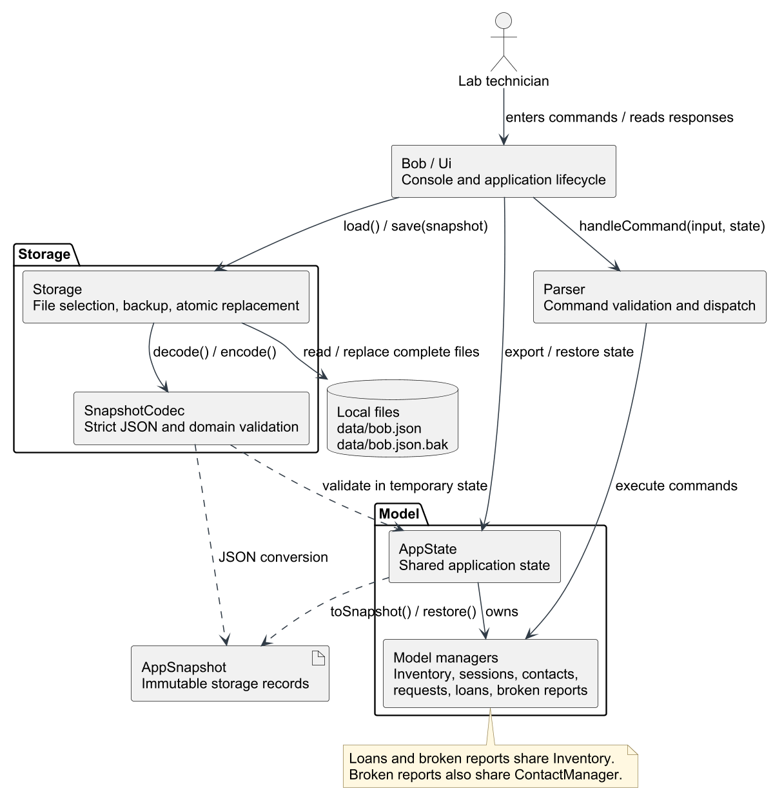

*Figure A1: Runtime components and storage dependencies. Solid arrows show component use; dashed arrows show
snapshot conversion and validation. The manager group represents the existing model classes, not a new Java class.*

`Bob` coordinates startup, command handling, and saving. `AppState` keeps the shared managers together, while
`Storage` handles files and `SnapshotCodec` handles JSON conversion and validation. Managers do not read or write
files themselves. The snapshot boundary allows a loaded dataset to be validated before it becomes live state.

### 3.2. UI component

The UI is implemented by [`Bob`](https://github.com/AY2627S1-CS2113-T11-3/tp/blob/master/src/main/java/seedu/bob/Bob.java) and [`Ui`](https://github.com/AY2627S1-CS2113-T11-3/tp/blob/master/src/main/java/seedu/bob/Ui.java).

- `Bob` displays the banner and greeting, reads input using `Scanner`, and separates command responses.
- `Ui` renders loan and broken-item confirmations and listings and stores the divider and complete `help` message.
- The UI does not contain business rules; it delegates command handling to `Parser`.
- The application exits when the user enters `Bye` in any letter case.

### 3.3. Logic component

The logic component is implemented by [`Parser`](https://github.com/AY2627S1-CS2113-T11-3/tp/blob/master/src/main/java/seedu/bob/Parser.java).

For every input line, `Parser`:

1. separates the command word from its arguments;
2. selects the command handler;
3. checks prefixes, argument order, and value formats;
4. constructs domain objects where necessary;
5. invokes the relevant model manager; and
6. passes loan results or broken-item reports and their manager to `Ui` for rendering.

Commands use fixed prefix orders, such as `n/NAME c/CATEGORY q/QUANTITY`. A shared prefix matcher separates values from
later arguments. Consequently, a value containing a standalone token such as `a/b` is currently interpreted as another
prefix and is rejected.

Expected command errors are converted into user-facing messages. Unexpected runtime failures are logged and replaced by a
generic safe error message so that one malformed command does not terminate the application.

In the sequence diagrams, a completed activation means that a call has returned. The shared parser and managers,
and successfully stored domain objects, survive the command. They therefore retain their lifelines without an `X`.
An `X` denotes object destruction, not the end of a method call. See the [diagram conventions](diagrams/README.md).

### 3.4. Model component

The model is composed of domain objects and managers:

- [`Inventory`](https://github.com/AY2627S1-CS2113-T11-3/tp/blob/master/src/main/java/seedu/bob/Inventory.java) stores categories and `InventoryItem` objects.
- [`SessionManager`](https://github.com/AY2627S1-CS2113-T11-3/tp/blob/master/src/main/java/seedu/bob/SessionManager.java) stores sessions in chronological order.
- [`Session`](https://github.com/AY2627S1-CS2113-T11-3/tp/blob/master/src/main/java/seedu/bob/Session.java) validates dates, times, and scheduling conflicts.
- [`Preparation`](https://github.com/AY2627S1-CS2113-T11-3/tp/blob/master/src/main/java/seedu/bob/Preparation.java) stores per-session requirements through `PreparationItem`.
- [`ContactManager`](https://github.com/AY2627S1-CS2113-T11-3/tp/blob/master/src/main/java/seedu/bob/ContactManager.java) stores contacts.
- [`RequestManager`](https://github.com/AY2627S1-CS2113-T11-3/tp/blob/master/src/main/java/seedu/bob/RequestManager.java) stores deadline-sorted student requests.
- [`Request`](https://github.com/AY2627S1-CS2113-T11-3/tp/blob/master/src/main/java/seedu/bob/Request.java) validates request details and holds the fulfillment status.
- [`BrokenItemManager`](https://github.com/AY2627S1-CS2113-T11-3/tp/blob/master/src/main/java/seedu/bob/BrokenItemManager.java) coordinates reports, shared inventory,
  and maintenance-contact availability.
- [`BrokenItem`](https://github.com/AY2627S1-CS2113-T11-3/tp/blob/master/src/main/java/seedu/bob/BrokenItem.java) holds immutable validated damage-report details.
- [`LoanManager`](https://github.com/AY2627S1-CS2113-T11-3/tp/blob/master/src/main/java/seedu/bob/LoanManager.java) retains all loan records and exposes active-only views using the shared inventory.
- [`Loan`](https://github.com/AY2627S1-CS2113-T11-3/tp/blob/master/src/main/java/seedu/bob/Loan.java) stores an independent item snapshot, quantity, borrower values, and due date.
- [`LoanRecord`](https://github.com/AY2627S1-CS2113-T11-3/tp/blob/master/src/main/java/seedu/bob/LoanRecord.java) retains a permanent ID, lifecycle status, and recording/closure timestamps.
- `LoanAdditionResult` and `LoanListEntry` carry immutable operation/query results to the loan UI.
- `AppState` groups the managers, exports snapshots, and restores complete independent model state.
- `AppSnapshot` and its nested records describe version-2 storage values without retaining mutable model references.

Managers expose operations rather than their mutable internal collections. Query collections are unmodifiable
list snapshots, so callers cannot add, remove, or reorder the manager's entries through those lists. This does
not make every contained object immutable: retrieved sessions and requests still expose domain operations.
Inventory queries copy mutable stock entries, and storage snapshots copy values independently. Domain classes
maintain invariants such as positive quantities, nonblank names, and conflict-free sessions.

### 3.5. Storage component

The [version-2 storage format and behavior contract](StorageFormat.md) defines the persisted fields and recovery
rules, with [loan-ledger](examples/bob-v2.json) and [empty](examples/bob-v2-empty.json) examples.
The older version-1 examples remain fixtures for strict, non-writing migration tests.

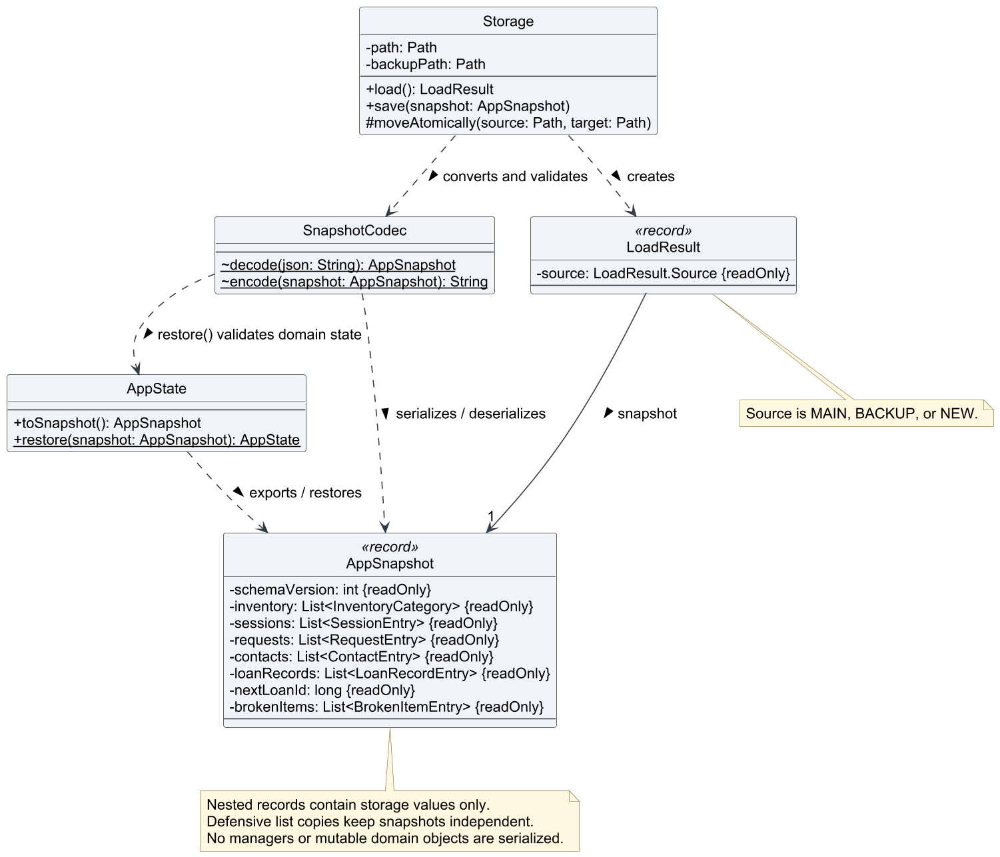

*Figure S1: Selected storage classes and members. Dependencies show temporary use; `LoadResult` holds one snapshot
and records whether it came from the main file, backup, or a new empty directory. Routine accessors are omitted.*

The model boundary consists of `AppState.toSnapshot()` and `AppState.restore(snapshot)`.
Snapshots use Java records (data classes with generated accessors and value equality) and defensive list copies,
so a later inventory deduction, request status change, or preparation edit cannot alter an earlier snapshot.
`AppState.restore(snapshot, clock)` also accepts an explicit clock for deterministic overdue tests.

Restoration constructs new managers and returns them only after every record passes domain validation. An invalid
snapshot raises `InvalidSnapshotException` with the underlying cause; existing state is never modified. Saved
sessions and requests may have past dates, while normal creation commands retain their today-or-later checks.
Preparation quantities are restored as totals. Loans are restored independently of available stock, then attached
to the shared inventory so subsequent returns restore the correct quantities. Loading does not replay commands or
print addition confirmations. `SnapshotFormat` converts ISO storage dates/times to the existing domain formats.

`Storage` resolves an explicit path, normally `data/bob.json` relative to the working directory. Its `load()`
returns a validated snapshot and `LoadResult.Source` (`MAIN`, `BACKUP`, or `NEW`), without writing files. A
corrupt/missing main can recover from a valid backup. Unsupported main versions stop loading without falling
back, protecting newer-format records. Neither unusable files nor unreadable directories are treated as empty state.

`SnapshotCodec` uses Gson with strict parsing and a bounded reader that detects duplicate object keys. It checks
exact field sets and primitive types before deserialization, including explicit nullable contact fields and integer
ranges. Version-1 active loans are converted to version-2 history entries in memory, with deterministic IDs
and unknown recording timestamps. Earlier version-1 files without `brokenItems` load with an empty report list.
Domain restoration then checks values, duplicates, and session conflicts. JSON errors, unsupported versions,
and I/O failures are distinguished by `StorageException.Kind`. The default `data` directory is ignored by Git.

`Storage.save(snapshot)` validates the complete state, closes a temporary sibling file after writing, preserves
the previous valid main as a backup, then replaces the main with an atomic move. A failed backup update aborts
the save. A corrupt main is never copied over a valid backup. Unsupported atomic moves fail explicitly rather
than falling back to an in-place write. Temporary cleanup never removes the main or backup. This protects complete
snapshots across process interruption; it is not a guarantee against all disk or power failures. Concurrent writers
to the same directory and migration from unsupported schema versions are not supported.

Broken reports are restored separately from available inventory, without deducting their units again.
Active contact positions reconnect reports to the exact restored contact; deleted-contact details restore a
separate object so an identical replacement contact cannot reconnect an old report.

`Bob.run(scanner, storage)` loads before accepting commands and returns an exit code for isolated integration tests.
`main` uses that code as the process status on failure. Normal loads are silent; backup recovery is reported after
the greeting. `Parser.handleCommand(input, state)` compares independent snapshots before and after execution to
report actual changes, including whether a repeated status command changed anything. This keeps the existing
command handlers and their output intact; the extra in-memory copying is sufficient for the expected small dataset.

Bob saves synchronously after changes and tracks failed saves as pending. A confirmation describes the in-memory
operation; a following warning explicitly identifies an unsaved change. The next changed command or exit retries
the full latest state. Recovered backup state is also pending until saved. Failed `Bye` saves offer `retry`, `cancel`,
or `exit`; cancellation preserves live state. EOF never waits for another answer. Unsaved exit and failed EOF saves
return a nonzero code. Read-only, rejected, and unchanged commands do not write files.

`AppStateTest`, `StorageTest`, `BobStartupTest`, and `BobPersistenceTest` cover complete round trips, historical
dates, statuses, ordering, independence, strict JSON, stock restoration, backup recovery, failed atomic moves,
unchanged-file checks, every mutation type, and failed-save exit choices. File-writing tests use JUnit temporary
directories. The `UI-PERSIST-*` cases in the [UI test plan](https://github.com/AY2627S1-CS2113-T11-3/tp/blob/master/test/ui-test-plan.md) test the packaged executable,
including fresh-process restarts and injected filesystem failures, with chronological phase transcripts.

#### 3.5.1. Automatic saving

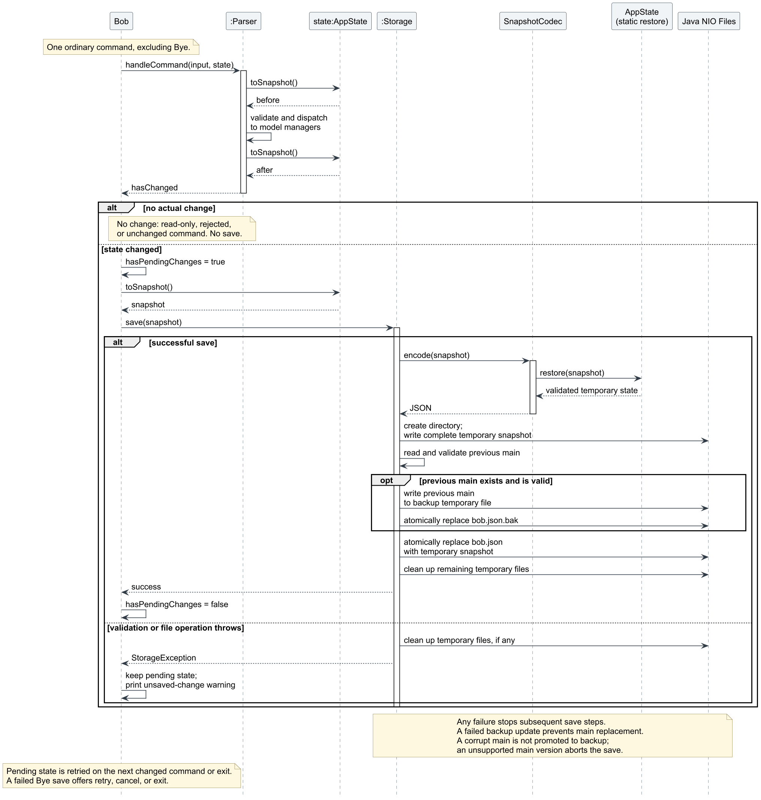

*Figure S2: One ordinary command and its automatic save. The live `state:AppState` is separate from the static
restoration call used to validate a temporary state. The detailed file operations show the successful path;
the alternative summarizes a failure at any validation or file operation. A failed backup update stops the save
before main-file replacement.*

The parser compares independent snapshots around command execution. When they differ, `Bob` marks the live state
as pending and asks `Storage` to save a fresh complete snapshot. `SnapshotCodec.encode()` validates it through
temporary model restoration before producing JSON. The backup is replaced only from a valid previous main file.
The new main is installed only after the temporary write and any required backup replacement succeed. Failed saves
keep the latest live state pending for a later changed command or exit; ordinary command confirmations still describe
the in-memory operation.

#### 3.5.2. Startup and recovery

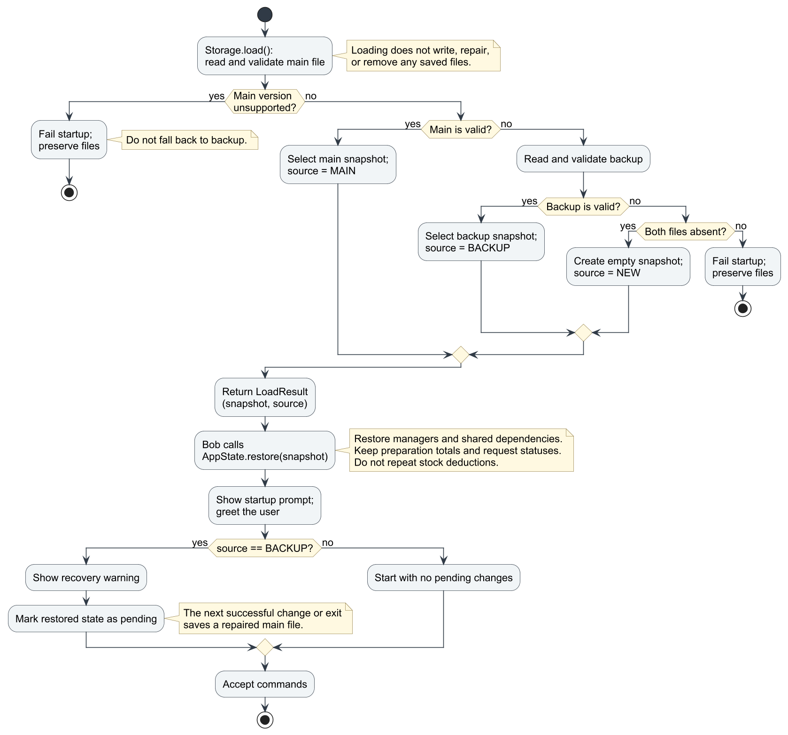

*Figure S3: Startup file selection and restoration for an interactive session. An unsupported main version stops
startup before backup fallback. Both files must be absent to start empty; unusable files never mean empty state.*

`Storage.load()` reports the selected source without repairing files. JSON decoding already validates domain state;
`Bob` then restores the independent managers used by the running session. Loans and broken reports reconnect to the
shared inventory without replaying deductions. Backup recovery is reported after the greeting and remains pending
until the next successful change or exit saves a repaired main file. EOF before the startup name exits without a
command session; that input-handling branch is omitted from the activity diagram.

#### 3.5.3. Diagram sources

The architecture and storage diagrams reuse the existing [`loan-style.puml`](diagrams/loan-style.puml) styling.
Editable sources: [architecture](diagrams/storage-architecture.puml), [storage classes](diagrams/storage-class.puml),
[automatic-save sequence](diagrams/storage-save-sequence.puml), and
[startup activity](diagrams/storage-load-activity.puml). Keep the corresponding PNGs in `docs/images/` in sync.

For tool setup, notation rules, and regeneration of every diagram, see the [diagram README](diagrams/README.md).
With Java 25 and the local PlantUML JAR, regenerate all diagrams from the repository root:

```text
java "-Djava.awt.headless=true" -jar build/diagram-tools/plantuml-1.2025.10.jar -charset UTF-8 -tpng -o ../images "docs/diagrams/*.puml"
```

The JAR path above refers to the local rendering tool under `build/`; the editable sources and rendered images are
kept in the repository.

### 3.6. Common classes

The `seedu.bob.exception` package contains checked domain exceptions for invalid commands, indices, quantities, dates,
stock, and session conflicts. `Ui.DIVIDER` and `Ui.HELP_MESSAGE` are shared display constants. `InventoryItem` and
`PreparationItem` are small value objects used by their respective managers.

## 4. Implementation

### 4.1. Inventory management

`Inventory` stores items in insertion-ordered categories. Item names are unique within a category, ignoring case, while
the same name may occur in different categories. `add-i` creates a category when needed, and `delete-i` removes a
positive quantity. Removing all units removes the item and then removes an empty category.

Inventory operations validate all inputs before changing state. Loan deductions use the same private quantity-deduction
path as `delete-i`, ensuring depleted items and categories are handled consistently. Inventory listing uses one-based item
indices within each category.

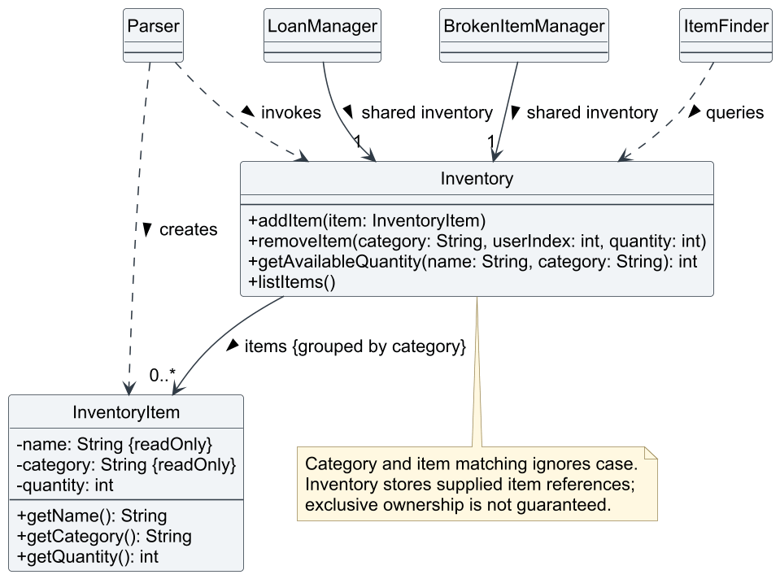

Editable source: [inventory overview](diagrams/item-management.puml).

*Figure 1: Inventory items and immediate collaborators. Arrows show navigability; dashed arrows show temporary use.*

#### 4.1.1. Detailed inventory addition design

Inventory addition registers usable stock through `add-i n/NAME c/CATEGORY [q/QUANTITY]`.
The quantity defaults to one when `q/` is omitted. See the [User Guide](UserGuide.md#add-an-item-add-i)
for command syntax and user-facing examples.

#### 4.1.2. Responsibilities and storage

| Component | Responsibility in addition |
| --- | --- |
| `Parser` | Checks prefix order, extracts and trims values, validates the quantity, constructs the item, and invokes inventory addition. It prints expected command errors. |
| `InventoryItem` | Holds a name, category, and positive quantity. Its constructor independently rejects null or blank names/categories and nonpositive quantities. |
| `Inventory` | Resolves the category, rejects duplicate names, stores the item, and prints the success confirmation. |

`Inventory` stores a `LinkedHashMap<String, ArrayList<InventoryItem>>`. Each key is a category's stored display name;
its list contains that category's items. The map and lists preserve insertion order, making subsequent listings
predictable. `findCategory` scans category names using `equalsIgnoreCase`, so `Tools` and `TOOLS` share a category
while retaining the first stored category spelling. Item names are also compared ignoring case within that category.

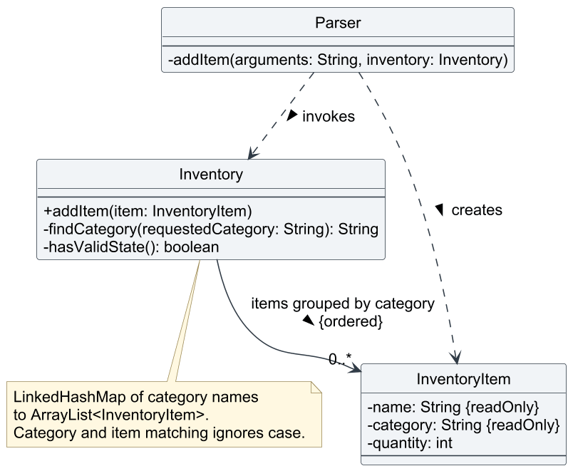

*Figure 1a: Selected inventory-addition relationships. Parser dependencies represent temporary use, while Inventory
retains item references grouped by category. Collection implementation classes and unrelated operations are omitted.*

In Figures 1 and 1a, the item association uses no composition diamond: `addItem` stores the supplied object, rather than creating an exclusively
owned copy. An item's name and category are final; its quantity can change through package-level stock operations.
Other features query the same inventory, so newly added stock is available to preparation checks, requests, and loans.

#### 4.1.3. Example walkthrough

Starting with an empty inventory, consider:

```text
add-i n/Screws c/Fasteners q/100
```

1. `Parser#addItem` accepts the prefix sequence `n/`, `c/`, `q/` and extracts the three values.
2. `parseQuantity` converts `100` into a positive integer. The parser constructs an `InventoryItem`.
3. `Inventory#addItem` calls `findCategory`. Since Fasteners does not exist, it creates an empty category list.
4. The duplicate scan finds no matching item, so the new item is appended.
5. Inventory checks its state with an assertion, logs the addition at `FINE`, and prints:

```text
Successfully added: 100x Screws to the inventory
```

Repeating the command with `n/screws c/FASTENERS q/20` raises `DuplicateItemException`. The original quantity stays
at 100; `add-i` does not replenish an existing entry. Adding `n/Screws c/Spares q/20` creates a separate entry instead.

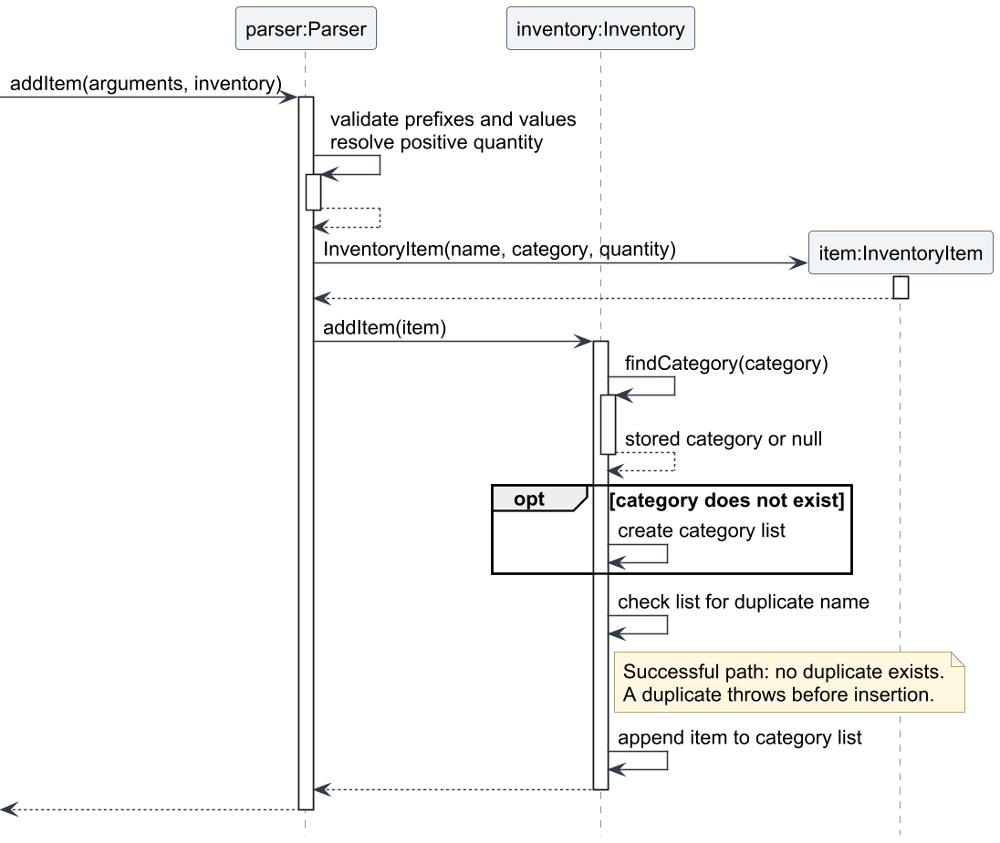

*Figure 1b: Successful addition after command dispatch. Internal actions use descriptive labels; routine getters,
logging, assertions, and console output are omitted. The duplicate check precedes insertion into the category list.*

#### 4.1.4. Validation and failure behaviour

| Boundary | Rule and result |
| --- | --- |
| Prefix parsing | Only `n/ c/` or `n/ c/ q/`, in that order, is accepted. Missing, repeated, reordered, or unexpected prefixes cause `CommandFormatException`. |
| Text values | The parser trims surrounding whitespace and rejects blank names/categories. Direct constructor calls validate these fields but do not trim them. |
| Quantity parsing | An explicit quantity must parse as a positive Java `int`, up to `Integer.MAX_VALUE`. Blank, non-integer, out-of-range, zero, and negative values cause `InvalidQuantityException`. |
| Domain construction | `InventoryItem` rejects invalid fields with `IllegalArgumentException`, protecting callers outside the parser too. |
| Inventory insertion | A null item causes `NullPointerException`; an existing name in the resolved category causes `DuplicateItemException`. |

Expected command failures are printed by the parser. Malformed input fails before inventory insertion, and duplicate
rejection leaves existing stock unchanged. Creating a new category happens before its duplicate scan; that new list
is empty, so a duplicate cannot occur on that path. These guarantees concern normal validation failures in the
single-threaded application, not recovery from process termination.

After successful insertion, `hasValidState` asserts that categories are nonblank and nonempty, items have positive
quantities and matching categories, and no category contains duplicate item names. Assertions detect programming
errors; input validation still operates when assertions are disabled. Addition and duplicate rejection produce
`FINE` diagnostic records without changing normal console output.

#### 4.1.5. Design considerations and alternatives

| Decision | Rationale and trade-off |
| --- | --- |
| Group items by category | A map of lists directly supports category-based listing and indices. A flat list would require regrouping for display. |
| Preserve insertion order | `LinkedHashMap` keeps category order predictable; `HashMap` would not guarantee it. Items remain in list insertion order. |
| Match names ignoring case | Capitalization differences do not accidentally create duplicate stock. Linear scans keep the implementation simple; normalized lookup keys could improve lookup for a larger inventory. |
| Reject duplicates rather than merge quantities | Accidental repeated commands cannot silently increase existing stock. A dedicated restocking command could make intentional increases explicit. |
| Create categories automatically | Adding the first item requires no separate category-management command. A category typo can consequently create a new category. |
| Validate at parser and domain boundaries | The parser gives command-specific feedback; constructor checks also protect direct callers such as tests. |

#### 4.1.6. Verification and limitations

`InventoryTest` covers successful addition, null input, case-insensitive duplicates, unchanged stock after duplicate
rejection, and identical names in different categories. `InventoryItemTest` covers constructor validation, while
`InventoryLoggingTest` checks diagnostic records. The [UI test plan](https://github.com/AY2627S1-CS2113-T11-3/tp/blob/master/test/ui-test-plan.md) records malformed-prefix,
blank-field, and invalid-quantity cases. These references describe existing checks; run the tests after changing
the implementation rather than assuming the documentation proves correctness.

Available inventory is saved automatically and restored when Bob restarts. Addition does not rename entries or restock existing
ones. Categories and names are free text; case-insensitive matching does not correct spelling differences.
Matching scans categories and then the selected list. With assertions enabled, the additional invariant check also
compares pairs of items within each category, which is suitable for the expected small data set.

Editable diagram sources: [class diagram](diagrams/inventory-add-class.puml) and
[addition sequence](diagrams/inventory-add-sequence.puml). Both reuse `loan-style.puml`; regenerate their PNGs in
`docs/images/` when changing the sources.

### 4.2. Session scheduling

`Session` parses dates in `d MMMM yyyy` format and times in `HHmm` format. Dates cannot be in the past, times must be
valid, and the end time must be later than the start time. `SessionManager` rejects overlapping sessions at the same
location, ignoring location capitalization, but permits overlapping sessions at different locations.

Sessions are sorted by date, start time, and name. Because sorting can change positions, users should run `list-s` before
using a session index. Deleting a session also discards its preparation.

#### 4.2.1. Detailed scheduling design

Lab session scheduling supports adding, listing, and deleting sessions through the `add-s`, `list-s`, and `delete-s`
commands. Responsibilities are divided between three classes:

- **Parser** validates command syntax, extracts arguments, and dispatches scheduling operations.
- **Session** validates individual session details and defines ordering and conflict detection.
- **SessionManager** maintains the schedule, rejects conflicting additions, and retrieves or removes sessions using
  displayed indices.

`SessionManager` stores sessions in an `ArrayList<Session>`, sorted after each successful addition. Displayed indices are
one-based list positions and can change after additions or deletions. Each `Session` owns a `Preparation` object, so
preparation remains associated with the same session when its position changes.

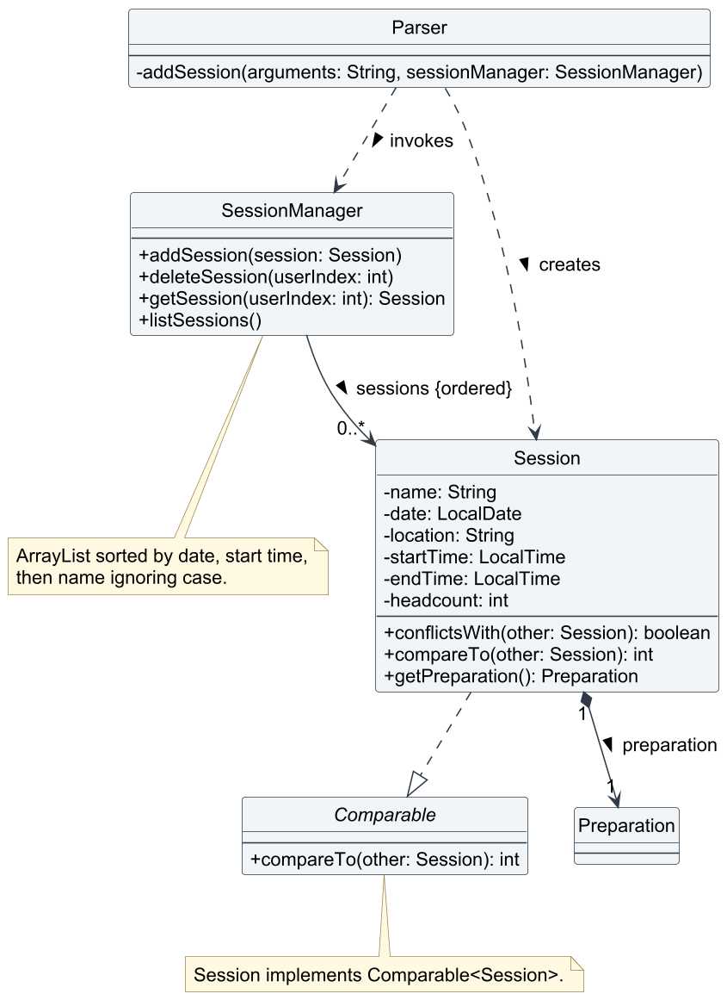

*Figure 2: Main scheduling classes and relationships. Selected members are shown; constructors, routine getters, and
preparation internals are omitted.*

##### 4.2.1.1. Key operations

- `SessionManager#addSession(Session session)` rejects conflicts before insertion, then adds the session and sorts the schedule.
- `Session#conflictsWith(Session other)` checks for overlapping times on the same date at the same location.
- `Session#compareTo(Session other)` orders sessions by date, then start time, then name ignoring capitalization.
- `SessionManager#getSession(int userIndex)` validates a displayed index and retrieves its session.
- `SessionManager#deleteSession(int userIndex)` validates and retrieves the session through `getSession()` before removing it.
- `SessionManager#listSessions()` displays numbered sessions in stored order, or an empty-schedule message.

##### 4.2.1.2. Example walkthrough

Assume that 5 November 2099 is a future date. Run this example from a new, empty working directory so
existing saved records do not affect the session indices.

**Step 1: Initialize an empty schedule**

When neither `data/bob.json` nor `data/bob.json.bak` exists, Bob starts with an empty schedule.
Calling `list-s` displays the empty-schedule message. Otherwise, Bob restores saved records according
to the startup and recovery rules described in Section 3.5.2.

**Step 2: Add an afternoon session**

The user enters:

`add-s n/Embedded Systems Lab d/5 November 2099 l/Room-A s/1300 e/1500 p/18`

`Parser` checks the prefixes, extracts values, converts the headcount, and constructs a validated `Session`. The manager
finds no existing sessions, inserts the candidate, sorts the list, and prints confirmation. Embedded Systems Lab receives
index 1.

**Step 3: Add an earlier session and reorder the schedule**

The user enters:

`add-s n/Digital Design Lab d/5 November 2099 l/Room-A s/0900 e/1100 p/24`

The sessions share a date and location, but their times do not overlap. The manager accepts the addition and calls
`Collections.sort()`, which uses `Session#compareTo()`.

| Displayed index | Session | Time |
| --- | --- | --- |
| 1 | Digital Design Lab | 0900–1100 |
| 2 | Embedded Systems Lab | 1300–1500 |

Embedded Systems Lab moves to index 2; its session and preparation objects remain unchanged.

**Step 4: Reject a conflicting session**

The user enters:

`add-s n/Circuit Lab d/5 November 2099 l/Room-A s/1000 e/1200 p/12`

Construction succeeds, but `Session#conflictsWith()` detects a conflict with Digital Design Lab because:

- Their dates match.
- Their locations match, ignoring capitalization.
- Each session starts before the other ends.

The manager throws `SessionConflictException` before insertion. `Parser` displays the error, and the schedule remains
unchanged. These time comparisons are strict, so sessions meeting exactly at an endpoint are allowed.

**Step 5: Associate preparation with a session**

The user enters:

`add-p s/2 i/Breadboard c/Equipments q/2`

`Parser` retrieves Embedded Systems Lab through `getSession(2)` and accesses its `Preparation` object. With 18 attendees,
the requirement is 36 breadboards. This records a requirement without reserving inventory. Preparation calculates required
quantities, while Parser compares these requirements with inventory availability.

**Step 6: Delete another session without losing preparation**

The user enters:

`delete-s 1`

`deleteSession()` retrieves Digital Design Lab through `getSession(1)`, converts the displayed index to a zero-based
position, and removes it.

Embedded Systems Lab becomes index 1 while retaining its requirement of 36 breadboards. Calling `list-p s/1` accesses
that same preparation. Calling `delete-s 2` now fails because only one session remains.

##### 4.2.1.3. Interactions during session addition

The sequence diagram shows successful addition. Construction precedes conflict checking; every comparison returns `false`
before insertion and sorting. Descriptive labels summarize routine implementation details.

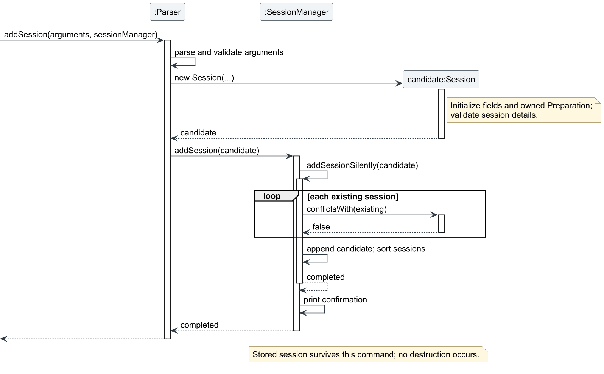

*Figure 3: Successful session addition. The loop checks each stored session and is skipped when the schedule is empty.
The candidate remains stored after the call; ending its constructor activation does not destroy it.*

Editable scheduling sources: [class diagram](diagrams/lab-session-scheduling-dg.puml) and
[addition sequence](diagrams/add-session-sequence.puml).

If parsing or construction fails, the manager is not asked to add the session. If a conflict is detected, addition stops
before insertion, sorting, and success confirmation.

##### 4.2.1.4. Design considerations

**Aspect 1: Representing and ordering the schedule**

**Current approach:** Store sessions in an `ArrayList` and sort after each successful addition.

Stored and displayed positions remain consistent, simplifying retrieval and deletion. The tradeoff is scanning existing
sessions for conflicts and sorting after insertion, which is sufficient for a small schedule.

**Alternative:** Preserve insertion order and sort a separate copy for display.

This avoids sorting the stored list, but displayed indices would require mapping back to the original collection. Keeping the
stored list sorted avoids this additional mapping.

**Aspect 2: Associating preparation with sessions**

**Current approach:** Each `Session` owns its `Preparation` object.

Sorting moves session references without changing their associated preparation. Deleting another session therefore cannot
transfer requirements to the wrong session. This intentionally couples a session with its preparation.

**Alternative:** Maintain preparation separately using session indices.

Both collections would require synchronization after sorting or deletion. Storing preparation inside the session avoids
this dependency on changing positions.

##### 4.2.1.5. Scheduling validation, assertions, and logging

| Component | Responsibility |
| --- | --- |
| `Parser` | Command structure, required prefix order, numeric conversion, and positive numeric arguments. |
| `Session` | Nonblank name and location, positive headcount, valid date and time values, date not before today, and start time before end time. |
| `SessionManager` | Rejecting null additions, checking scheduling conflicts, and validating indices against the current schedule. |

Expected command errors are reported through exceptions before the relevant insertion or deletion occurs.

When Java assertions are enabled, `hasValidState()` checks for nonnull sessions and pairwise absence of conflicts after
additions and deletions. It does not verify sorting. Assertions supplement ordinary validation; user-input checks do not
depend on them.

`SessionManager` uses `java.util.logging.Logger` to record attempted and successful additions and deletions at `INFO`
level, and conflicts or invalid indices at `WARNING` level.

The public `Session` constructor uses the system's default time zone. A package-private overload accepts a `Clock`
so tests can check today, yesterday, and time-zone boundaries deterministically. Null date and time strings receive
the same validation exceptions and messages as malformed strings.

##### 4.2.1.6. Scheduling limitations

- Sessions cannot span midnight. Date checks occur during construction; sessions are not automatically removed afterward,
  and today's start time is not compared with the current clock time.
- There is no command to edit a session. Deleting and recreating one produces a new session with empty preparation.
- Historical sessions remain in saved state; storage restoration omits only the new-command past-date restriction.

### 4.3. Session preparation

Session preparation helps a lab technician work out what a session needs and whether current stock is enough. It
supports adding a per-attendee requirement (`add-p`), removing part or all of a requirement (`delete-p`), and listing
requirements against live stock (`list-p`). Every successful preparation command ends by displaying the updated list, so
shortages are visible immediately.

#### 4.3.1. Detailed preparation design

Preparation divides responsibilities as follows:

- **Parser** validates prefixes, resolves the session, supplies its headcount, and renders the preparation list.
- **Session** owns exactly one `Preparation`, created with the session.
- **Preparation** stores required totals in insertion order, merges repeated items, and validates every change.
- **PreparationItem** is an immutable value holding an item name, category, and total required quantity.
- **Inventory** answers availability queries through `getAvailableQuantity()` without reserving or changing stock.

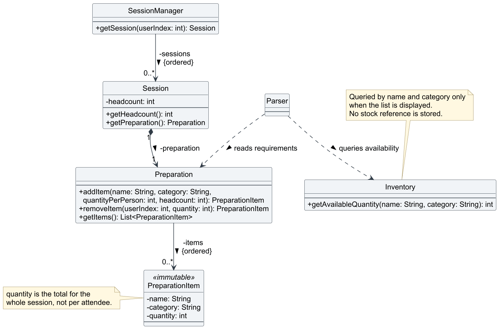

*Figure 4: Selected preparation classes. The filled diamond shows that a session owns its preparation. Parser reads
requirements and queries inventory when rendering the list; preparation items hold no reference to stock.
UI, constructors, and private helpers are omitted.*

Because the `Preparation` lives inside its `Session`, the requirements move with the session when the schedule is
re-sorted or another session is deleted. A preparation keyed by session index would instead attach requirements to the
wrong session after renumbering.

`PreparationItem` is immutable. Each change replaces the stored item with a new one, and `getItems()` returns a
`List.copyOf()` snapshot. Code that reads the list therefore cannot change the stored requirements by accident.

#### 4.3.2. Key operations

- `Preparation#addItem(String name, String category, int quantityPerPerson, int headcount)` validates the input,
  multiplies the per-attendee quantity by the headcount, and adds the result to any existing requirement with the same
  name and category (ignoring case). It returns the updated item.
- `Preparation#removeItem(int userIndex, int quantity)` subtracts a **total** quantity from the item at a one-based
  position. The item is removed when its required total reaches zero. It returns the item as it was before the removal.
- `Preparation#getItems()` returns an immutable snapshot in displayed order.
- `Inventory#getAvailableQuantity(String name, String category)` returns matching stock, or zero when the item or
  category does not exist.

#### 4.3.3. Example walkthrough

Start with this inventory and a session of 10 attendees, shown as session 1 by `list-s`:

```text
add-i n/Wire c/Components q/15
add-s n/Practice Lab d/8 October 2099 l/Room-A s/0900 e/1000 p/10
```

**Step 1: Add a requirement**

```text
add-p s/1 i/Wire c/Components q/2
```

`Parser` reads the headcount (10) from session 1 and calls `addItem("Wire", "Components", 2, 10)`. No matching item
exists, so `Preparation` appends a `PreparationItem` with a total of 20. The list shows 15 available and a shortfall of
5. Inventory still holds 15 Wire, because preparation only reads stock.

**Step 2: Add the same item again with different capitalisation**

```text
add-p s/1 i/wire c/components
```

The quantity defaults to 1 per attendee. `findItemIndex()` matches the existing row ignoring case, so the total becomes
30 and the spelling from the first addition (`Wire [Components]`) is kept. No duplicate row is created.

**Step 3: Remove part of a requirement**

```text
delete-p s/1 i/1 q/12
```

Unlike `add-p`, `q/` here is a total, not a per-attendee quantity. The requirement drops from 30 to 18. Asking to
remove more than 18 is rejected without changing the preparation.

**Step 4: Stock changes elsewhere**

```text
add-l n/Wire c/Components q/5 b/Alex Tan t/91234567 d/8 October 2099
list-p s/1
```

Assuming there are no existing loans, this creates loan 1 and reduces usable stock from 15 to 10 Wire.
`list-p` queries inventory again, so the shortfall increases from 3 to 8 without changing the preparation.
Returning the loan with `return 1` restores stock to 15 and the shortfall to 3.
Adding the same inventory entry with `add-i` would be rejected as a duplicate; it does not top up stock.

| After operation | Required Wire | Available Wire | Displayed warning |
| --- | --- | --- | --- |
| Step 1: `add-p ... q/2` | 20 | 15 | Shortfall: 5 |
| Step 2: `add-p ...` (default 1) | 30 | 15 | Shortfall: 15 |
| Step 3: `delete-p ... q/12` | 18 | 15 | Shortfall: 3 |
| Step 4: `add-l ... q/5` | 18 | 10 | Shortfall: 8 |

#### 4.3.4. Interactions during preparation addition

The sequence below shows a successful `add-p` command after `Bob` passes the input to `Parser`. Prefix validation
and session-index parsing precede session lookup; per-person quantity parsing follows that lookup.
Print statements, assertions, and logging are omitted.

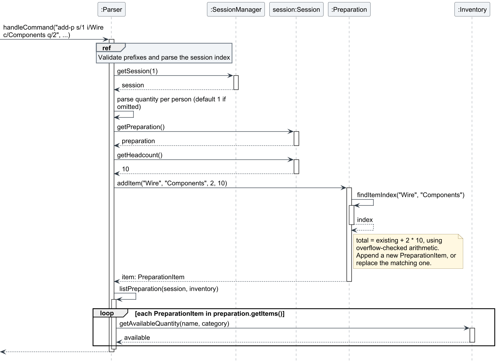

*Figure 5: The headcount is read from the session before `addItem()` is called. After the change, `listPreparation()`
queries inventory once per required item.*

If the session index is invalid, `getSession()` throws before the preparation is touched. The parser rejects invalid
quantities before calling `addItem()`, which independently validates its inputs and rejects totals above
`Integer.MAX_VALUE` before changing its list. The overflow check uses
`Math.multiplyExact()` and `Math.addExact()`, so an oversized request cannot silently wrap around to a negative total.

#### 4.3.5. Calculating availability and shortfalls

For each required item, `listPreparation()` looks up the live stock. When the available quantity is below the required
total, it prints the row with a shortfall of `required - available`. Listing changes neither the preparation nor the
inventory.

An item is matched by name **and** category. Wire stored under `Tools` does not count towards Wire required under
`Components`. A missing item counts as zero available, so a requirement can be recorded before the stock is bought.

#### 4.3.6. Design considerations and alternatives

**Aspect 1: Where to store preparation**

**Current approach:** Each `Session` owns a `Preparation` object.

Requirements stay with the correct session when indices change, and deleting a session deletes its requirements. No
extra lookup structure is needed.

**Alternative:** Keep a separate map from session index (or session name) to requirements. Indices change after sorting
and deletion, and session names are not unique, so the map would need its own key and cleanup logic.

**Aspect 2: Reserving stock**

**Current approach:** Preparation does not reserve stock. It reads availability each time it is displayed.

This is simple, never leaves inventory and preparation out of sync, and reflects loans and stock changes immediately.
The cost is that two sessions needing the same item can both appear sufficient even when stock covers only one of them.

**Alternative:** Deduct or reserve stock when a requirement is added. This would prevent double counting between
sessions, but every preparation, session deletion, and loan would then need matching release and rollback rules.

**Aspect 3: Storing the total or the per-attendee quantity**

**Current approach:** Store the total (`quantityPerPerson × headcount`) when the item is added.

Repeated additions with different per-attendee quantities merge naturally into one total, and `delete-p` can remove an
exact number of units (for example, spares that are no longer needed).

**Alternative:** Store the per-attendee quantity and multiply at display time. Totals would then follow headcount
changes automatically, but repeated additions with different per-attendee quantities could not be merged into one
value. The current approach is sufficient because sessions do not yet support editing the headcount.

**Aspect 4: Identifying an item**

**Current approach:** Match by name and category together, ignoring case, and keep the first spelling.

This matches how `Inventory` identifies stock, so the comparison in `list-p` is consistent with what inventory holds.

**Alternative:** Use inventory item IDs. This would survive renaming, but inventory does not have permanent IDs, and
requirements must be allowed for items that are not yet in stock.

#### 4.3.7. Preparation validation, assertions, and testing

| Component | Responsibility |
| --- | --- |
| `Parser` | Exact prefix order, optional `q/` for `add-p`, and positive integer conversion of indices and quantities. |
| `SessionManager` | Valid one-based session index. |
| `Preparation` | Nonblank name and category, positive quantity and headcount, valid item index, removal not exceeding the requirement, and overflow-safe totals. |
| `Inventory` | Case-insensitive stock lookup that never changes stock. |

After every successful change, `Preparation` asserts that no stored item is blank or non-positive and that no two items
share the same name and category. User-input errors are reported with exceptions, so they still work when assertions
are disabled.

`PreparationTest` covers headcount multiplication, case-insensitive merging, partial and full removal, invalid input,
and overflow. `ParserPreparationTest` covers category-specific shortages, recalculation after stock changes, and malformed or invalid
commands leaving state unchanged. Console
scenarios are recorded as `UI-PREP-*` in the [UI test plan](https://github.com/AY2627S1-CS2113-T11-3/tp/blob/master/test/ui-test-plan.md).

#### 4.3.8. Preparation limitations

- Stock is not reserved, so several sessions can rely on the same units.
- Totals are fixed when added and do not follow later headcount changes.
- Item indices are list positions, so they shift after an item is fully removed.
- `listPreparation()` prints directly from `Parser`, rather than through `Ui` as loan tracking does. Moving it into
  `Ui` would make the output easier to test and keep display code in one place.
- Preparation totals persist with their owning sessions across application restarts.

#### 4.3.9. Preparation diagram sources

Editable PlantUML sources: [class diagram](diagrams/preparation-class.puml) and
[addition sequence](diagrams/preparation-add-sequence.puml). They reuse [loan-style.puml](diagrams/loan-style.puml)
so all implementation diagrams share one style.

### 4.4. Contact management

`add-c`, `list-c`, and `delete-c` follow the same structure as sessions: `Contact` is the validated data class,
`ContactManager` owns the list and prints confirmations, and `Parser` dispatches the commands. `delete-c` takes a
single index on the command line, like `delete-s`.

Deleting a contact that a broken-item report uses needs `-force`. `Parser.deleteContact` splits its arguments into
tokens (an index, then optionally exactly `-force`), validates the index, and asks
`BrokenItemManager#countReportsUsing` how many reports hold that exact `Contact` object. If the count is above zero
and `-force` is missing, it prints a warning that names the count and repeats the command with the flag, and deletes
nothing. The check lives in `Parser`, which already holds both managers, so `ContactManager` and `BrokenItemManager`
do not depend on each other. A flag was chosen over a y/n prompt because no other command asks for confirmation in
the middle of a command. Adding a contact with identical details later does not reconnect those reports, because
reports and `countReportsUsing` compare contacts by identity.

The [User Guide](UserGuide.md#add-a-contact-add-c) describes these contact rules. Their implementation belongs in
`Contact` (validation) or `Parser` (`ADD_CONTACT_PREFIXES`):

| Decision | Rule | Rationale |
| --- | --- | --- |
| Phone format | Digits only, no length check | Accepts local and international numbers. Rejecting separators keeps one canonical form. A length check would wrongly reject some valid numbers. |
| Email format | Non-whitespace text on both sides of an `@`, with no whitespace anywhere | Catches obvious typos without a full email grammar or checking address existence. |
| Duplicate contacts | Allowed | Two suppliers can share a name or switchboard number. Unlike `add-i`, a contact has no natural unique key. |
| Optional fields | `e/` before `r/`; a supplied value must not be blank | Matches the fixed prefix order used by every other command. |
| Empty list | `list-c` shows `No contacts saved.` | Matches `list-s`, which shows `No sessions scheduled.` |

Known limitation: prefixes are detected by a shared pattern (a single letter followed by `/` at the start of a
word), so a value containing a word such as `a/b` cannot be entered. This affects commands with prefixed arguments, including contacts; `find-i` accepts plain search text.

### 4.5. Loan tracking

Loan tracking supports recording loans (`add-l`), listing active, overdue, complete-history, or returned-only views, correcting an
incorrect record (`delete-l INDEX`), and recording a full return (`return INDEX`). Each accepted loan deducts available
stock; return and correction restore the entire loan quantity before closing the record as `RETURNED` or
`VOIDED`. Closed records remain in history and leave the active view.

#### 4.5.1. Detailed loan tracking design

At startup, `Bob` creates one `LoanManager` using the same `Inventory` instance as inventory and preparation commands.
This gives all features a consistent view of available stock. Loan tracking divides responsibilities as follows:

- **Parser** validates command syntax, constructs domain objects, invokes the manager, and passes results to the UI.
- **Loan** captures item details, quantity, borrower name and phone, and a strictly parsed due date.
- **LoanManager** maintains all lifecycle records, coordinates stock changes, and evaluates overdue status using its `Clock`.
- **LoanRecord** wraps loan details with a stable ID, status, and optional recording/closure timestamps.
- **Inventory** locates items case-insensitively, validates stock changes, and removes or recreates depleted entries.
- **Ui** renders successful results, warnings, listing rows, and empty states.

`LoanManager` stores an `ArrayList<LoanRecord>` in creation order and a persisted `nextLoanId`. Each addition is
independent, even when its details match another record. Active lists filter `ACTIVE` records before assigning
one-based action indices; returned and voided records remain in the full collection with their permanent IDs.

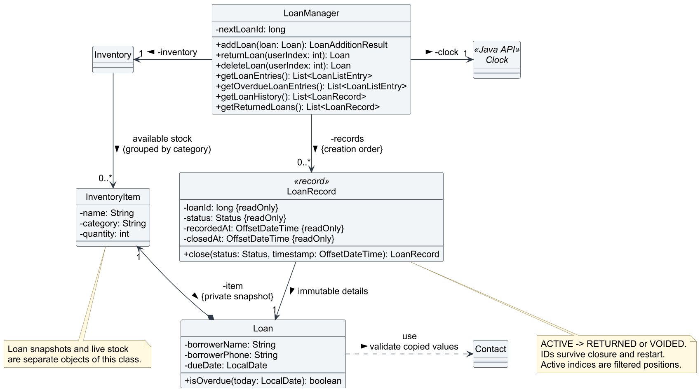

*Figure 6: Selected loan classes and navigable relationships. The manager retains lifecycle wrappers around immutable
loan details. The filled diamond shows that a loan owns its private item snapshot. The dashed dependency on `Contact` is used during construction; no contact reference is retained. Parser, UI,
result classes, constructors, routine getters, and inventory internals are omitted.*

The `InventoryItem` owned by a loan is a separate object from live inventory stock. `Loan` exposes only its values, so
deducting, deleting, or restoring stock cannot change the recorded loan quantity. Borrower values are copied into final
strings and validated through `Contact`; borrowers are not registered in `ContactManager`. These snapshots preserve the
details of a loan even when the source inventory entry disappears or a source contact changes.

#### 4.5.2. Key operations

- `LoanManager#addLoan(Loan loan)` deducts stock, appends a new active `LoanRecord`, advances its ID counter, and returns a `LoanAdditionResult` with its addition-time
  overdue flag. The UI uses that flag for the backlog warning.
- `Inventory#lendItem(String name, String category, int quantity)` validates and deducts available units. It shares the
  private deduction path with `delete-i`, including cleanup of depleted items and empty categories.
- `LoanManager#getLoanEntries()` and `getOverdueLoanEntries()` return immutable `LoanListEntry` rows containing a loan,
  its full-list index, and its query-time overdue flag.
- `Loan#isOverdue(LocalDate today)` returns whether its due date is strictly before the supplied date.
- `LoanManager#returnLoan(int userIndex)` and `deleteLoan(int userIndex)` delegate to the private
  `closeLoanAndRestoreStock()` method, replacing the selected wrapper with `RETURNED` or `VOIDED` metadata after
  stock restoration. They return the original loan details for their distinct UI confirmations.
- `getLoanHistory()` and `getReturnedLoans()` return immutable record views; IDs and recorded dates are rendered by `Ui`.
- `Inventory#restoreStock(String name, String category, int quantity)` merges matching stock or recreates a missing item
  or category. It rejects integer overflow before changing stock.

#### 4.5.3. Example walkthrough

Start with an empty loan list and the following inventory command:

```text
add-i n/Multimeter c/Equipment q/5
```

**Step 1: Record the first loan**

```text
add-l n/Multimeter c/Equipment q/2 b/Alex Tan t/91234567 d/30 October 2099
```

`Parser` validates the prefixes and quantity, constructs a borrower `Contact`, and constructs a `Loan`. The loan copies
the borrower's values, parses the due date, and creates its item snapshot. Construction does not alter stock.
`LoanManager#addLoan()` validates the next ID and captures the recording time, then deducts two units before
appending the record and advancing the counter. Inventory now holds three
units, while loan 1 independently records two.

**Step 2: Keep a repeated loan separate**

```text
add-l n/Multimeter c/Equipment q/1 b/Alex Tan t/91234567 d/31 October 2099
```

The second addition creates loan 2 with its own quantity and due date. The manager does not merge it into loan 1.

**Step 3: Reject an excessive request**

```text
add-l n/Multimeter c/Equipment q/3 b/Sam Lee t/92345678 d/31 October 2099
```

Only two units are available. `Inventory#lendItem()` rejects the request before deduction, and the manager never appends
the candidate loan. `Parser` displays the error; no success confirmation or overdue warning is displayed.

**Step 4: Return a loan and renumber the list**

```text
return 1
```

The manager restores the first loan's two units before marking its record `RETURNED` and recording its closure time. The second loan becomes index 1 without
changing its recorded quantity or due date. Users should refresh `list-l` after removal before choosing another index.

**Step 5: Correct an incorrect record**

```text
delete-l 1
```

This uses the same restoration path as a return but displays a correction confirmation. All five units are available
again, and the active loan list is empty. History retains the first record as `RETURNED` and the second as `VOIDED`.
Neither closure changes supplier contacts or session requirements.

| After operation | Available Multimeters | Active loans, in displayed order |
| --- | --- | --- |
| Initial inventory addition | 5 | None |
| First loan | 3 | 1: two units, due 30 October 2099 |
| Second loan | 2 | 1: two units; 2: one unit, due 31 October 2099 |
| Rejected three-unit request | 2 | Unchanged |
| `return 1` | 4 | 1: one unit, due 31 October 2099 |
| `delete-l 1` | 5 | None |

Preparation queries `Inventory#getAvailableQuantity()` when displayed, so its availability and shortfall figures reflect
each successful deduction and restoration. Preparation does not reserve stock or change a loan.

#### 4.5.4. Interactions during loan addition

The sequence below shows a successful `add-l` command after `Bob` passes the input to `Parser`. The validation reference
frame summarizes syntax checks and construction; collection internals, routine getters, assertions, and logging are
omitted. `Ui` is shown by its class name because its display methods are static.

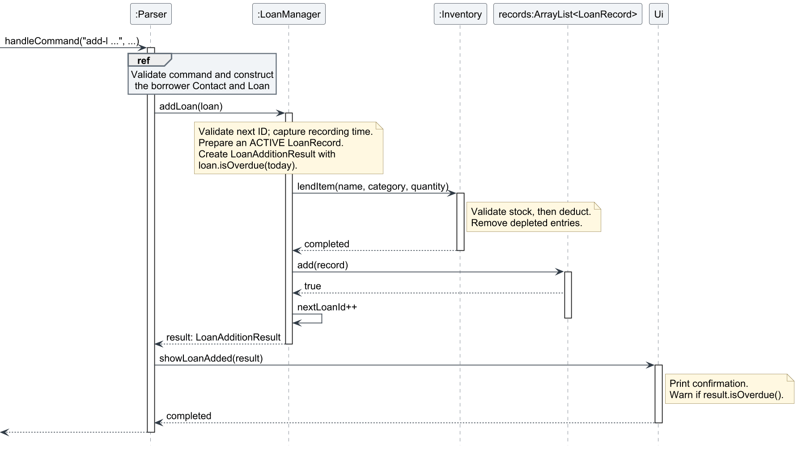

*Figure 7: Stock deduction succeeds before the loan is appended. The manager returns data to Parser, which invokes Ui.*

If command parsing or domain construction fails, the manager is never called. If inventory rejects lending, execution
stops before `records.add(record)` or counter advancement. The manager computes the addition result's overdue flag before deduction, but returns it
only after successful insertion; a rejected backlog request therefore produces no overdue warning.

#### 4.5.5. Interactions during a full return

`returnLoan()` and `deleteLoan()` share `closeLoanAndRestoreStock()`. The sequence shows `return 1` using a valid index
and successful restoration. A correction follows the same model interaction, followed by `Ui.showLoanDeleted()`.

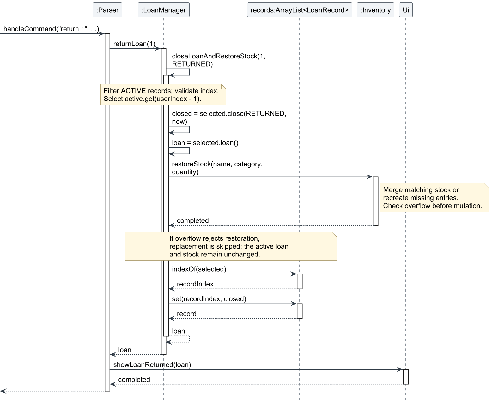

*Figure 8: The selected active record is resolved, a closed replacement is prepared, its units are restored, and only
then is the replacement installed. The original ID and loan details remain in history.*

Restoration matches the item name and category ignoring case. If the entry has disappeared after lending all its stock,
inventory recreates it; otherwise, the quantity is increased. If adding the quantity would exceed `Integer.MAX_VALUE`,
restoration throws before mutation and the active loan remains available for retry. An invalid index fails before any
stock operation. This ordering preserves state for expected validation failures in the single-threaded command loop.

#### 4.5.6. Overdue evaluation and filtered indices

Due dates are parsed strictly with English month names using `d MMMM uuuu` internally, displayed to users as
`d MMMM yyyy`. Impossible dates are rejected. Past dates are accepted for entering existing backlog loans. A loan is
overdue only when `dueDate.isBefore(today)`; a loan due today remains on time.

`LoanManager` uses `Clock.systemDefaultZone()` by default and accepts an injected clock for tests. Each addition or
listing query reads one local date. The immutable `Loan` stores its due date, while each `LoanListEntry` captures the
overdue status and position for that query. A later query recalculates the flags, including after midnight, without
rewriting an earlier snapshot. `Ui` renders supplied flags rather than consulting the clock again.

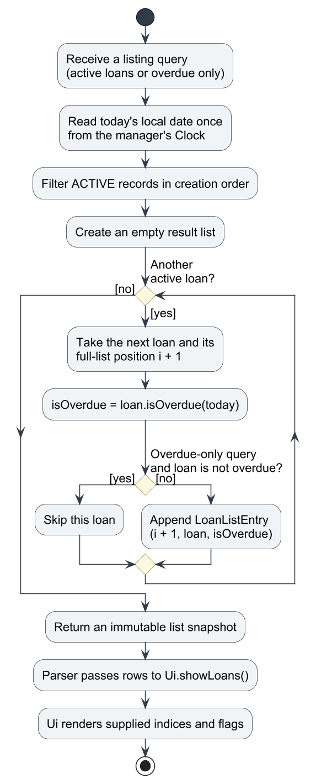

*Figure 9: Listing evaluates every loan against one date. Filtering retains full-list positions and changes no stock or
active records.*

For example, when only loans 2 and 4 are overdue, `list-l overdue` displays indices **2** and **4**, rather than 1 and 2.
`return 4` therefore selects the same record in both views. After removal, later indices shift with the full list, so
query snapshots are descriptions of a past view rather than permanent identifiers.

#### 4.5.7. Design considerations and alternatives

**Aspect 1: Representing loan details**

**Current approach:** Keep separate loan records with private item snapshots and copied borrower values.

This preserves quantities and borrower details when live inventory or source contacts change. Repeated loans can have
different due dates and be returned independently. The cost is storing some duplicate values.

**Alternative:** Retain live item/contact references or merge loans by item and borrower. References use less duplicate
data but couple recorded details to later changes. Merging also needs rules for different due dates and partial returns.
Independent snapshots are simpler for the supported full-return workflow.

**Aspect 2: Coordinating inventory and loan changes**

**Current approach:** `LoanManager` coordinates both operations, deducting before insertion and restoring before closure.
Inventory owns matching, quantity validation, and cleanup. Both return and correction reuse one restoration path while retaining distinct terminal statuses.

This prevents expected stock errors from leaving an accepted record without a matching stock change. It also avoids
duplicating inventory rules in the parser.

**Alternative:** Change the loan list first and roll back on a stock error. That adds rollback paths and another source
of state inconsistency. A database transaction could support stronger concurrent-update guarantees. Bob processes
commands sequentially and commits inventory and loans together as one file snapshot.

**Aspect 3: Identifying loans in filtered views**

**Current approach:** Retain permanent IDs for bookkeeping, while carrying full active-list positions into active
and overdue result rows. The complete ledger is filtered before action indices are assigned.

The same index selects the same active record in either view, without maintaining a second index map. Positions can
change after removal, so users must obtain a fresh listing.

**Alternative:** Change all action commands to accept permanent IDs and store records in a map. This would avoid
stale action positions, but changes established command semantics. The implementation keeps explicit history IDs
separate from active indices; ID generation and its durable counter are required for the ledger in either case.

**Aspect 4: Determining overdue status**

**Current approach:** Recalculate status at each query using an injected `Clock`, then capture it in immutable results.

This handles date rollover and makes boundary tests deterministic. Evaluating once per query also prevents rows in one
listing from being compared against different dates if midnight occurs during rendering.

**Alternative:** Store a permanent overdue flag inside each loan, or let the UI read the system date for each row. A
stored flag needs scheduled updates; UI evaluation mixes date rules with presentation and makes tests depend on wall
clock time. Query snapshots keep time decisions in the manager.

**Aspect 5: Displaying command results**

**Current approach:** Return `LoanAdditionResult`, `Loan`, or `List<LoanListEntry>` to `Parser`, which calls `Ui`.

The model can be tested without capturing console output, and the UI can render the same captured flags and positions
even if the clock or active list later changes. The tradeoff is two small result classes.

**Alternative:** Print directly from `LoanManager`. This reduces result objects but couples state changes and queries to
console formatting. Keeping rendering in `Ui` makes the loan model easier to reuse and test.

**Aspect 6: Restoring missing inventory entries**

**Current approach:** Inventory stores available stock, while active `Loan` records separately store outstanding
quantities. When a loan is returned, `Inventory.restoreStock()` recreates its item or category if necessary.

An inventory entry can disappear simply because all available units have been lent out. Recreating the entry allows
those units to be returned without requiring the user to manually recreate the item first. The loan's independent
snapshot preserves the name, category, and quantity needed for restoration.

Under this model, `delete-i` removes available units; it does not cancel outstanding loans or permanently retire an
item type. For example, starting with five Multimeters, lending two leaves three available. Deleting those three
removes the inventory entry, but the two loaned units remain recorded. Returning that loan recreates the entry with
**two units**, without restoring the three intentionally deleted units.

**Alternative:** Track total quantity and quantity on loan within each inventory entry, deriving availability as:

`available quantity = total quantity − quantity on loan`

This would retain entries while units remain on loan and provide a clearer view of all stock held by the lab. However,
it would require maintaining additional quantity invariants across inventory deletion, lending, returns, and
corrections, and changing the existing removal of zero-available entries.

The current approach keeps available-stock management simple and uses individual loan records to track outstanding
quantities.

**Limitation:** The application does not distinguish removing available stock from permanently retiring an item type.
If permanent retirement is required, explicit retirement rules and handling for outstanding loans would be needed.
The alternative above could provide a suitable foundation for that extension.

#### 4.5.8. Loan validation, assertions, and testing

| Component | Responsibility |
| --- | --- |
| `Parser` | Exact prefix order, positive integers, active action indices, and lowercase `overdue`, `history`, or `returned` filters. |
| `Loan` / `Contact` | Nonblank item and borrower details, digits-only phone, positive quantity, and a valid due date. |
| `LoanManager` | Nonnull dependencies/records, valid full-list indices, clock-based overdue queries, and operation ordering. |
| `Inventory` | Valid identifiers, matching stock, positive quantities, sufficient available stock, and overflow-safe restoration. |

Assertions check valid records and the exact stock and list-size changes after successful mutations. User-input checks
use exceptions and remain active when assertions are disabled. The existing validation/error-handling and logging
sections below describe the shared failure boundary and diagnostic configuration.

`LoanTest` covers domain validation and snapshot isolation. `LoanManagerTest` covers separate records, immutable query
results, full returns, corrections, replenished stock, and overflow preservation. `LoanOverdueTest` covers date boundaries,
timezones, midnight rollover, one clock read per query, and filtered indices. `ParserLoanTest` and `LoanUiTest` cover
command handling and rendered results. Additional assertion, logging, and inventory-validation tests cover defensive
checks. Console scenarios are recorded as `UI-LOAN-*` in the [UI test plan](https://github.com/AY2627S1-CS2113-T11-3/tp/blob/master/test/ui-test-plan.md).

#### 4.5.9. Loan tracking limitations

- Returns and corrections always restore the complete quantity. Partial returns, loan editing, and history deletion
  are not supported.
- Loan indices are list positions, so previously captured indices can become stale after removal.
- Stock is matched by case-insensitive name/category, without a permanent item identifier.
- Due dates have day precision and use the manager clock's timezone; no automatic notifications are sent.
- All loan records persist with available inventory. History accumulates and increases snapshot comparison/write costs.

The [loan history design](#46-loan-history) below explains retention, migration, and the alternatives considered.

#### 4.5.10. Diagram sources

Editable PlantUML sources: [class diagram](diagrams/loan-tracking-class.puml),
[addition sequence](diagrams/loan-add-sequence.puml), [return sequence](diagrams/loan-return-sequence.puml), and
[listing activity](diagrams/loan-overdue-activity.puml). They share [loan-style.puml](diagrams/loan-style.puml).

The section follows the walkthrough and design-alternatives format of the
[AB3 implementation example](https://se-education.org/addressbook-level3/DeveloperGuide.html#implementation).
See the [SE-EDU PlantUML tutorial](https://se-education.org/guides/tutorials/plantUml.html) for editing and image export.
Export PNGs into `docs/images/` after changing a source so the guide's images remain in sync.

### 4.6. Loan history

**Status: implemented.** Active, returned, and voided records persist in schema version 2. The following design
record retains the original considerations, alternatives, and phased verification plan. Existing action commands
still use active-list indices; the additional views expose permanent identities for bookkeeping.

#### 4.6.1. Objective and lifecycle

The manager keeps every successfully recorded loan for bookkeeping, including loans that have been returned or corrected.
It uses one permanent, insertion-ordered collection and derives active and historical views from it.
An incorrect entry closed with `delete-l` remains as a voided record, distinguishable from a genuine return.

| Operation | Record change | Inventory effect |
| --- | --- | --- |
| `add-l ...` | Create a new `ACTIVE` record with a permanent ID. | Deduct the recorded quantity once. |
| `return INDEX` | Replace the selected active record with a `RETURNED` version and closure timestamp. | Restore its complete quantity once. |
| `delete-l INDEX` | Replace the selected active record with a `VOIDED` version and closure timestamp. | Restore its complete quantity once. |
| History query or restart | Preserve records and their statuses. | No deductions or restorations. |

`RETURNED` and `VOIDED` are terminal states: neither can be returned or voided again. Normal commands should not
permanently erase records. Retaining voided entries preserves an account of corrections without counting them as
completed borrowing. Optional correction reasons, editing, partial returns, reopening records, export, and permanent
history deletion are outside the initial implementation.

#### 4.6.2. Record model, identifiers, and timestamps

Keep `Loan` as the existing immutable snapshot of item details, quantity, borrower name and phone, and due date.
The implementation adds an immutable `LoanRecord` wrapper for lifecycle metadata; closing a loan replaces its wrapper while
retaining its ID and original loan details. Existing references to loan details cannot change historical values.

| Model/storage value | Purpose and validation |
| --- | --- |
| `loanId` | Positive, permanent sequential ID. Separate loans receive different IDs even when all their details match. |
| `loan` | Existing immutable `Loan` details, including captured borrower values rather than live contact references. |
| `status` | Exactly `ACTIVE`, `RETURNED`, or `VOIDED`; unsupported values are rejected. |
| `recordedAt` | Timestamp when the loan entry was recorded in Bob. Nullable for imported records whose original timestamp is unknown. |
| `closedAt` | Timestamp when Bob records the return or correction. Required for closed records and absent for active records. |
| `nextLoanId` | Manager-level counter persisted alongside the records; positive and greater than every stored loan ID. |

The manager's injected `Clock` supplies timestamps. ISO offset timestamps preserve their local-time context in
storage; the console intentionally shows readable calendar dates in that recorded offset. `recordedAt` is not an
asserted physical borrowing time: backlog loans are
already supported, and entering a past due date does not reveal when the item was actually borrowed. Similarly,
`closedAt` records the closure command's time. Do not invent missing dates during migration.

IDs and the next-ID counter use validated positive 64-bit integers; existing quantity limits remain unchanged.
Validate ID availability and construct the candidate record before deducting stock. Advance the counter only after
an accepted addition, and reject counter overflow before any inventory change. Loading rejects duplicate IDs,
invalid counters, malformed timestamps, and inconsistent status/closure fields.

Keep `return INDEX` and `delete-l INDEX` tied to the latest active-loan list. Resolve those positions through the
filtered active records, not through positions in the complete collection. Overdue listings retain full active-list
positions, as they do today. A permanent loan ID is an identity for bookkeeping, not another name for a displayed
active index. History output must label IDs clearly and direct users to `list-l` before selecting an active index.

#### 4.6.3. Stock consistency and integration

`LoanManager` should remain the only coordinator of loan and inventory changes. Before a return or correction,
validate the active index and prepare the closed record. Restore inventory before replacing the active record.
An invalid index, an already closed record, or stock-restoration overflow must leave both inventory and the record
unchanged. A closed record must never restore stock again, including after a restart.

Preserve `getLoans()` as an active-only view so callers such as `ItemFinder` do not mistake historical quantities
for equipment still on loan. Active and overdue result rows should continue using the existing display rules.
Late status for an active loan remains a query-time calculation; a permanently stored overdue flag would become stale.

For example, start with five available units and record loans of two and one units. Returning active index 1 should
leave four units available, retain the first record as `RETURNED`, and display the second record at active index 1.
Voiding that remaining active loan should restore availability to five and retain its record as `VOIDED`.
History then contains both original IDs, while the active view is empty. Restarting must preserve this result.

#### 4.6.4. Persistence and version-1 compatibility

Use schema version 2 because loan storage changes from active-only entries to permanent records with lifecycle
metadata. Extend `AppSnapshot`, `AppState`, and `SnapshotCodec` to include every loan record and `nextLoanId`.
Keep inventory, loan history, and the other feature collections in the same complete snapshot, so the existing
atomic main-file replacement cannot save an inventory return separately from its loan status.

The version-2 reader also accepts valid version-1 files. Convert their loans into `ACTIVE` records in memory,
assign IDs in their existing order, set `nextLoanId` above the assigned IDs, and leave unknown recording timestamps
null. Preserve all other saved features, including compatibility with the older omission of `brokenItems`.
Perform conversion before restoring the current model, without replaying add or return commands or changing stock.

Reading a valid version-1 main file, including read-only commands followed by ordinary exit, should not rewrite it.
The next successful data-changing command saves version 2 and retains the validated previous main as its backup.
Recovering an older backup restores that ledger and its counter together. Newer lost IDs are not reserved;
sequential IDs are stable within the retained dataset, not globally unique across independent or rolled-back copies.
Existing backup recovery still marks restored state as pending and may repair the main on exit. Loading or saving
must continue to reject unsupported newer versions and preserve the existing backup, temporary-file, and failure
handling rules. Version-2 validation must not weaken strict version-1 validation.

History and counter changes must participate in snapshot equality so the existing autosave detection sees closures
and new records. A failed save leaves the full changed live state pending and reports the existing warning; later
retry must save the same IDs and timestamps without repeating a stock operation. A disk save failure does not turn
a successful in-memory return into a second return attempt.

Previously returned or deleted loans cannot be reliably reconstructed from version-1 active-only snapshots.
Existing backups are previous snapshots, not a complete loan ledger. Migration imports available active records;
history retention starts with this feature, without fabricating earlier returns or their dates.

#### 4.6.5. Commands and views

| Command | View |
| --- | --- |
| `list-l` | Active loans only, preserving existing command behavior. |
| `list-l overdue` | Overdue active loans, retaining active-list indices. |
| `list-l history` | All active, returned, and voided records in creation order. |
| `list-l returned` | Returned records only. |

History rows include the permanent ID, status, item/category, quantity, borrower details, due date, and
recording/closure dates. The complete offset timestamps remain stored in JSON. An imported missing timestamp
is shown as `Unknown`, rather than as today's date.
Use creation order rather than sorting on timestamps, which can be unknown for imported records. Queries should
return immutable result rows, render through `Ui`, and never mutate the model or rewrite storage files.
Exact output, empty states, and argument validation were recorded in the UI plan before implementation.

#### 4.6.6. Considerations and alternatives

| Design question | Recommended approach and rationale | Alternative and tradeoff |
| --- | --- | --- |
| Where to keep active and closed records | One permanent collection with filtered views avoids duplicating a loan or moving it between independent lists. | Separate active and history collections simplify individual queries but need coordinated moves and additional uniqueness checks. |
| How to represent lifecycle metadata | Wrap immutable `Loan` details in a `LoanRecord`, replacing the wrapper when closing. This keeps existing loan value behavior separate from bookkeeping. | Add mutable lifecycle fields directly to `Loan`; fewer classes, but retained references and snapshot independence become harder to reason about. |
| How to identify records | Persist sequential IDs and their next counter; they are readable and preserve identity after list renumbering. Keep active indices for existing action commands. | UUIDs avoid a shared counter but are less convenient to read. Switching all actions to permanent IDs would change existing command semantics. |
| How to retain corrections | Mark incorrect entries `VOIDED`, preserving their details separately from genuine returns. | Hard deletion loses the correction trail; treating corrections as returns would misrepresent bookkeeping. |
| Where to store history | Extend the existing complete JSON snapshot so inventory and history are replaced together. | A separate history file needs coordination across two file replacements. SQLite could provide database transactions and efficient larger queries, but adds dependencies and migration work. |
| How to evolve the file format | Write version 2 and explicitly convert valid version-1 data in memory. Older readers can reject the new version clearly. | Reuse version 1 with optional lifecycle fields; fewer version branches, but it changes the meaning of an established strict format and complicates compatibility. |
| How to represent a full audit trail | Retain each original loan plus its terminal status and timestamps. This is sufficient for the implemented full-return workflow. | An append-only event log could record every action, but requires event replay, validation, and recovery rules. Consider it if partial returns or record edits are added. |
| How to handle historical dates | Preserve known timestamps and display unknown imported values explicitly. | Using migration time as the original recording time makes old records look newly created and gives misleading bookkeeping dates. |
| How to scale retained history | Start with the existing in-memory collection and complete snapshots for the expected small dataset. Document that records accumulate. | Filtering, pagination, archival, or database storage may become useful as history grows; pagination alone does not reduce snapshot-copying or disk-write costs. |

Permanent IDs do not require changing the available-stock inventory model or adding permanent item identifiers.
The earlier total-stock alternative remains a separate design choice. Partial returns would require additional
quantity invariants and return-event data, so they should not be included implicitly in this history extension.

#### 4.6.7. Implementation phases and verification record

| Phase | Work and completion criteria | Verification |
| --- | --- | --- |
| 1: Contract | Finalize lifecycle rules, IDs, timestamps, ordering, schema examples, and exact command outputs. Record phase-specific cases in `test/ui-test-plan.md`. | Reviewed behavior, sample data, and expected UI responses exist before implementation. |
| 2: Model and lifecycle | Add `LoanRecord`, retain all records, derive active views, and implement stock-safe return and void transitions. Preserve existing loan APIs where practical. | Unit tests cover duplicate details, stable IDs, renumbering, immutable queries, repeated closure, rejected additions, and stock-restoration failure. Existing loan UI cases pass. |
| 3: Durable history | Implement version-2 snapshots, strict validation, version-1 conversion, counter restoration, and autosave integration. | Active, returned, and voided records round-trip; migration, backup recovery, and failed-save retry tests pass without duplicate stock changes. Restart UI cases pass. |
| 4: History UI | Add history and returned-only views, clearly labeled IDs and timestamps, help text, empty states, and strict syntax handling. | Exact UI comparisons pass for mixed statuses, imported dates, duplicate details, and history after restart. Read-only cases prove saved files are unchanged. |
| 5: Regression and documentation | Update the User Guide, Developer Guide, storage contract, examples, and UML to reflect the implemented behavior. | Java 25 `check` and the complete UI suite pass, including a create/return/void/restart workflow with exact inventory quantities. |

Phases 2 and 3 were kept on the feature branch until durable round trips passed, avoiding a released intermediate
implementation that could lose closed records on exit. At each implementation phase,
follow the SE-EDU Java coding standard, run Java 25 unit tests and Checkstyle through `check`, and use the `test-ui`
skill for the relevant recorded console cases before proceeding. Stop UI execution at the first mismatch, preserve
expected outputs, and record the chronological result. Use fixed clocks for timestamps and temporary directories
for file-writing tests. The [UI test plan](https://github.com/AY2627S1-CS2113-T11-3/tp/blob/master/test/ui-test-plan.md) contains the reusable loan-history cases
and expected outputs for these verification steps.

### 4.7. Student request tracking

`add-r`, `delete-r`, `list-r`, and `mark-r` follow the same structure as the other features: `Request` validates and
formats one request, `RequestManager` owns the deadline-sorted list and prints confirmations, and `Parser` dispatches
the commands. `Request` is the counterpart of `Contact`, while `RequestManager` mirrors `ContactManager` and
`SessionManager`.

A request records the student's name, item name, quantity, deadline, and status. Unlike a preparation item, a request
does not name a category. Availability is therefore calculated by
`Inventory#getTotalAvailableQuantity(String name)`, which adds the stock of that item name across all categories.
Adding a request does not reserve stock. `RequestManager#listRequests(Inventory)` calls this method whenever the list
is displayed, so later inventory changes are reflected immediately. Fulfilling a request is the stock-changing
operation: `Inventory#deductTotalAvailableQuantity(String name, int quantity)` checks the total first, then deducts it
across categories in inventory display order.

`add-r` builds a `Request`, adds it to the manager, and sorts the list by deadline. `delete-r INDEX` and
`mark-r INDEX STATUS` use the same one-based positions shown by `list-r`. Because the list is sorted, deleting or
marking always acts on the row the user sees. `mark-r` accepts `prepared` or `fulfilled` in any capitalization. A new
request starts as `pending`. Marking `prepared` changes only the status. Marking `fulfilled` is a one-way operation: it
deducts the requested total from available stock, is rejected when stock is insufficient, and cannot be repeated or
reversed.

For example:

```text
add-r n/Alice i/Wire q/20 d/8 October 2099
list-r
mark-r 1 prepared
```

`add-r` prints a confirmation, `list-r` shows the pending request with current availability, and `mark-r` changes the
status shown by the next `list-r`. Marking `prepared`, adding, and deleting requests do not change inventory stock;
marking `fulfilled` deducts the requested quantity.

| Decision | Rule | Rationale |
| --- | --- | --- |
| Deadline format | `d MMMM yyyy`, English month names with an initial capital; today or later | Reuses the session date format and keeps deadlines unambiguous. |
| Deadline ordering | Earliest deadline first; ties sorted by student name, then item name | Gives a stable list order, so indices do not change between identical listings. |
| Item category | Not recorded | The requirement lists only student, item, quantity, and deadline. Availability and fulfillment both work across categories with the same item name. |
| Duplicate requests | Allowed | The same student may request the same item again for a different deadline or quantity. |
| Status changes | `mark-r` sets `prepared` or `fulfilled`; `fulfilled` is final | A fulfilled request has already changed stock, so allowing it to return to `prepared` would leave status and inventory inconsistent. |
| Inventory effect | `fulfilled` deducts; other request commands leave stock unchanged | Adding, deleting, and marking prepared still change request state and trigger autosaving. `delete-r` never restores stock. |

#### 4.7.1. Detailed request addition design

Request addition records a student's requirement through
`add-r n/STUDENT_NAME i/ITEM q/QUANTITY d/DEADLINE`. All four arguments are mandatory and must appear in that order.
See the [User Guide](UserGuide.md#add-a-request-add-r) for user-facing examples.

#### 4.7.2. Responsibilities and storage

| Component | Responsibility in addition |
| --- | --- |
| `Parser` | Checks the exact prefix sequence, extracts trimmed values, parses a positive quantity, constructs a request, and passes it to the manager. Expected command exceptions are printed as user-facing errors. |
| `Request` | Validates nonblank student/item names, a positive quantity, and a real deadline on or after today. Holds immutable request details and an initially `pending` status. Implements `Comparable<Request>` for ordering. |
| `RequestManager` | Stores request references in an `ArrayList<Request>`, sorts after every addition, checks its invariant, and prints the confirmation and list-refresh reminder. |
| `Inventory` | Provides a read-only availability total when requests are listed. It is not consulted or changed during addition. |

`Bob` creates one request manager for the running process. The manager stores the supplied request reference rather
than copying it. It exposes individual requests through `getRequest`, but does not expose its internal list.
Student name, item name, quantity, and deadline cannot change after construction; changing status does not affect
the comparison keys, so it does not require re-sorting.

`Request#compareTo` orders by deadline, then student name, then item name. Both name comparisons ignore case.
Quantity and status are not tie-breakers. `Collections.sort` is stable, so requests with equal comparison keys
retain their relative insertion order. Duplicates remain separate records rather than being merged.

#### 4.7.3. Addition walkthrough

Assume the list already contains a request from student Bob for two Batteries by 9 October 2099, and the
computer's date is no later than 8 October 2099. Enter:

```text
add-r n/Alice i/Wire q/20 d/8 October 2099
```

1. `Parser#addRequest` checks that `findPrefixes` returns exactly `n`, `i`, `q`, `d`, then extracts the values.
2. `parseQuantity` converts `20` to a positive Java `int`.
3. The `Request` constructor trims and validates names and parses the deadline with a strict English
   `d MMMM uuuu` formatter. It rejects impossible dates and dates before `LocalDate.now(clock)`.
4. After successful construction, `RequestManager#addRequest` rejects null input, appends the request, and calls
   `sortRequests`. Alice becomes request 1 because her deadline is earlier; Bob becomes request 2.
5. The manager asserts that its list contains only nonnull requests in comparison order, logs the addition at
   `FINE`, and prints:

```text
Successfully added request: Alice - 20x Wire by 8 October 2099
Request list updated. Run list-r to see the latest order.
```

The following sequence summarizes a successful addition after command dispatch. Prefix extraction, assertions,
logging, and console rendering are condensed into descriptive steps.

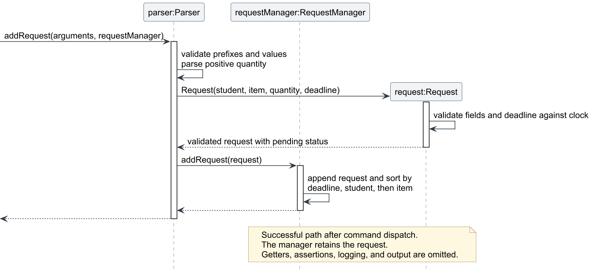

*Figure R1: Successful request addition. Construction validates the request before the manager appends and sorts it.
The manager retains the request after the call returns; routine getters, assertions, logging, and output are omitted.*

Editable source: [request addition sequence](diagrams/request-add-sequence.puml).

Addition succeeds even if no Wire exists. A request can be recorded while stock is short, but fulfillment checks the
total before changing anything. `getTotalAvailableQuantity` matches the complete item name ignoring case across all
categories, accumulates using a `long`, and caps the displayed total at `Integer.MAX_VALUE`. Each request is checked
independently; two requests may both show sufficient stock for the same units, and the first fulfilled request consumes
the stock that the second one needs.

#### 4.7.4. Detailed request fulfillment design

`mark-r INDEX fulfilled` is the only request command that changes inventory. `prepared` is a status-only change.

1. `Parser` validates the index and status, normalizes the status, and passes the shared inventory to
   `RequestManager#markRequest`.
2. `RequestManager` retrieves the request and rejects an already fulfilled request with `RequestException`.
3. For `fulfilled`, the manager calls `Inventory#deductTotalAvailableQuantity(name, quantity)`. Inventory checks the
   total before mutation and throws `InsufficientStockException` when the requested quantity is too large.
4. If stock is sufficient, inventory deducts from categories in display order, removing empty items and categories as
   needed.
5. Only after deduction succeeds, the request status becomes `fulfilled` and the manager prints the confirmation.

Because a request does not record a category, deduction uses the same total shown by `list-r`. Two requests can both
appear fulfillable; the first fulfillment consumes stock and the second is rejected if the remainder is insufficient.
An insufficient or already-fulfilled attempt leaves both status and inventory unchanged. Fulfillment is final:
`delete-r` removes the request but does not restore stock, and there is no unfulfill command.

`Request#markAs` is package-private and independently rejects transitions from fulfilled, including through
a retained request reference. Package-level application callers must still use `RequestManager#markRequest`
to coordinate status changes with stock deduction; changing model status alone does not perform a handover.
The manager retains its index-specific error message for rejected command operations.

Listings show live availability for every request, but shortage warnings apply only to pending or prepared requests.
A fulfilled request has already received its stock, so a lower current inventory does not imply an incomplete handover.

#### 4.7.5. Validation and failure behavior

| Boundary | Rule and result |
| --- | --- |
| Prefix parsing | Missing, repeated, reordered, or extra prefixes cause `CommandFormatException`. Prefix-like standalone tokens inside names are also interpreted as prefixes. |
| Quantity parsing | Blank, non-integer, zero, negative, and values above `Integer.MAX_VALUE` cause `InvalidQuantityException`. There is no default quantity for requests. |
| Request construction | Null or blank names cause `CommandFormatException`; nonpositive quantities cause `InvalidQuantityException`. Null, blank, malformed, or past deadlines cause `InvalidRequestDeadlineException`. |
| Date boundary | Impossible calendar dates are rejected by strict parsing. Today is accepted. The public constructor uses the system's default time zone; a package-private constructor accepts a `Clock` for repeatable tests. |
| Manager insertion | A null request causes `NullPointerException` before the list is modified. Duplicate requests are accepted. |
| Fulfillment | The request must not already be fulfilled, and total available stock must cover its quantity. Insufficient stock causes `InsufficientStockException`; a repeated or reversed fulfillment causes `RequestException`. Both leave status and inventory unchanged. |

The parser finishes construction before calling the manager. Invalid command values therefore leave the request
list unchanged. Fulfillment checks stock before any deduction, so a rejected handover leaves inventory unchanged too.
These guarantees cover expected validation failures, rather than recovery from unexpected runtime failures or process
termination. Assertions detect programming errors and do not replace input validation. Creation, rejection, and status
changes emit `FINE` diagnostics without changing normal console output.

#### 4.7.6. Design considerations and alternatives

| Decision | Rationale and trade-off |
| --- | --- |
| Sort an `ArrayList` on addition | Keeps displayed and stored indices aligned for listing, deletion, and marking. Sorting on display would require translating displayed positions; a priority queue would not directly support indexed commands. |
| Allow duplicate requests | Preserves separately recorded requirements. Merging by student and item could combine requests with different quantities or deadlines unintentionally. |
| Read availability on listing | Reflects inventory changes without maintaining a cached stock count. Adding a request does not reserve stock, so requests can be recorded before stock arrives. |
| Deduct on fulfillment across categories | Uses the same total that `list-r` displays. Requiring a category would break the documented request format. Deducting in display order keeps the result deterministic. |
| Make fulfillment final | Reversing fulfillment would require restoring stock and deciding which category receives it. Rejecting the change keeps status and stock consistent. |
| Inject a clock for model tests | Tests can verify deadlines due today and in the past without depending on the wall clock. The normal command path still uses the local calendar date. |

#### 4.7.7. Verification and limitations

`RequestTest` covers trimmed fields, invalid quantities and dates, clock-based deadline boundaries, initial status,
comparison ordering, and status changes. `RequestManagerTest` covers sorting, tie-breakers, null input, indices,
availability display, fulfillment deductions, insufficient stock, and one-way status changes. `ParserRequestTest`
covers command formats, rejected inputs, confirmations, ordering, live stock checks, and failed fulfillment.
`RequestLoggingTest` verifies request diagnostics; the [UI test plan](https://github.com/AY2627S1-CS2113-T11-3/tp/blob/master/test/ui-test-plan.md) records console cases.

Requests persist across application restarts. They have no persistent identifiers: adding or deleting a request can change the
indices used by `delete-r` and `mark-r`, so users must refresh `list-r`. Requests cannot be edited in place and are
not removed automatically after their deadline. Marking prepared records status only. Marking fulfilled deducts stock
and is final; deleting a fulfilled request does not restore stock, and there is no unfulfill command. Fulfillment also
does not create a loan; use the loan command instead when the handover is a loan.

### 4.8. Broken-item tracking

`add-b`, `list-b`, and `delete-b` track damaged units separately from usable inventory. Recording damage deducts
usable stock; deleting a fully repaired or incorrectly recorded report restores its entire quantity. This is a
stock-changing operation, not a general-purpose record deletion. See the [User Guide](UserGuide.md#broken-item-tracking)
for command syntax and user-facing messages.

#### 4.8.1. Responsibilities and relationships

`Bob` creates one `BrokenItemManager` with the same `Inventory` and `ContactManager` used by other features, and
passes it to `Parser`. `BrokenItem` validates and stores report details; `BrokenItemManager` coordinates reports
and stock; `Inventory` validates and performs quantity changes; `Ui` displays the returned results.

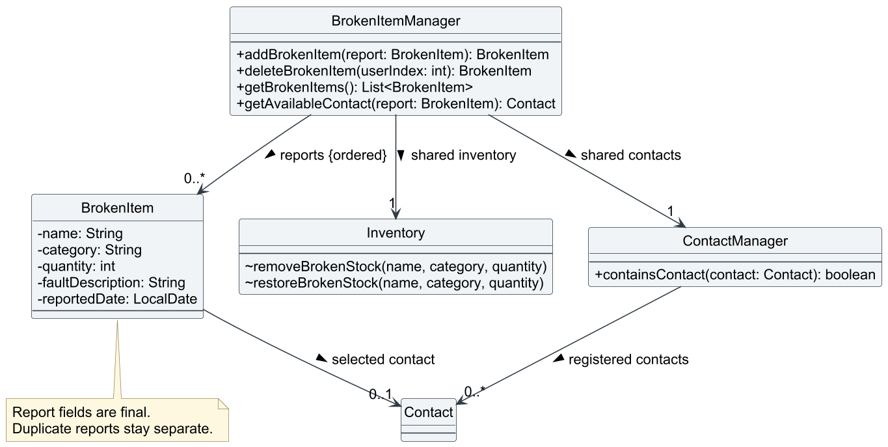

*Figure 10: Selected broken-item relationships. The manager stores reports in insertion order and shares inventory
and contacts with the application. A report may retain a reference to a contact that has since been deleted.*

| Operation | Implementation and state change |
| --- | --- |
| Add | `Parser` resolves the optional contact and constructs a validated `BrokenItem`. `BrokenItemManager#addBrokenItem` checks contact membership, calls `Inventory#removeBrokenStock`, then appends the report. |
| List | `getBrokenItems()` returns an unmodifiable snapshot. `Ui#showBrokenItems` displays one-based positions and resolves each contact through `getAvailableContact()`. No stock changes. |
| Delete | `deleteBrokenItem(index)` validates the position, calls `Inventory#restoreBrokenStock`, then removes the report. Remaining positions shift. |
| Count contact use | `countReportsUsing(contact)` returns how many reports hold that exact `Contact` object, compared by identity, so a contact with identical details is not counted. It is read-only and also counts reports whose contact has since been removed from the contact list. A null contact is rejected. |

#### 4.8.2. Example and stock consistency

Assume five Multimeters in Equipment and no existing reports. Reporting two broken units leaves three usable
units and one report for two units. `list-b` changes neither quantity. After both units are repaired,
`delete-b 1` restores usable stock to five and removes the report. Reports for the same item remain separate,
so deleting one restores only that report's quantity.

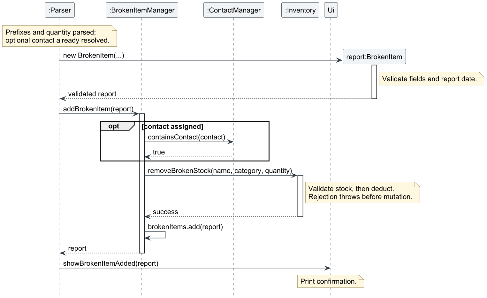

*Figure 11: Successful `add-b` after argument parsing and optional contact resolution. Report construction validates
details before stock changes; the manager appends the report only after stock deduction succeeds. Routine getters,
assertions, and logging are omitted.*

For deletion, the order is deliberately reversed: restore stock first, then remove the report. If restoration
would exceed `Integer.MAX_VALUE`, an exception leaves both stock and the report unchanged. Missing stock entries
or categories are recreated on successful restoration. These guarantees cover expected validation failures in
the single-threaded application; they are not database transactions or recovery from process failure.

Preparation and request availability read the shared inventory, so they reflect deductions and restorations
without updating a second stock total. Loans also use this inventory. Damaged units returned from a loan must
first be returned through the loan workflow, then reported with `add-b`; the two commands are not atomic.
`find-i` currently combines usable inventory and active loans only. It does not include broken quantities, and
an item with all units broken and none on loan may be absent from its results.

#### 4.8.3. Validation and contact handling

- `Parser` requires prefixes in order (`n/ c/ q/ f/ d/`, optionally `m/`), nonempty values, and valid integers.
  `list-b` rejects arguments; `delete-b` requires one positive index within the current report list.
- `BrokenItem` strips surrounding whitespace, rejects blank fields and nonpositive quantities, and parses
  English dates strictly using `d MMMM uuuu`. Report dates may be today or earlier. An injected `Clock`
  supports deterministic date tests.
- The manager checks an assigned contact is still registered before deduction. Inventory matches item name
  and category ignoring case and rejects missing or insufficient stock before changing quantities.
- A report stores the selected `Contact` object. Membership uses identity, so renumbering contacts cannot
  redirect a report, and adding identical contact details does not revive a deleted link. Listing distinguishes
  `Not assigned` from `Unavailable (contact deleted)`; a deleted contact does not prevent stock restoration.
- Expected failures use the `CommandException` hierarchy, including `BrokenItemException` and
  `InvalidBrokenItemIndexException`. `Parser` prints their messages. Assertions check internal report validity
  and exact stock changes; FINE logging records diagnostics without adding normal console output.

#### 4.8.4. Design choices and limitations

**Separate reports rather than a broken flag on inventory items.** A report preserves its quantity, fault,
reported date, and optional contact even if deduction removes the last usable inventory entry. A single flag
would not represent multiple faults or batches with different contacts.

**Store a contact reference rather than its displayed index.** This prevents accidental reassignment after
deletion or renumbering. Each complete snapshot preserves object identity using active contact positions
or separate deleted-contact details. Durable contact IDs would support future cross-file imports.

Reports cannot be edited, partially repaired, disposed of, or reassigned to another contact. Deletion restores
all units and keeps no repair history. Reports persist across restarts without repeating stock deductions. Concurrent
commands would require coordinated storage of reports and inventory changes.

#### 4.8.5. Verification and diagram sources

`BrokenItemTest` covers field validation and fixed-clock date boundaries. `BrokenItemManagerTest` covers exact
stock changes, invalid indices, missing stock, restoration overflow, contact deletion, snapshots, interaction
with loans, and `countReportsUsing`. `ParserBrokenItemTest` covers command syntax, unavailable dependencies, stock
visibility across features, and `delete-c` with and without `-force`. `ParserHelpTest` and the console regression fixture check the advertised commands.

**Boundary value analysis for the contact-deletion safeguard.** The tests for `countReportsUsing` and `delete-c`
were chosen by boundary value analysis, so each boundary has a test:

| Input | Boundary values | Test |
| --- | --- | --- |
| Reports using the contact (`countReportsUsing`) | 0, 1, 2 | `countReportsUsing_noReports_returnsZero`, `_oneReportUsesContact_returnsOne`, `_twoReportsUseContact_returnsTwo` |
| Other reports in the list | only other contacts or unassigned; mixed | `_onlyOtherContactsOrUnassigned_returnsZero`, `_mixedReports_countsOnlyTheQueriedContact` |
| Contact identity | same details but a different object | `_sameDetailsDifferentObject_notCounted` |
| Report count over time | 2, then 1, then 0 | `_afterReportsDeleted_fallsBackThroughOneToZero` |
| Contact registration | removed from the contact list | `_contactNoLongerRegistered_stillCountsItsReports` |
| Argument | null | `_nullContact_rejectsWithoutMutation` |

| Input to `delete-c` | Boundary values | Test (`ParserBrokenItemTest`) |
| --- | --- | --- |
| Number of tokens | 0, 1, 2, 3 | `deleteContact_tokenCountOutsideOneOrTwo_showsUsageAndKeepsContact`, plus the cases below for 1 and 2 |
| Reports using the contact | 0, 1, 2 | `_reportWithoutContact_deletesWithoutForce`, `_oneReportUsesContact_warnsInSingular…`, `_twoReportsUseContact_warnsInPlural…` |
| Index | 0, -1, last, last + 1, overflow, non-number, empty list | `_forceWithIndexOutsideBounds_reportsIndexErrorAndKeepsContacts`, `_forceOnEmptyContactList_reportsIndexError` |
| Flag spelling | `-force`; near misses `-forc`, `-forces`, `-FORCE`, `-Force`, `force`, `--force`, `-f`, `-` | `_usedByReportWithForce_removesContactAndKeepsReport`, `_nearMissFlagSpellings_showUsageAndKeepContact` |
| Other contact in use / flag on an unused contact | not the contact being deleted | `_otherContactUsedByReport_deletesWithoutWarning`, `_forceOnUnusedContact_deletesNormally` |
| Broken-item tracking | unavailable | `_reportsUnavailable_deletesWithoutWarning` |
| Re-adding a deleted contact | identical details | `_forcedThenAddedAgainWithSameDetails_reportStaysUnavailable` |

Editable diagram sources: [class diagram](diagrams/broken-item-class.puml) and
[addition sequence](diagrams/broken-item-add-sequence.puml). They reuse `loan-style.puml`; regenerate the PNGs
in `docs/images/` after changing their sources.

### 4.9. Validation and error handling

Validation is performed at the parser and domain boundaries:

- parser validation checks command names, prefix order, missing values, and integer syntax;
- domain constructors validate names, dates, times, quantities, and phone or email formats;
- managers validate indices, conflicts, stock levels, and state transitions; and
- assertions document internal invariants such as positive stored quantities and conflict-free schedules.

The parser catches expected `CommandException` subclasses and prints their messages. It logs unexpected runtime failures
with `java.util.logging` and prints a generic recovery message.

Loan validation uses the existing checked exception hierarchy. Invalid loan dates and malformed loan indices retain
their original parsing causes for debugging while preserving the existing user-facing messages. The loan stock helpers
also validate item names, categories, and positive quantities before modifying inventory, even when called directly.

Loan assertions check valid stored records and the exact inventory quantity and active-list size changes for successful
operations. Stock restoration is checked before installing a closed loan record. Assertions identify internal programming errors;
expected invalid commands are always handled by exceptions. Assertion failures are not caught as recoverable user errors.
Use `java -ea -jar build/libs/bob.jar` for debugging; Gradle tests enable assertions, while normal launch is unchanged.

## 5. Documentation, logging, testing, and DevOps

- [User Guide](UserGuide.md) — user-facing command formats, examples, and limitations.
- [UI test plan](https://github.com/AY2627S1-CS2113-T11-3/tp/blob/master/test/ui-test-plan.md) — command-by-command manual and console test cases.
- [README](https://github.com/AY2627S1-CS2113-T11-3/tp/blob/master/README.md) — setup, Gradle, testing, and Checkstyle instructions.

The project uses Gradle and the Gradle wrapper for reproducible builds. Java code follows the SE-EDU Java coding standard,
and `check` runs compilation, automated tests, and Checkstyle. Changes should be developed on a feature branch and
verified with `check` before review. Local persistence is implemented; release automation is limited to the Gradle
build and the project's CI configuration.

Logging is intended for diagnostics rather than user interaction. `Bob`, `Parser`, `Inventory`, `SessionManager`, and
`LoanManager` log lifecycle events, rejected operations, and unexpected failures at suitable levels.

Loan lifecycle, overdue-list queries, stock changes, and expected rejections use `FINE`, matching inventory diagnostics.
Messages include item/category, quantities, due dates, indices, or active counts as appropriate. They omit borrower
names, phone numbers, and raw commands. Expected loan command errors retain their exception causes in debug records;
unexpected runtime failures are logged once at the existing parser `SEVERE` boundary. Default logging is unchanged.

To inspect loan diagnostics, save this configuration as `build/loan-debug-logging.properties` after building:

```properties
handlers=java.util.logging.ConsoleHandler
.level=INFO
java.util.logging.ConsoleHandler.level=FINE
seedu.bob.LoanManager.level=FINE
seedu.bob.Inventory.level=FINE
seedu.bob.Parser.level=FINE
```

Then launch a debug session with:

```text
java -ea -Djava.util.logging.config.file=build/loan-debug-logging.properties -jar build/libs/bob.jar
```

Normal launches need no logging configuration. Logging tests capture records directly and restore shared logger settings
after each test. The UI regression plan is checked both normally and with assertions enabled.

## Appendix A: Product Scope

### Target users

Bob targets lab technicians or teaching assistants who:

- manage reusable equipment and consumable supplies;
- schedule laboratory sessions at different locations and times; and
- need a quick command-line workflow without a database or graphical interface.

### Value proposition

Bob combines inventory tracking and lookup, session scheduling, preparation checks, supplier contacts, student requests,
loans, and broken-item reports in one lightweight command-line application. It highlights shortages and updates
availability when stock is fulfilled, loaned, returned, reported broken, or restored.

## Appendix B: User Stories

| Priority | As a... | I want to... | So that I can... |
|---|---|---|---|
| High | lab technician | add, remove, and list inventory | know what equipment is available |
| High | lab technician | schedule and delete lab sessions | avoid conflicting bookings |
| High | lab technician | prepare materials for a session | identify shortages before the session |
| High | lab technician | find an item across inventory and active loans | see whether it is available or fully loaned |
| High | lab technician | record and return loans | track borrowed resources and restore stock |
| Medium | lab technician | track student requests and their status | prepare and fulfil requests by their deadlines |
| Medium | lab technician | record and clear broken-item reports | separate damaged units from usable stock |
| Medium | lab technician | save supplier and repair contacts | find relevant people quickly |
| Medium | lab technician | filter overdue loans | follow up on late returns |
| Low | project maintainer | persist data between launches | retain records after restarting Bob |

### Use cases

#### Use case: Prepare a lab session

**Actor:** Lab technician

**Preconditions:** Bob is running and a session has been added.

**Main success scenario:**

1. User adds inventory items.
2. User creates a session with a headcount.
3. User adds required items with `add-p`.
4. System calculates total requirements and compares them with current inventory.
5. User views `list-p` and obtains the preparation checklist.

Use case ends.

**Extensions:**

- **4a.** Required stock exceeds available stock.
  - **4a1.** System marks the item insufficient and displays the shortfall.
  - Use case resumes at step 5.

#### Use case: Record and return a loan

**Actor:** Lab technician

**Preconditions:** The requested item exists in inventory with enough available quantity.

**Main success scenario:**

1. User enters `add-l` with item, quantity, borrower, phone, and due date.
2. System deducts the quantity and creates an active loan.
3. User enters `return INDEX` when the item is returned.
4. System restores the quantity and closes the record as `RETURNED`, retaining it in history.

Use case ends.

**Extensions:**

- **1a.** The item is missing or stock is insufficient.
  - **1a1.** System rejects the command without changing state.
- **3a.** Restoring stock would overflow the integer range.
  - **3a1.** System rejects the return and keeps the loan active.

## Appendix C: Non-Functional Requirements

1. The application should run with JDK 25 on Windows, macOS, and Linux.
2. Read-only, rejected, and unchanged commands must leave saved file contents and modification times unchanged.
   A data-changing command must finish its synchronous save attempt before the next command is processed.
3. Invalid user input must produce a command-specific error and leave model state unchanged. Verify this by
   comparing relevant listings before and after rejection in the UI test plan.
4. Collections exposed for querying should not allow callers to mutate manager state accidentally.
5. Java classes and nontrivial behavior must be documented with Javadoc. Before accepting a Java change,
   the Java 25 Gradle `check` task and the affected feature UI regression cases must pass.
6. Completed snapshots must survive restarting from the same working directory. Multi-user access, encryption,
   unsaved-change recovery, and guarantees against every power or disk failure are outside the storage contract.

## Appendix D: Glossary

- **Inventory item** — A named resource stored under a category with a positive quantity.
- **Session** — A scheduled lab event with a date, location, time range, and headcount.
- **Preparation** — The total material requirement for one session.
- **Request** — A student's requested item and quantity, its deadline, and its pending, prepared, or fulfilled status.
- **Loan** — Immutable details of lent units and a borrower; a `LoanRecord` tracks its active or closed status.
- **Broken-item report** — A record of damaged units that are excluded from usable inventory until the report is deleted.
- **Backlog loan** — A loan added with a due date before today.
- **Overdue** — A loan whose due date is strictly before the current local date.
- **Prefix** — The one-letter marker such as `n/` or `q/` that introduces a command argument.

## Appendix E: Instructions for Manual Testing

These scenarios complement the [User Guide](UserGuide.md) with concrete commands and observable results for
manual acceptance testing. The
[UI test plan](https://github.com/AY2627S1-CS2113-T11-3/tp/blob/master/test/ui-test-plan.md) contains the full command-by-command expected console output and additional
boundary cases. The results below are acceptance expectations, not a record of execution.

### Test setup and isolation

Build once from the repository root using Java 25:

```text
Windows: .\gradlew.bat check shadowJar
macOS/Linux: ./gradlew check shadowJar
```

Use a new, empty directory for each independent scenario. Copy the built JAR into that directory so the launch
command works while Bob keeps its test data separate from the repository and any real records. For example,
from the repository root in PowerShell:

```powershell
$manualJar = (Resolve-Path 'build/libs/bob.jar').Path
$manualDirectory = Join-Path ([System.IO.Path]::GetTempPath()) ('bob-manual-' + [guid]::NewGuid())
New-Item -ItemType Directory -Path $manualDirectory | Out-Null
Copy-Item -LiteralPath $manualJar -Destination (Join-Path $manualDirectory 'bob.jar')
Set-Location -LiteralPath $manualDirectory
java -jar bob.jar
```

On macOS/Linux, from the repository root:

```sh
manual_directory=$(mktemp -d)
cp build/libs/bob.jar "$manual_directory/bob.jar"
cd "$manual_directory"
java -jar bob.jar
```

Alternatively, launch with an absolute path to the built or downloaded JAR from an empty test directory,
for example `java -jar "C:\path\to\bob.jar"` or `java -jar "/path/to/bob.jar"`. Replace the example path.

Enter `Alex` at the name prompt. Keep the same directory across launches within a restart scenario. In the
filesystem scenarios below, use a second terminal opened in that test directory. All fixture changes apply only
to that directory. Close Bob before modifying an existing snapshot, except for the explicitly described
failed-save fixture. The date examples assume the computer's date is between 1 January 2020 and 31 December 2099.
Use appropriately earlier report dates or later future dates if necessary.

### Launch and shutdown

1. Launch with `java -jar bob.jar`. Verify that the banner and name prompt appear.
2. Enter `Alex`. Verify that the greeting names Alex and a divider appears.
3. Enter `help`. Verify that inventory, sessions, preparations, contacts, requests, loans, and broken-item commands appear.
4. Enter `help extra`. Verify a format error and that Bob continues accepting commands.
5. Enter `Bye`. Verify a clean exit without a farewell message. In a new scenario, repeat with `bye` or `BYE`.

### Inventory, scheduling, and preparation

Start empty and enter these commands in order:

| Command | Expected result |
| --- | --- |
| `add-i n/Wire c/Components q/15` | Creates 15 available Wire in Components. |
| `add-i n/Wire c/Components q/1` | Rejects a duplicate; stock stays 15. |
| `add-i n/Tape c/Consumables q/0` | Rejects a nonpositive quantity; Tape is absent. |
| `add-s n/Practice Lab d/31 December 2099 l/Room-A s/0900 e/1000 p/10` | Creates one session for 10 attendees. |
| `add-s n/Circuit Lab d/31 December 2099 l/room-a s/0930 e/1030 p/5` | Rejects the overlapping session; only Practice Lab remains. |
| `add-p s/1 i/Wire c/Components q/2` | Creates a total requirement of 20 Wire. |
| `list-p s/1` | Shows 20 required, 15 available, and a shortage of 5. |
| `delete-p s/1 i/1 q/20` | Removes the requirement without changing available stock. |
| `list-i` | Still shows 15 Wire. |

### Partial preparation changes and session deletion

In another empty scenario, add 15 Wire and create Practice Lab with the same inventory, session, and preparation
commands above. The initial requirement is 20 Wire for 10 attendees. Then enter:

| Command | Expected result |
| --- | --- |
| `delete-p s/1 i/1 q/5` | Reduces the requirement to 15 without changing the 15 available Wire. |
| `list-p s/1` | Shows 15 required and 15 available, with no shortage. |
| `delete-i c/Components i/1 q/1` | Leaves 14 available Wire. |
| `list-p s/1` | Shows a shortfall of one. |
| `delete-s 1` | Removes Practice Lab and its preparation. |
| `list-s` | Shows no sessions. |
| `list-p s/1` | Rejects the missing session. |
| `delete-i c/Components i/1 q/14` | Removes the remaining stock. |
| `list-i` | Shows no inventory. |

### Finding inventory items

Start empty and enter these commands in order:

| Command | Expected result |
| --- | --- |
| `add-i n/Wire c/Components q/5` | Creates five Wire. |
| `add-i n/Jumper Wire c/Spares q/3` | Creates three Jumper Wire. |
| `find-i WIRE` | Matches both entries despite capitalization. |
| `find-i components` | Matches Wire in Components only. |
| `add-l n/Wire c/Components q/5 b/Alex Tan t/91234567 d/31 December 2099` | Creates an active loan and deducts all five available Wire. |
| `find-i wire` | Still includes Wire with zero available, five on loan, and `All on loan`; Jumper Wire remains available. |
| `find-i missing` | Reports no matches. |
| `find-i` | Rejects the missing keyword; inventory and loans stay unchanged. |

Search-result numbers must not be used as inventory or loan action indices.

### Student requests

Start empty and enter these commands in order:

| Command | Expected result |
| --- | --- |
| `add-i n/Wire c/Components q/15` | Creates 15 available Wire. |
| `add-r n/Alice i/Wire q/20 d/31 December 2099` | Creates a Pending request for 20 Wire. |
| `list-r` | Shows 15 available and a shortfall of 5. |
| `mark-r 1 prepared` | Changes the status to Prepared without deducting stock. |
| `mark-r 1 fulfilled` | Rejects insufficient stock; the request stays Prepared and stock stays 15. |
| `add-i n/Wire c/Spares q/5` | Adds five Wire under a different category. |
| `mark-r 1 fulfilled` | Changes the request to Fulfilled and deducts all 20 Wire across both categories. |
| `mark-r 1 fulfilled` | Rejects repeated fulfillment without deducting stock again. |
| `mark-r 1 prepared` | Rejects changing a fulfilled request. |
| `delete-r 1` | Removes the request without restoring stock. |
| `list-i` | Shows no remaining inventory. |

In a separate scenario, add requests with different deadlines. Verify deadline ordering and renumbering after
deletion. Malformed or past deadlines, blank names, bad quantities, invalid indices, and unsupported statuses
must leave the request list and inventory unchanged.

### Broken-item tracking and contacts

Start empty and enter these commands in order:

| Command | Expected result |
| --- | --- |
| `add-i n/Meter c/Equipment q/10` | Creates ten usable Meters. |
| `add-c n/Lab Maintenance t/61234567` | Creates contact 1. |
| `add-b n/Meter c/Equipment q/2 f/Cracked screen d/1 January 2020 m/1` | Creates one report and deducts two usable units. |
| `list-b` | Shows the fault, date, quantity two, and Lab Maintenance contact. |
| `find-i meter` | Shows eight available units; the broken units are excluded. |
| `delete-c 1` | Removes the contact without removing the report. |
| `list-b` | Shows `Unavailable (contact deleted)` for the report's contact. |
| `delete-b 1` | Removes the whole report and restores both units. |
| `list-i` | Shows ten usable Meters again. |
| `delete-b 1` | Rejects the now-invalid index; stock stays ten. |

Deleting a broken-item report represents full repair or correction, rather than partial repair or disposal.

### Loan lifecycle and history

Start empty and enter these commands in order:

| Command | Expected result |
| --- | --- |
| `add-i n/Wire c/Components q/5` | Creates five available Wire. |
| `add-l n/Wire c/Components q/2 b/Alex Tan t/91234567 d/1 January 2020` | Creates loan ID 1, warns that its due date is past, and leaves three available Wire. |
| `list-l overdue` | Shows the loan as overdue at active index 1. |
| `return 1` | Restores stock to five and closes loan ID 1 as RETURNED. |
| `return 1` | Rejects the index; does not restore stock twice. |
| `list-l returned` | Shows loan ID 1 with RETURNED status. |
| `add-l n/Wire c/Components q/1 b/Bea Tan t/92345678 d/31 December 2099` | Creates loan ID 2 at active index 1 and leaves four available Wire. |
| `delete-l 1` | Restores stock to five and closes loan ID 2 as VOIDED. |
| `list-l history` | Retains IDs 1 and 2 with RETURNED and VOIDED statuses respectively. |
| `list-l` | Shows no active loans. |

For a restoration-overflow boundary case, start another empty scenario:

| Command | Expected result |
| --- | --- |
| `add-i n/Wire c/Components q/1` | Creates one Wire. |
| `add-l n/Wire c/Components q/1 b/Alex Tan t/91234567 d/31 December 2099` | Loans the only unit, removing the depleted stock entry. |
| `add-i n/Wire c/Components q/2147483647` | Creates a replacement stock entry at the maximum integer quantity. |
| `return 1` | Rejects restoration overflow. |
| `list-l` | Still shows the active loan. |
| `list-i` | Still shows 2147483647 available Wire. |

### Contacts and filtered active-loan indices

In a fresh scenario, enter:

```text
add-c n/Lab Maintenance t/61234567
add-c n/Component Supplier t/91234567 e/supplier@example.com r/Wires
list-c
delete-c 1
list-c
add-i n/Multimeter c/Equipment q/5
add-l n/Multimeter c/Equipment q/2 b/Alex Tan t/91234567 d/31 December 2099
add-l n/Multimeter c/Equipment q/1 b/Sam Lee t/92345678 d/1 January 2000
list-i
list-l
list-l overdue
return 1
list-l
delete-l 1
list-i
list-l
list-l history
list-l returned
```

Contacts are renumbered after deletion. Creating loans does not create supplier contacts. Stock falls to two.
The second loan produces an overdue warning and is row `2.` in the overdue filter. Returning the first loan
restores two units and renumbers the remaining active loan to 1. Correcting that remaining loan restores one
more unit, leaving five in stock and no active loans. History retains loan ID 1 as `RETURNED` and ID 2 as `VOIDED`;
the returned-only view contains ID 1 alone. Verify that listing either view does not restore stock again.
Test invalid phones/dates/indices, insufficient stock, unsupported filters, extra return arguments, and a restoration
that would exceed 2,147,483,647; rejected operations must preserve the active loan and stock.

### Saving and restarting

Start empty and enter these commands in order:

| Command | Expected result |
| --- | --- |
| `add-i n/Wire c/Components q/10` | Creates `data/bob.json` containing ten available Wire. |
| `add-r n/Alice i/Wire q/3 d/31 December 2099` | Creates one Pending request without deducting stock. |
| `mark-r 1 fulfilled` | Saves the Fulfilled request and seven available Wire. |
| `add-l n/Wire c/Components q/2 b/Alex Tan t/91234567 d/31 December 2099` | Saves five available Wire and active loan ID 1. |
| `Bye` | Exits cleanly. |

Launch `java -jar bob.jar` again from the same directory and enter `Alex`:

| Command | Expected result |
| --- | --- |
| `list-i` | Shows five available Wire; loading has not deducted stock again. |
| `list-r` | Retains the Fulfilled request. |
| `list-l` | Shows the saved active loan at index 1. |
| `list-l history` | Shows that loan with permanent ID 1. |
| `return 1` | Restores stock to seven and saves the RETURNED record. |
| `Bye` | Exits cleanly. |

Launch once more. `list-i` must show seven Wire, `list-r` must retain the Fulfilled request, `list-l` must be empty,
and `list-l history` and `list-l returned` must retain loan ID 1 as RETURNED. To check read-only saving behavior,
record the main file's modification time and contents, run `list-i` and `help`, and verify both remain unchanged.
The detailed `UI-PERSIST-*` and `UI-HISTORY-*` cases cover other record types and version-1 migration.

### Recovering from a backup

1. In an empty scenario, run `add-i n/Wire c/Components q/5`, then
   `add-i n/Tape c/Consumables q/2`, then `Bye`.
2. Verify that both `data/bob.json` and `data/bob.json.bak` exist. The backup contains the previous state with
   Wire only; the main file additionally contains Tape.
3. With Bob stopped, replace only this scenario's main file contents with `invalid JSON`. Leave the backup intact.
4. Restart from the same directory and enter `Alex`. Verify the message
   `Recovered data from backup. It may not include the latest changes.`
5. Run `list-i`. Verify five Wire and no Tape, matching the older backup rather than an empty dataset.
6. Enter `Bye` to save the recovered state. Restart again and verify five Wire with no recovery warning.

### Unusable saved data and unsupported versions

1. In another disposable scenario directory, create a `data` directory and place `invalid JSON` in both
   `bob.json` and `bob.json.bak`. Launch Bob and verify that startup stops before the name prompt, preserves
   both files, and accepts no commands.
2. For another independent scenario, copy a valid main snapshot and backup from a completed scenario. Change
   only the main snapshot's `schemaVersion` to an unsupported value such as `999`.
3. Verify that startup refuses the unsupported main version even though a valid older backup exists. Both
   files must remain unchanged; Bob must not treat the directory as an empty dataset.

### Failed-save retry and exit choices

1. Start a fresh empty scenario and enter `Alex`. Before any data-changing command, use the second terminal
   to create an ordinary file named `data`, preventing Bob from creating its data directory. In PowerShell,
   use `Set-Content -LiteralPath './data' -Value 'manual-test blocker'`; on macOS/Linux,
   use `printf '%s' 'manual-test blocker' > data`.
2. Run `add-i n/Wire c/Components q/5`. Verify the addition confirmation followed by a warning beginning
   `Warning: changes are only in memory. Could not save to`. No snapshot has been saved.
3. Run `Bye`. Verify `Unsaved changes remain. Enter retry, cancel, or exit:`.
4. Enter `cancel`. Verify `Exit canceled. Unsaved changes remain in memory.`. Run `list-i` and verify five Wire.
5. Remove only the blocker file in the second terminal: PowerShell `Remove-Item -LiteralPath './data'`,
   or macOS/Linux `rm ./data`. Do not create a replacement file.
6. Run `Bye`. Saving must succeed and Bob must exit. Restart from the same directory and verify five Wire.
7. To test the explicit retry choice, repeat in a new scenario, but remove the blocker while the exit-choice
   prompt is displayed, then enter `retry`. Verify successful saving and exit, then restart to confirm five Wire.
8. To test deliberate unsaved exit, repeat in another new scenario and leave the blocker in place. At the
   exit-choice prompt, enter `exit`. Verify `Exiting with unsaved changes.` and a nonzero process exit code
   (`$LASTEXITCODE` in PowerShell or `$?` immediately after Java exits in a POSIX shell). No snapshot is created.

For the additional EOF failure case, use the isolated fixtures in
[`UI-PERSIST-SAVE-FAIL-001` through `004`](https://github.com/AY2627S1-CS2113-T11-3/tp/blob/master/test/ui-test-plan.md#ui-persist-save-fail-001-keep-unsaved-data-visible-and-allow-cancel-or-explicit-exit).
When input ends while saving still fails, Bob must exit with a nonzero code without hanging at a prompt.

### Automated and UI verification

Run `gradlew.bat check` or `./gradlew check` from the repository root for compilation, tests, and Checkstyle.
Run the platform-specific text UI test script for the course-style fixture. For the full UI plan on Windows,
run `powershell -File scripts/run-ui-tests.ps1` from the repository root. The runner compares exact expected output,
stops at the first mismatch, and writes a transcript. Use the [UI test plan](https://github.com/AY2627S1-CS2113-T11-3/tp/blob/master/test/ui-test-plan.md) for additional
malformed-prefix, date, quantity, index, contact, startup-failure, and migration cases.
