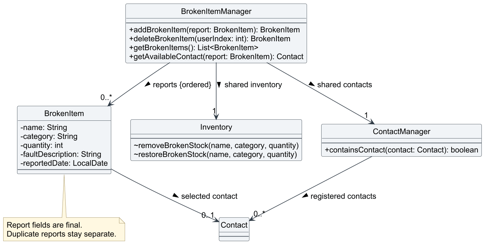
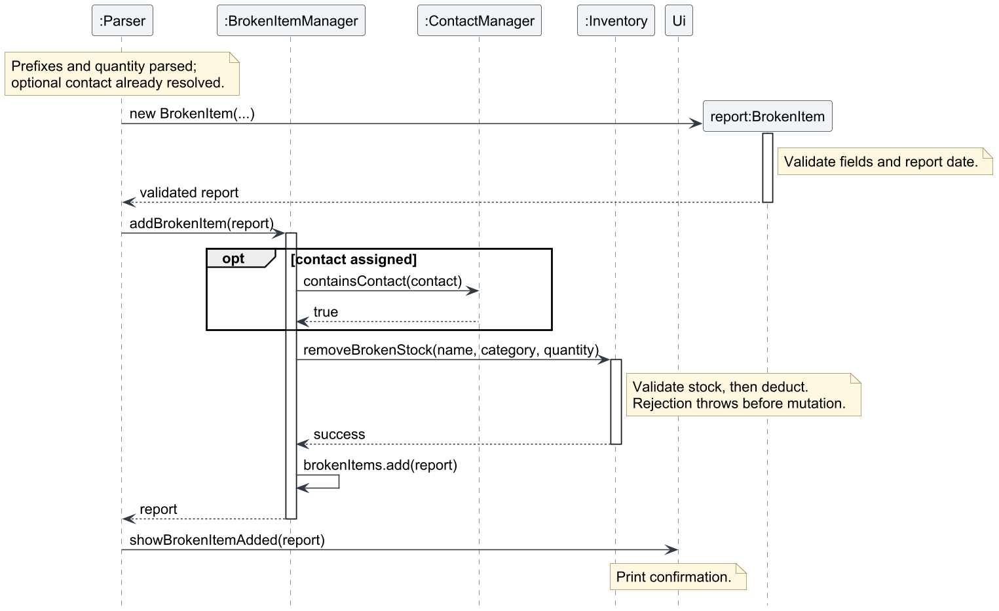

# Gavin Lim — Project Portfolio Page

## Overview

Bob is a Java command-line application that helps university lab technicians manage inventory,
schedule sessions, prepare materials, maintain contacts, and track student requests, equipment
loans, and broken items.

My main contributions were lab session scheduling and broken-item tracking. I also improved
validation, regression testing, documentation, and integration between features.

**GitHub:** [gavinlimsh](https://github.com/gavinlimsh)

**Code contributions:** [RepoSense](https://nus-cs2113-ay2627-s1.github.io/tp-dashboard/?search=gavinlimsh)

## Summary of Contributions

### Lab session scheduling

Implemented the initial `add-s`, `list-s`, and `delete-s` functionality, then improved scheduling
behavior and tests collaboratively with the team.

- **Purpose:** Help technicians maintain a chronological schedule and avoid overlapping sessions
  at the same location.
- **Implementation:** Contributed session creation, listing, retrieval, and deletion, together
  with validation, assertions, and logging.
- **Technical challenge:** Sorting and deletion change displayed indices. Tests verify that
  preparation remains attached to the correct session after renumbering. Conflict tests distinguish
  overlapping sessions from adjacent sessions and sessions at different locations.
- **Testing:** Expanded coverage for invalid names, locations, dates, times, headcounts, and indices.
  Later improvements included null-input validation and deterministic date-boundary tests using
  an injected clock.

Evidence: [initial implementation](https://github.com/AY2627S1-CS2113-T11-3/tp/commit/c635ca5e2de05a4be90a63d715c71e54f0e5befa),
[PR #46](https://github.com/AY2627S1-CS2113-T11-3/tp/pull/46),
[PR #66](https://github.com/AY2627S1-CS2113-T11-3/tp/pull/66).

### Broken-item tracking

Implemented `add-b`, `list-b`, and `delete-b` with item name, category, quantity, fault description,
reported date, and an optional maintenance contact.

- **Purpose:** Separate damaged units from usable stock and retain the details needed to arrange repairs.
- **Stock consistency:** Reporting damage deducts available stock; removing a fully repaired or
  incorrect report restores its entire quantity. Validation failures and restoration overflow
  preserve the affected stock and reports.
- **Technical challenge:** Reports must remain meaningful after stock entries disappear or contacts
  are renumbered. Reports retain their own item details and selected contact identity. Deleting a
  contact makes the link unavailable; an identical replacement does not silently reconnect it.
- **Integration and testing:** Connected parsing, help, console output, inventory, and contacts.
  Added model, manager, and parser tests for malformed commands, date boundaries, insufficient
  stock, overflow, deleted contacts, and interactions with loans.

Evidence: [PR #52](https://github.com/AY2627S1-CS2113-T11-3/tp/pull/52).

### Integration and quality assurance

- Fixed parser compilation and help-output inconsistencies, including lookup-related merge
  errors in [PR #58](https://github.com/AY2627S1-CS2113-T11-3/tp/pull/58).
- Aligned lookup with inventory's case-insensitive matching, including Unicode variants, and added
  regression tests in [PR #66](https://github.com/AY2627S1-CS2113-T11-3/tp/pull/66).
- Strengthened fulfilled-request protection against resets through retained references and
  repeated stock deduction. Added regression tests for insufficient stock and completed-request
  displays in [PR #73](https://github.com/AY2627S1-CS2113-T11-3/tp/pull/73).
- Expanded console regression fixtures and used command-by-command UI checks to compare actual
  output with expected results. These checks help expose integration problems beyond individual
  methods. See the [UI test plan](https://github.com/AY2627S1-CS2113-T11-3/tp/blob/master/test/ui-test-plan.md).
  Teammates subsequently extended the runner for persistence and loan history.

### Documentation

- Expanded the User Guide's [scheduling](../UserGuide.md#lab-session-scheduling) and
  [broken-item](../UserGuide.md#broken-item-tracking) sections with syntax, examples, validation,
  changing-index guidance, stock effects, and recovery instructions.
- Contributed Developer Guide explanations for [scheduling](../DeveloperGuide.md#42-session-scheduling)
  and [broken-item tracking](../DeveloperGuide.md#47-broken-item-tracking), including walkthroughs,
  design alternatives, and class and sequence diagrams.
- Added editable PlantUML sources for the broken-item diagrams in
  [PR #60](https://github.com/AY2627S1-CS2113-T11-3/tp/pull/60).
  The team refined the documentation and UML notation in
  [PR #78](https://github.com/AY2627S1-CS2113-T11-3/tp/pull/78), addressing
  [DG feedback #75](https://github.com/AY2627S1-CS2113-T11-3/tp/issues/75).
  The diagrams below include those refinements.

### Team support and reviews

Reviewed teammates' work and supported integration across features. In the request-tracking review,
I highlighted the risk of users acting on outdated list positions and identified incorrect
RepoSense annotation placement.

Evidence: [index-change feedback](https://github.com/AY2627S1-CS2113-T11-3/tp/pull/45#discussion_r4347338625),
[annotation feedback](https://github.com/AY2627S1-CS2113-T11-3/tp/pull/45#discussion_r4347284658).

<div style="break-before: page; page-break-before: always;"></div>

## Contributions to the User Guide - Selected Extracts

Abridged from my [broken-item instructions](../UserGuide.md#broken-item-tracking).

### Reporting broken items

**Format:**

```text
add-b n/NAME c/CATEGORY q/QUANTITY f/FAULT d/DATE_REPORTED [m/CONTACT_INDEX]
```

Supply prefixes in this order. Only the maintenance contact, `m/`, is optional.
Quantity must be positive and within available stock; the reported date must be today or earlier.

**Do not remove these units using `delete-i` first:** `add-b` already deducts them.
For damaged loan returns, record the full return using `return INDEX`, then report the damaged
quantity with `add-b`. Partial loan returns are unsupported.

Start in a new, empty working directory, enter your name, then run:

```text
add-i n/Meter c/Equipment q/10
add-c n/Lab Maintenance t/61234567
add-b n/Meter c/Equipment q/2 f/Cracked screen d/1 January 2020 m/1
```

This leaves 8 usable Meters and a report for 2 damaged units. Replace the example date with the
actual reported date. Each successful addition deducts stock again, so avoid duplicate reports.
Invalid input or insufficient stock leaves inventory and reports unchanged.

### Viewing reports

Use `list-b` to display reports with one-based indices and maintenance-contact details.
An unassigned contact displays `Contact: Not assigned`; a deleted contact displays
`Contact: Unavailable (contact deleted)`.

### Removing a report

**Format:** `delete-b INDEX`

**Deletion immediately restores every unit in the report.** Use it only after full repair or
to correct an incorrect report, never for disposal or partial repair. There is no confirmation prompt.

Use the current index from `list-b`. In the example, `delete-b 1` restores the 2 Meters,
returning usable stock to 10.

<div style="break-before: page; page-break-before: always;"></div>

## Contributions to the Developer Guide - Selected Extracts

The following selections are abridged from my scheduling and broken-item documentation.
They include team refinements; persistence and loan-history implementation were contributed
by teammates. An additional design comparison is explicitly identified below.

### Scheduling: keeping preparation attached to its session

Source: [Session scheduling](../DeveloperGuide.md#42-session-scheduling).

Each `Session` owns its `Preparation` object. Sorting moves session references without changing
their preparation. Deleting another session therefore cannot transfer requirements to the wrong
session. This couples preparation's lifecycle to its session.

**Additional design comparison for this portfolio:** A separate map keyed by stable session IDs
would also survive renumbering. However, it would require identifier management and cleanup when
sessions are deleted. Session-owned preparation gives direct access with fewer coordination steps.
A separate map becomes more useful if preparation needs an independent lifecycle.

The schedule uses an `ArrayList`, sorted after successful additions. Stored and displayed positions
remain consistent. Scanning for conflicts and sorting after insertion are sufficient for the
application's small schedules.

### Broken-item tracking: responsibilities and relationships

Source: [Broken-item tracking](../DeveloperGuide.md#47-broken-item-tracking).

`BrokenItem` validates and stores report details. `BrokenItemManager` coordinates reports using
the application's shared `Inventory` and `ContactManager`. `Inventory` validates and performs
quantity changes, while `Ui` displays the returned results.

<figure style="margin: 1em 0; break-inside: avoid; page-break-inside: avoid;">
  
  <figcaption style="margin-top: 0.5em; font-style: italic;">
    Figure 1: The manager stores reports in insertion order and shares inventory
    and contacts with the application. A report can retain a reference to a
    contact that has since been deleted.
  </figcaption>
</figure>

### Stock consistency and operation ordering

Assume five Multimeters in Equipment and no existing reports. Reporting two broken units leaves
three usable units and one report for two units. Listing changes neither quantity. After both
units are repaired, `delete-b 1` restores usable stock to five and removes the report.

Reports for the same item remain separate: deleting one restores only that report's quantity.

<figure style="margin: 1em 0; break-inside: avoid; page-break-inside: avoid;">
  
  <figcaption style="margin-top: 0.5em; font-style: italic;">
    Figure 2: Successful add-b after argument parsing and optional contact
    resolution. Report validation precedes stock deduction; the report is
    appended only after deduction succeeds. Routine getters, assertions,
    and logging are omitted.
  </figcaption>
</figure>

For deletion, restore stock first, then remove the report. If restoration would exceed
`Integer.MAX_VALUE`, an exception leaves both stock and the report unchanged. Missing stock
entries or categories are recreated on successful restoration.

These guarantees cover expected validation failures in the single-threaded application;
they are not database transactions or recovery from process failure.

Preparation and request availability read the shared inventory, so they reflect stock changes
without maintaining another total. Loans use this inventory too. Damaged loan returns require
two operations: return the loan, then report the damaged units. These commands are not atomic.

### Design choices and contact identity

**Separate reports rather than a broken flag on inventory items.** Each report preserves its
quantity, fault, reported date, and optional contact even when deduction removes the last usable
inventory entry. A single flag cannot represent multiple faults or batches with different contacts.

**Store a contact reference rather than its displayed index.** Identity-based membership checks
prevent contact renumbering from redirecting reports. Adding identical contact details does not
revive a deleted link. Listing distinguishes unassigned contacts from deleted contacts;
neither situation prevents stock restoration.

Reports cannot be edited, partially repaired, disposed of, or reassigned to another contact.
Deletion restores all units and keeps no repair history. These limitations distinguish report
removal from disposal or maintenance-history tracking.

### Verification

- `BrokenItemTest`: field validation and fixed-clock date boundaries.
- `BrokenItemManagerTest`: stock changes, invalid indices, missing stock, restoration overflow,
  contact deletion, snapshots, and interaction with loans.
- `ParserBrokenItemTest`: command syntax, unavailable dependencies, and stock visibility across
  features.
- Help tests and the console regression fixture: consistency of advertised commands and output.

Diagram sources:
[class diagram](https://github.com/AY2627S1-CS2113-T11-3/tp/blob/master/docs/diagrams/broken-item-class.puml)
and
[addition sequence](https://github.com/AY2627S1-CS2113-T11-3/tp/blob/master/docs/diagrams/broken-item-add-sequence.puml).