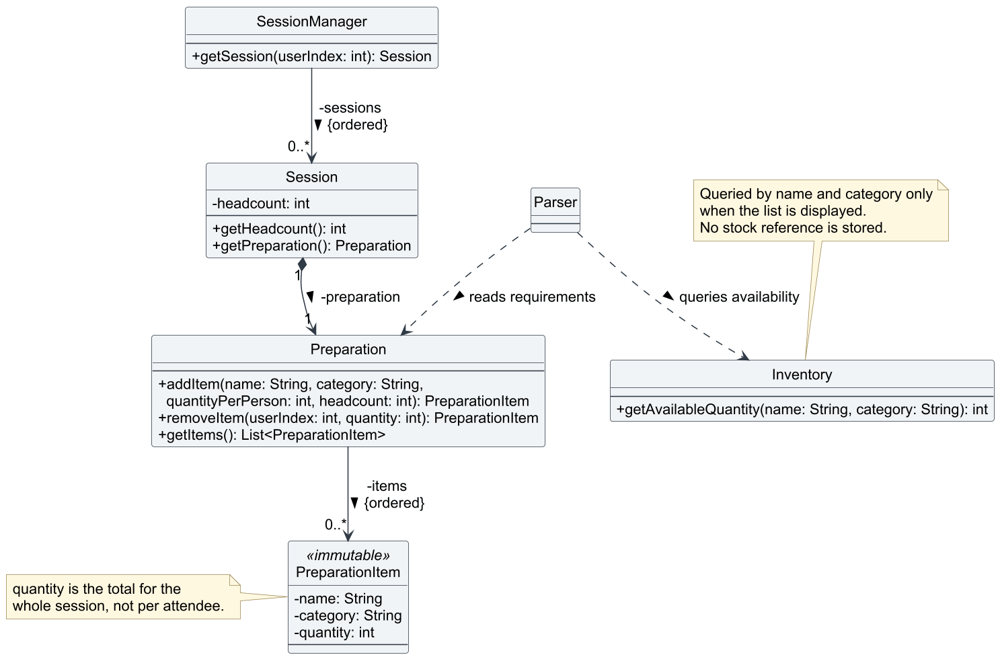
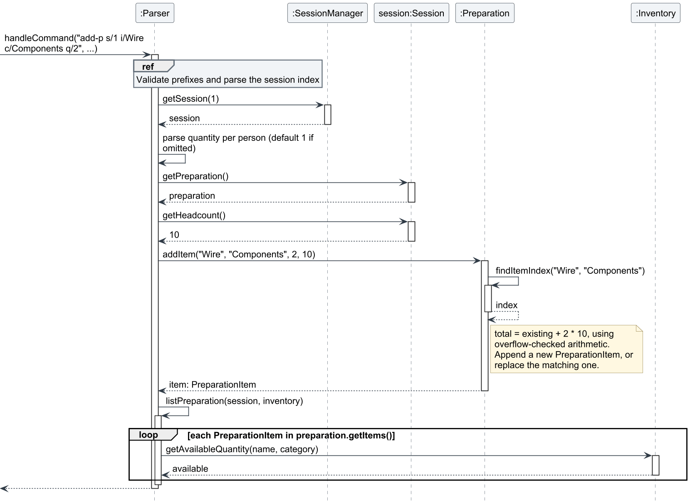

# Tan Yu Jun - Project Portfolio Page

## Overview

Bob is a Java command-line application that helps university lab technicians manage inventory, schedule lab sessions,
prepare materials, maintain contacts, and track student requests, equipment loans, and broken items. My main
contributions are session preparation and quick item lookup across available stock and active loans. I also contributed
automated console regression testing, user and developer documentation, and project test plans.

GitHub: [J-unn-y](https://github.com/J-unn-y)

## Summary of Contributions

- **Code contributed:** [GitHub repository](https://github.com/J-unn-y/tp) and
  [tP Code Dashboard](https://nus-cs2113-ay2627-s1.github.io/tp-dashboard/?search=j-unn-y&sort=groupTitle&sortWithin=title&timeframe=commit&mergegroup=&groupSelect=groupByRepos&breakdown=true&checkedFileTypes=docs~functional-code~test-code~other).

- **Session preparation:** Implemented `add-p`, `delete-p`, and `list-p`. A requirement entered per attendee is
  multiplied by the session headcount, merged with repeated requirements for the same item and category, and compared
  against live inventory. Shortages are shown immediately so technicians can arrange missing materials before a lab.
  Each `Session` owns its `Preparation`, keeping requirements attached when sessions are sorted or deleted. Preparation
  reads but does not reserve stock, so inventory and loan changes appear on the next listing without duplicate state.
  Overflow-safe calculations and validation reject an invalid change before stored requirements are modified.
  - [Implementation, tests, and user guidance](https://github.com/AY2627S1-CS2113-T11-3/tp/commit/8631c3182ca0fbddcb85d5dbd1b621fa6f97cdf8)
  - [Merged as PR #16](https://github.com/AY2627S1-CS2113-T11-3/tp/pull/16)

- **Quick item lookup:** Implemented `find-i KEYWORD`, which finds partial, case-insensitive matches in item names and
  categories. Results combine available stock and active loans and distinguish available items from items that are
  entirely on loan. This prevents a fully loaned item from appearing to be absent. Lookup uses read-only snapshots and
  is separated into `ItemFinder`, so searching cannot change inventory or loans and the matching logic can be tested
  independently.
  - [Combine inventory and loan snapshots for search](https://github.com/AY2627S1-CS2113-T11-3/tp/commit/2519a2f2b63567340c5a18b2172970763632ff61)
  - [Add the command flow and tests](https://github.com/AY2627S1-CS2113-T11-3/tp/commit/75b256255413d34a69b509e9840cf038dd9cc72a)
  - [Document the feature](https://github.com/AY2627S1-CS2113-T11-3/tp/commit/1f41f1caa9201ac64c0cd4d1b326c52f690b7f41)
  - [Implemented for issue #40](https://github.com/AY2627S1-CS2113-T11-3/tp/issues/40)

- **Enhancements implemented:** Corrected the session date validation message to show the required `yyyy` year format.
  Added RepoSense author tags for preparation code so contribution attribution is accurate.
  - [Add preparation author tags](https://github.com/AY2627S1-CS2113-T11-3/tp/commit/ac9709b17f47634e427ebd8edb5019f7aa2a6e72)

- **Testing and verification:** Added unit and parser coverage for preparation totals, merging, removal, invalid input,
  overflow, live stock changes, and shortages. Added 16 focused tests for item lookup. Automated the console regression
  test in CI on Windows, macOS, and Linux, and wrote manual console test plans used before releases.
  - [Automate console regression tests in CI](https://github.com/AY2627S1-CS2113-T11-3/tp/commit/efdeb3aa88ae5623d9c4deb000dbedceb717ebba)
  - [Merged as PR #29](https://github.com/AY2627S1-CS2113-T11-3/tp/pull/29)
  - [Team UI test plan](../../test/ui-test-plan.md)

- **Contributions to the User Guide:** Wrote the lab session preparation, inventory management, and `find-i` sections.
  Wrote most of Quick start and Command format, and contributed to scheduling, troubleshooting, FAQ, limitations, and
  the command summary.
  - [Session preparation instructions](../UserGuide.md#lab-session-preparation)
  - [Inventory management and item lookup](../UserGuide.md#inventory-management)

- **Contributions to the Developer Guide:** Wrote the session preparation design, including class responsibilities,
  key operations, a worked example, validation, alternatives, tests, and limitations. Created the preparation class
  diagram and `add-p` sequence diagram with editable PlantUML sources.
  - [Add the preparation class diagram](https://github.com/AY2627S1-CS2113-T11-3/tp/commit/f6d8d1fd8c03c7131764f3f4c69352d0fa5c5af5)
  - [Add the implementation walkthrough](https://github.com/AY2627S1-CS2113-T11-3/tp/commit/e323a70184280c26e6c424347c0b36a8429de075)
  - [Document design alternatives](https://github.com/AY2627S1-CS2113-T11-3/tp/commit/e40b383232cea7cbe55e3c82a4e1ada01b604a65)
  - [Session preparation design](../DeveloperGuide.md#43-session-preparation)

- **Team tasks and reviews:** Recorded user stories and tasks in the issue tracker and reviewed teammates' PRs
  [#25](https://github.com/AY2627S1-CS2113-T11-3/tp/pull/25),
  [#30](https://github.com/AY2627S1-CS2113-T11-3/tp/pull/30), and
  [#52](https://github.com/AY2627S1-CS2113-T11-3/tp/pull/52).
  - [Preparation user story #27](https://github.com/AY2627S1-CS2113-T11-3/tp/issues/27)
  - [Preparation task #28](https://github.com/AY2627S1-CS2113-T11-3/tp/issues/28)
  - [Developer Guide task #53](https://github.com/AY2627S1-CS2113-T11-3/tp/issues/53)
  - [RepoSense attribution task #54](https://github.com/AY2627S1-CS2113-T11-3/tp/issues/54)

<div style="break-before: page; page-break-before: always;"></div>

## Contributions to the User Guide - Selected Extracts

Abridged from my [session preparation](../UserGuide.md#lab-session-preparation) and
[item lookup](../UserGuide.md#find-an-item-find-i) instructions. These extracts describe the merged implementation.

### Preparing materials for a session

**Formats:**

```text
add-p s/SESSION_INDEX i/ITEM c/CATEGORY [q/QUANTITY_PER_PERSON]
delete-p s/SESSION_INDEX i/ITEM_INDEX q/TOTAL_QUANTITY
list-p s/SESSION_INDEX
```

`add-p` multiplies the per-person quantity by the selected session's headcount. If `q/` is omitted, the command uses
one unit per attendee. Repeated additions with the same item and category merge ignoring capitalization. `delete-p`
removes a total quantity rather than a per-person quantity; removing the entire total deletes the requirement.

For a 10-person session with 15 Wire available:

```text
add-p s/1 i/Wire c/Components q/2
list-p s/1
```

Bob records 20 required units and displays a shortfall of five. Preparation does not deduct or reserve inventory.
Running `list-p` again after an inventory or loan change recalculates availability from current stock.

### Finding available and fully loaned items

**Format:** `find-i KEYWORD`

The keyword can contain spaces. Matching ignores capitalization and checks partial item names and categories. Each
result shows its category, available units, active-loan units, and either `Available` or `All on loan`. Items with the
same name in different categories remain separate, and broken units are excluded.

```text
find-i wire
```

An item remains searchable when all its usable units are on active loans, preventing it from being mistaken for an
item the lab has never owned. Searching is read-only and changes neither inventory nor loans.

<div style="break-before: page; page-break-before: always;"></div>

## Contributions to the Developer Guide - Selected Extracts

The following selections are abridged from my
[session preparation design](../DeveloperGuide.md#43-session-preparation).

### Responsibilities and ownership

`Parser` validates prefixes, resolves the session, supplies its headcount, and renders the preparation list. Each
`Session` owns exactly one `Preparation`. `Preparation` stores required totals in insertion order and merges repeated
items, while immutable `PreparationItem` values hold the name, category, and total. `Inventory` provides live
availability without reserving or modifying stock.

<figure style="margin: 1em 0; break-inside: avoid; page-break-inside: avoid;">
  
  <figcaption style="margin-top: 0.5em; font-style: italic;">
    Figure 1: A session owns its preparation; the parser reads requirements and queries inventory when displaying them.
  </figcaption>
</figure>

Ownership keeps requirements attached when sessions are re-sorted or another session is deleted. `getItems()` returns
an immutable snapshot, so callers cannot accidentally change stored requirements.

### Addition and live availability

For `add-p s/1 i/Wire c/Components q/2` on a 10-person session, `Parser` obtains the headcount and calls
`addItem("Wire", "Components", 2, 10)`. `Preparation` records a total of 20. The listing then queries inventory and,
with 15 units available, reports a shortfall of five. No stock is deducted.

<figure style="margin: 1em 0; break-inside: avoid; page-break-inside: avoid;">
  
  <figcaption style="margin-top: 0.5em; font-style: italic;">
    Figure 2: The parser reads the session headcount before adding the requirement, then queries live inventory.
  </figcaption>
</figure>

The parser rejects invalid indices and quantities before mutation. `Preparation` independently validates direct calls
and uses `Math.multiplyExact()` and `Math.addExact()` so an oversized total cannot wrap into a negative value.

### Design choices and alternatives

| Decision | Rationale and trade-off |
| --- | --- |
| Store preparation inside each session | Requirements follow session sorting and deletion. A separate index-keyed map would need stable identifiers and cleanup. |
| Read stock when listing | Loans and stock changes appear immediately without synchronizing a second total. Multiple sessions can still rely on the same units. |
| Store calculated totals | Repeated additions merge naturally and exact totals can be removed. Totals do not automatically follow later headcount changes. |
| Match by item name and category | This agrees with inventory and permits requirements for stock not yet purchased. Permanent item IDs are not available. |

### Verification and limitations

`PreparationTest` covers multiplication, case-insensitive merging, partial and full removal, invalid input, and
overflow. `ParserPreparationTest` covers shortages, recalculation after stock changes, and rejected commands leaving
state unchanged. Command-level scenarios are recorded under `UI-PREP-*` in the
[UI test plan](../../test/ui-test-plan.md).

Preparation does not reserve stock, totals do not follow later headcount changes, and displayed item indices can shift
after a full removal. The stored totals persist with their owning session across application restarts.

Diagram sources: [preparation class diagram](../diagrams/preparation-class.puml) and
[`add-p` sequence diagram](../diagrams/preparation-add-sequence.puml).
