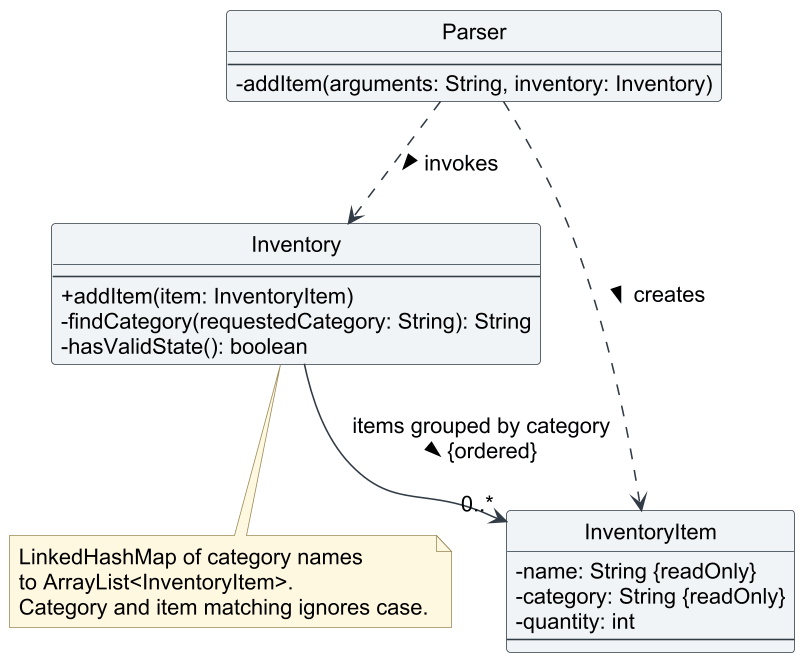
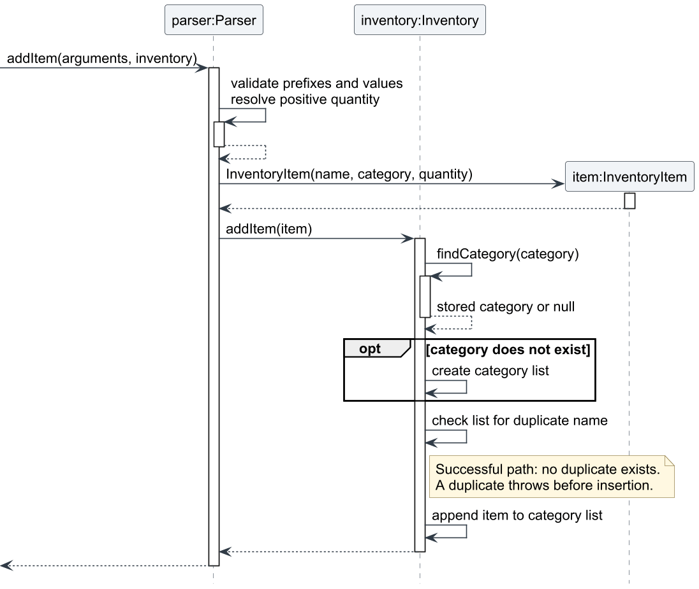

# Wei Xiong - Project Portfolio Page

## Overview

Bob is a Java command-line application that helps university lab technicians manage inventory, schedule lab sessions,
prepare materials, maintain contacts, and track student requests, equipment loans, and broken items. My main
contributions are inventory management and student request tracking, including stock deduction on fulfillment.
I also contributed regression tests, project tooling, and corrections to the team's guides and UML diagrams.

GitHub: [Lokwx](https://github.com/Lokwx)

## Summary of Contributions

- **Code contributed:** [GitHub repository](https://github.com/Lokwx/tp) and
  [tP Code Dashboard](https://nus-cs2113-ay2627-s1.github.io/tp-dashboard/?search=Lokwx&sort=groupTitle&sortWithin=title&timeframe=commit&mergegroup=&groupSelect=groupByRepos&breakdown=true&checkedFileTypes=docs~functional-code~test-code~other).

- **Inventory management:** Implemented the original inventory feature, including the `Inventory` and
  `InventoryItem` components and the `add-i`, `delete-i`, and `list-i` command flows. Items are grouped by category;
  technicians can register stock, remove a quantity, and view the remaining units. My initial removal flow removed
  an item when its quantity was depleted. The shared inventory gives other features a common source of available stock.
  - [Implement inventory addition, removal, and listing](https://github.com/Lokwx/tp/commit/dedb0b0)
  - [Improve inventory removal output](https://github.com/Lokwx/tp/commit/e7be2de)
  - [Add inventory diagnostic logging](https://github.com/Lokwx/tp/commit/02945cd)
  - Dayna later added the shared inventory validation and exception framework, case-insensitive category and
    duplicate matching, predictable category ordering, and empty-category cleanup in
    [the inventory validation changes](https://github.com/AY2627S1-CS2113-T11-3/tp/commit/781253e).

- **Student request tracking:** Implemented `Request` and `RequestManager` and integrated `add-r`, `delete-r`,
  `list-r`, and `mark-r` with the parser, application startup, and help text. A request records a student, item,
  quantity, deadline, and status. Requests are sorted by deadline, with student and item names breaking ties.
  Listing compares each request with live stock across categories and displays shortages without reserving units.
  This helps technicians identify upcoming requirements and arrange missing stock.
  - [Introduce the request model](https://github.com/Lokwx/tp/commit/601b009)
  - [Introduce the request manager](https://github.com/Lokwx/tp/commit/3cc1f74)
  - [Integrate request commands](https://github.com/Lokwx/tp/commit/7a93962)
  - [Add read-only stock totals for requests](https://github.com/Lokwx/tp/commit/64e1689)
  - [Merged as PR #45](https://github.com/AY2627S1-CS2113-T11-3/tp/pull/45)

- **Request fulfillment:** Extended `mark-r INDEX fulfilled` to deduct the requested quantity from shared
  inventory. Requests do not record a category, so deduction uses the same combined availability shown by
  `list-r` and consumes stock across categories in display order. The full total is checked before deduction;
  insufficient stock leaves both inventory and request status unchanged. Status changes only after successful
  deduction. Fulfillment is final: it cannot be repeated or reversed, and deleting the request does not restore stock.
  - [Implementation, tests, and guide updates](https://github.com/Lokwx/tp/commit/ab12249)
  - [Merged as PR #72](https://github.com/AY2627S1-CS2113-T11-3/tp/pull/72), addressing
    [issue #70](https://github.com/AY2627S1-CS2113-T11-3/tp/issues/70)
  - Gavin subsequently strengthened protection through retained request references and completed-request display
    behavior in [PR #73](https://github.com/AY2627S1-CS2113-T11-3/tp/pull/73).

- **Enhancements implemented:** Added request-specific deadline, index, and status handling, assertions, and
  diagnostics. Injected a clock into deadline validation so tests can check today's boundary consistently.
  Hardened request construction and quantity parsing, and used overflow-safe aggregation for availability.
  Added a reminder to refresh the request list after additions and deletions because sorted indices can change.
  - [Make deadline checks testable with an injected clock](https://github.com/Lokwx/tp/commit/60ce111)
  - [Harden request validation and availability totals](https://github.com/Lokwx/tp/commit/a736545)
  - [Remind users to refresh request indices](https://github.com/Lokwx/tp/commit/dc932c7)

- **Testing and verification:** Wrote the initial inventory model and manager tests and added inventory logging
  tests. Added request model, manager, parser, and logging tests covering valid commands, rejected inputs,
  deadline ordering, status changes, and availability after stock changes. These tests help detect regressions
  in the inventory and request workflows. Later extended inventory, request model, manager, and parser tests for
  fulfillment across categories, insufficient stock, and rejection of repeated or reversed fulfillment through
  the manager and command paths. Added stock-total tests in `InventoryAvailabilityTest`; teammates contributed
  the preparation availability tests in that shared class.
  - [Initial inventory unit tests](https://github.com/Lokwx/tp/commit/7951f7f)
  - [Inventory logging tests](https://github.com/Lokwx/tp/commit/5b2651c)
  - [Request model tests](https://github.com/Lokwx/tp/commit/55a6069)
  - [Request manager tests](https://github.com/Lokwx/tp/commit/9f650f6)
  - [Request parser tests](https://github.com/Lokwx/tp/commit/d2c277b)
  - [Request logging tests](https://github.com/Lokwx/tp/commit/0516ba6)
  - [Fulfillment regression tests](https://github.com/Lokwx/tp/commit/ab12249)

- **Contributions to the User Guide:** Documented student request commands, confirmations, deadlines, status
  changes, and read-only availability. Expanded the existing inventory instructions with duplicate-addition
  examples, input corrections, category-specific indices, and complete-removal behavior. Added request examples
  explaining rejected additions and stock totals across categories. Updated fulfillment instructions to explain
  stock deduction, final status, insufficient-stock rejection, and the distinction between fulfillment and a loan.
  - [Student request documentation](https://github.com/Lokwx/tp/commit/ee5803f)
  - [Expanded inventory instructions](https://github.com/Lokwx/tp/commit/8cb1f1f)
  - [Expanded request examples](https://github.com/Lokwx/tp/commit/42afe88)
  - [Inventory management section](../UserGuide.md#inventory-management)
  - [Student request tracking section](../UserGuide.md#student-request-tracking)

- **Contributions to the Developer Guide:** Documented inventory addition responsibilities, storage, validation,
  design alternatives, and limitations, with class and sequence diagrams and editable PlantUML sources.
  Expanded the request design with the addition flow, deadline sorting, clock-based validation, a sequence
  diagram, live availability, and test references. Added the fulfillment flow and its stock-consistency guarantees.
  - [Earlier inventory design documentation](https://github.com/Lokwx/tp/commit/9c8ffef)
  - [Initial student request design documentation](https://github.com/Lokwx/tp/commit/23b82a8)
  - [Detailed inventory addition design and diagrams](https://github.com/Lokwx/tp/commit/4ed0ac9)
  - [Detailed request addition design](https://github.com/Lokwx/tp/commit/f88e0a0)
  - [Inventory management design](../DeveloperGuide.md#41-inventory-management)
  - [Student request tracking design](../DeveloperGuide.md#47-student-request-tracking)

- **Team documentation and UML maintenance:** Addressed Developer Guide feedback across inventory, scheduling,
  preparation, loans, broken-item tracking, and storage diagrams. Corrected navigability, class compartments,
  association-label directions, and sequence notation. Added missing editable PlantUML sources and rendering
  instructions, numbered guide headings, and updated links. Aligned both guides with persistence and loan history,
  corrected preparation and loan-return call sequences, and clarified example prerequisites and validation behavior.
  These were documentation and diagram contributions; Dayna implemented persistence and loan history.
  - [Merged as PR #78](https://github.com/AY2627S1-CS2113-T11-3/tp/pull/78), addressing
    [DG feedback #75](https://github.com/AY2627S1-CS2113-T11-3/tp/issues/75)
  - [UML corrections and editable sources](https://github.com/Lokwx/tp/commit/fd32c66)
  - [Guide and diagram behavior alignment](https://github.com/Lokwx/tp/commit/f934244)
  - [Diagram rendering instructions](../diagrams/README.md)

- **Project tooling and conventions:** Added project instructions and skills for applying the SE-EDU Java and Git
  conventions, and aligned Checkstyle switch indentation with the intermediate Java guide. Added the early Bash
  compile-and-run script and later updated its entry point from Duke to Bob. The current documented build and
  launch workflow uses the Gradle wrapper and executable JAR.
  - [Shared standards and Checkstyle configuration](https://github.com/Lokwx/tp/commit/8819e46)
  - [Initial run script](https://github.com/Lokwx/tp/commit/2752760)
  - [Run-script entry point update](https://github.com/Lokwx/tp/commit/85eea6b)

<div style="break-before: page; page-break-before: always;"></div>

## Contributions to the User Guide - Selected Extracts

Abridged from my [inventory](../UserGuide.md#inventory-management) and
[request](../UserGuide.md#student-request-tracking) instructions, including later team refinements.
These extracts describe the merged implementation.

### Registering inventory

**Format:** `add-i n/NAME c/CATEGORY [q/QUANTITY]`

Supply prefixes in this order. Name and category cannot be blank. Quantity defaults to one when
omitted; an explicit quantity must be a positive whole number up to 2,147,483,647, entered without commas.
An existing item name in the same category is rejected ignoring capitalization. Adding an item does
not increase an existing entry's quantity.

Start Bob from a new, empty working directory and enter your name before running these examples.
Assume the computer's date is no later than 8 October 2099.

```text
add-i n/Wire c/Components q/15
add-i n/Wire c/Spares q/5
list-i
```

This creates separate entries with a combined availability of 20 Wire. Inventory indices restart
at one within each category. Refresh `list-i` after stock-changing operations because depleted
entries can disappear and remaining indices can change.

### Recording and fulfilling a request

**Formats:**

```text
add-r n/STUDENT_NAME i/ITEM q/QUANTITY d/DEADLINE
mark-r INDEX STATUS
```

All four addition arguments are required. `STATUS` accepts `prepared` or `fulfilled`, ignoring case.
The deadline must be a real date today or later, using
the `d MMMM yyyy` format with a full English month name and an initial capital. Requests are listed
by earliest deadline; ties use student and item names, ignoring case. Run `list-r` after additions
or deletions before using a request index.

Continuing the inventory example:

```text
add-r n/Alice i/Wire q/20 d/8 October 2099
list-r
mark-r 1 prepared
mark-r 1 fulfilled
list-r
```

Adding the request and marking it prepared leave all 20 Wire available. Fulfillment deducts 15
from Components and five from Spares, leaving zero available. The request remains listed as
`[Fulfilled]` without a shortage warning.

If stock is insufficient, fulfillment is rejected without changing stock or status. Two requests
may both initially show enough stock for the same units; fulfilling one changes the availability
for the other. Adding or preparing a request does not reserve stock.

**Fulfillment is final.** It cannot be repeated or reversed, and deleting the fulfilled request
does not restore its stock. Fulfillment does not create a loan. For a loan, use `add-l` instead
to avoid deducting the same units twice.

<div style="break-before: page; page-break-before: always;"></div>

## Contributions to the Developer Guide - Selected Extracts

The following selections are abridged from my inventory and request documentation and include
team refinements.

### Inventory addition: responsibilities and relationships

Source: [Inventory management](../DeveloperGuide.md#41-inventory-management).

`Parser` validates prefix order, extracts trimmed values, parses quantity, and constructs an
`InventoryItem`. The item independently validates its fields. `Inventory` resolves the category,
rejects duplicate names, stores the supplied item reference, and prints the confirmation.

<figure style="margin: 1em 0; break-inside: avoid; page-break-inside: avoid;">
  
  <figcaption style="margin-top: 0.5em; font-style: italic;">
    Figure 1: Parser uses Inventory and creates InventoryItem objects. Inventory retains
    item references grouped by category. The association does not promise exclusive ownership.
  </figcaption>
</figure>

The current inventory uses a `LinkedHashMap<String, ArrayList<InventoryItem>>`. Category and item
insertion order make listings predictable. Category resolution and duplicate checks ignore case
while preserving stored spelling. These refinements include Dayna's inventory changes described
above. Other features query the same inventory for usable stock.

### Addition ordering and validation

For `add-i n/Screws c/Fasteners q/100`, the parser validates the values and creates an item.
Inventory creates Fasteners if needed, checks for a duplicate, then appends the item.
A duplicate such as `n/screws c/FASTENERS q/20` is rejected without changing the existing 100 units.

<figure style="margin: 1em 0; break-inside: avoid; page-break-inside: avoid;">
  
  <figcaption style="margin-top: 0.5em; font-style: italic;">
    Figure 2: Successful addition after command dispatch. Construction validates the item,
    and duplicate checking precedes insertion. Routine getters, assertions, logging,
    and console output are omitted.
  </figcaption>
</figure>

Parser validation provides command-specific feedback; constructor checks protect direct callers.
Assertions check internal invariants, including positive stored quantities and nonempty categories.
They detect programming errors and do not replace input validation. Diagnostic records use `FINE`
without changing normal console output.

### Requests: sorting and live availability

Source: [Student request tracking](../DeveloperGuide.md#47-student-request-tracking).

`RequestManager` stores an `ArrayList<Request>` and sorts after each addition. Requests compare by
deadline, then student and item names ignoring case. Stable sorting preserves insertion order when
all three keys match. Quantity and status are not comparison keys, so marking does not require sorting.

`Inventory#getTotalAvailableQuantity` matches the full item name ignoring case across categories.
It accumulates in a `long` and caps the displayed total at `Integer.MAX_VALUE`. Availability is read
when listing, so loans, broken-item reports, and other stock changes appear without a cached total.
Each request is checked independently; the displayed availability is not a reservation.

### Fulfillment: check stock before mutation

Source: [Request fulfillment design](../DeveloperGuide.md#474-detailed-request-fulfillment-design).

1. `Parser` validates the index and status and passes the shared inventory to `RequestManager#markRequest`.
2. The manager retrieves the request and rejects an already fulfilled request.
3. `Inventory#deductTotalAvailableQuantity` checks the full available total before any deduction.
4. If sufficient, inventory deducts across categories in display order and removes depleted entries.
5. Only after successful deduction does the manager mark the request fulfilled and print confirmation.

Insufficient stock leaves the request and inventory unchanged. These guarantees cover expected
validation failures in the single-threaded application; they do not provide recovery from process
termination. Requests persist across restarts through the storage implementation contributed by Dayna.

### Design choices and alternatives

| Decision | Rationale and trade-off |
| --- | --- |
| Preserve inventory insertion order | `LinkedHashMap` makes category listings predictable; `HashMap` would not guarantee order. Linear case-insensitive scans are sufficient for the expected small inventory. |
| Reject duplicate inventory additions | Repeated `add-i` commands cannot silently increase stock. Automatically merging duplicate additions would make accidental repeated commands harder to detect. |
| Sort requests on addition | Stored and displayed indices stay aligned. Sorting only for display would require translating indices; a priority queue would not directly support indexed commands. |
| Read availability when listing | Stock changes are reflected immediately without maintaining another total. Adding or preparing requests does not reserve units. |
| Deduct across categories on fulfillment | Matches availability for requests, which do not store a category. Display-order deduction keeps the outcome deterministic. |
| Keep fulfillment final | Reversal would require deciding which categories receive restored stock. Rejecting reversal avoids that ambiguity and repeated deductions. |
| Inject a clock for deadline tests | Tests can verify today and past-date boundaries consistently while normal commands use the local calendar date. |

### Verification and limitations

- `InventoryItemTest` covers item validation. `InventoryTest` covers inventory operations,
  duplicates, and stock deduction. `InventoryLoggingTest` covers inventory diagnostics.
- `InventoryAvailabilityTest` covers stock totals across categories, case-insensitive matching,
  live quantity changes, null names, and totals exceeding the integer range. Its preparation
  availability tests were contributed by teammates.
- `RequestTest` covers validation, fixed-clock boundaries, ordering, and status transitions.
- `RequestManagerTest` and `ParserRequestTest` cover sorting, indices, live availability, command
  handling, successful fulfillment, insufficient stock, and final status.
- `RequestLoggingTest` checks request diagnostics. The team's
  [UI test plan](../../test/ui-test-plan.md) records command-level cases.

Requests have no persistent identifiers, cannot be edited in place, and remain after their deadlines.
Refresh the list before acting on an index. Fulfillment does not create a loan or support undo;
deleting a fulfilled request does not replenish inventory.

Diagram sources: [inventory class diagram](../diagrams/inventory-add-class.puml) and
[addition sequence](../diagrams/inventory-add-sequence.puml).
