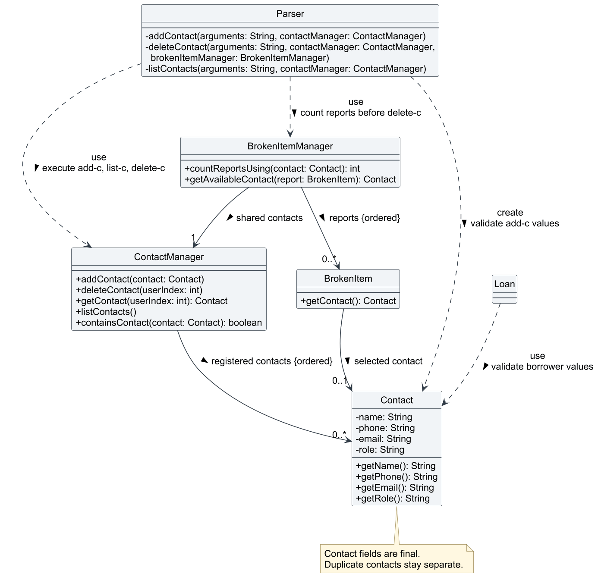
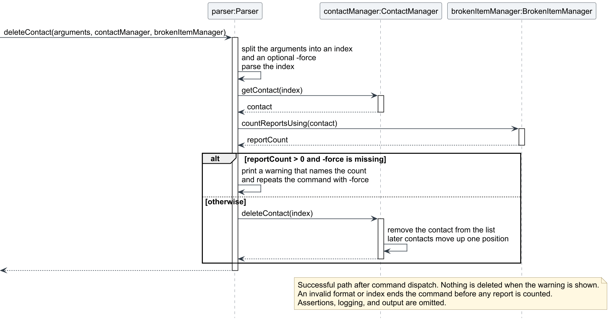

# Rachel Li - Project Portfolio Page

## Overview

Bob is a Java command-line application that helps lab technicians manage inventory, lab sessions, material
preparation, contacts, equipment loans, broken items, and student requests. My main contributions are contact
management, the safeguard for deleting a contact that a broken-item report uses, and the `help` command. I also wrote
the user guide sections for these features, and the contact section of the developer guide with its UML diagrams.

GitHub: [rachelnwk](https://github.com/rachelnwk)

## Summary of Contributions

- **Code contributed:** [GitHub repository](https://github.com/rachelnwk/tp) and
  [tP Code Dashboard](https://nus-cs2113-ay2627-s1.github.io/tp-dashboard/?search=rachelnwk&sort=groupTitle&sortWithin=title&timeframe=commit&mergegroup=&groupSelect=groupByRepos&breakdown=true&checkedFileTypes=docs~functional-code~test-code~other).

- **Contact management:** Implemented `Contact` and `ContactManager` and integrated the `add-c`, `delete-c`, and
  `list-c` commands with the parser and application startup
  ([#31](https://github.com/AY2627S1-CS2113-T11-3/tp/pull/31)). A contact records a name and phone number, with an
  optional email and role, so technicians can keep suppliers and maintenance staff in one place. Contacts are
  numbered by position, and deleting one renumbers the rest so the displayed indices stay consecutive.
  Duplicate contacts are allowed because different people can share a name. Dayna later added saving and restoring
  of contacts as part of persistent storage, and Gavin added the identity check that broken-item reports use to
  verify that their contact is still registered.
  - [Add contacts](https://github.com/rachelnwk/tp/commit/38ec143)
  - [List contacts](https://github.com/rachelnwk/tp/commit/01abb08)
  - [Delete contacts](https://github.com/rachelnwk/tp/commit/c770736)

- **Contact-deletion safeguard:** Deleting a contact silently broke the link on every broken-item report that used
  it. `delete-c` now refuses to delete such a contact and shows how many reports use it, unless the command is
  repeated as `delete-c INDEX -force`
  ([#93](https://github.com/AY2627S1-CS2113-T11-3/tp/pull/93)). `BrokenItemManager#countReportsUsing` counts the
  reports that hold the exact contact, and `Parser` makes the decision, so the contact and broken-item managers stay
  independent. A flag was chosen over a prompt so that every command stays a single line.
  - [Count reports that use a contact](https://github.com/rachelnwk/tp/commit/bcd37d7)
  - [Require -force to delete a contact in use](https://github.com/rachelnwk/tp/commit/99eaad2)
  - [Show -force in the help text](https://github.com/rachelnwk/tp/commit/7e361d6)

- **Help command:** Implemented `help`, which lists every command grouped by feature (inventory, lab sessions, lab
  preparation, contacts, and other) so that users need not consult the user guide to recall a command format
  ([#33](https://github.com/AY2627S1-CS2113-T11-3/tp/pull/33)). The text is kept in `Ui` beside the shared
  divider, and extra arguments such as `help me` are rejected with a usage message, like every other command.
  - [Add the help command](https://github.com/rachelnwk/tp/commit/6ce758c)

- **Enhancements implemented:** Validated contact input so that bad data is rejected before anything is stored:
  phone numbers must be digits only, emails must contain `@` and no spaces, and supplied optional values must not be
  blank. An empty list shows `No contacts saved.` instead of a blank screen, and an invalid `delete-c` index is
  reported with a dedicated exception that follows the existing `CommandException` pattern. Added assertions and
  diagnostic logging in line with the other features.

- **Incremental development and code quality:** Built every feature in small, ordered steps, finishing and checking
  each one before starting the next. Contacts were added one command at a time (`add-c`, then `list-c`, then
  `delete-c`), each with its JUnit tests. The deletion safeguard followed the same order: the counting method and its
  unit tests, then the `-force` behavior, then its parser tests, then the documentation. Each step ended with the full
  Gradle check and manual runs of the packaged application, and was committed with a message that explains why the
  change was made. Followed the SE-EDU coding standard, including the Single Level of Abstraction Principle (SLAP):
  `Parser` methods read at one level and delegate to small helpers such as `findPrefixes`, `extractValues`, and
  `parseContactIndex`, while `Contact` validates its own values.

- **Testing and verification:** Wrote 50 JUnit tests for contacts, `help`, and the deletion safeguard. The safeguard
  tests were chosen by boundary value analysis (BVA) of the number of reports using a contact, the number of words in
  the command, the index, and the flag spelling. The first 28 tests cover the features: contact model tests cover
  valid and invalid fields; manager tests cover adding, renumbering after deletion, and out-of-range indices; parser
  tests cover each command end to end, including missing or repeated prefixes, duplicate contacts, and renumbering
  after a deletion; help tests compare the full output against the expected text. After each step I also tested
  manually, running the packaged application through each boundary case. Extended the console regression test
  (`text-ui-test`) and the manual test plan (`test/ui-test-plan.md`) with contact, help, and safeguard cases.
  - [Extra list tests, including renumbering and duplicates](https://github.com/rachelnwk/tp/commit/0402c49)
  - [Parser tests for delete-c with -force](https://github.com/rachelnwk/tp/commit/40dccf5)

- **Contributions to the User Guide:** Wrote the Contact management section (`add-c`, `list-c`, `delete-c`, with
  examples and expected output, including the `-force` warning) and the Viewing help section. Added the matching
  rows to the command summary and updated the error table and limitations, which no longer described `help` as
  unsupported. Also updated the original Word document user guide so that it describes the contact and `help`
  commands as implemented.
  - [Contact management section](../UserGuide.md#contact-management)
  - [Viewing help section](../UserGuide.md#viewing-help)

- **Contributions to the Developer Guide:** Wrote section 4.4 on contact management to the same depth as the other
  features ([#94](https://github.com/AY2627S1-CS2113-T11-3/tp/pull/94)). It covers the command design, the classes and
  how contacts are saved, walkthroughs of `add-c` and `delete-c`, the table of failure messages, the design
  alternatives, the tests with their boundary value analysis, the known limitations, and the places where the `help`
  text must be kept in step. Drew the contact class diagram and the `add-c` and `delete-c` sequence diagrams in
  PlantUML, with editable sources. Also added the contact entries to the model overview, the glossary, the user
  stories, and the manual testing instructions.
  - [Contact management design](../DeveloperGuide.md#44-contact-management)
  - [Listing and deletion, including the safeguard](../DeveloperGuide.md#444-listing-and-deletion)
  - [Contact verification and limitations](../DeveloperGuide.md#447-verification-and-limitations)
  - [Contact manual tests](../DeveloperGuide.md#contacts)

- **Team tasks:** Recorded each piece of work as an issue before doing it:
  [contacts #32](https://github.com/AY2627S1-CS2113-T11-3/tp/issues/32),
  [Developer Guide for contacts #89](https://github.com/AY2627S1-CS2113-T11-3/tp/issues/89),
  [portfolio update #91](https://github.com/AY2627S1-CS2113-T11-3/tp/issues/91), and
  [contact-deletion safeguard #92](https://github.com/AY2627S1-CS2113-T11-3/tp/issues/92). Updated the About Us page
  ([#1](https://github.com/AY2627S1-CS2113-T11-3/tp/pull/1)) and created the first version of this portfolio
  ([#68](https://github.com/AY2627S1-CS2113-T11-3/tp/pull/68)). Kept the manual test plan and the Developer Guide's
  manual testing instructions in step with the new deletion behavior, fixing the steps that deleted a contact in use
  ([#93](https://github.com/AY2627S1-CS2113-T11-3/tp/pull/93),
  [#94](https://github.com/AY2627S1-CS2113-T11-3/tp/pull/94)).

- **Pull requests and reviews:** Opened six pull requests that were merged: About Us
  ([#1](https://github.com/AY2627S1-CS2113-T11-3/tp/pull/1)), contacts
  ([#31](https://github.com/AY2627S1-CS2113-T11-3/tp/pull/31)), `help`
  ([#33](https://github.com/AY2627S1-CS2113-T11-3/tp/pull/33)), the first portfolio
  ([#68](https://github.com/AY2627S1-CS2113-T11-3/tp/pull/68)), the deletion safeguard
  ([#93](https://github.com/AY2627S1-CS2113-T11-3/tp/pull/93)), and the contact Developer Guide
  ([#94](https://github.com/AY2627S1-CS2113-T11-3/tp/pull/94)). Was also requested as a reviewer on Dayna's
  defensiveness ([#30](https://github.com/AY2627S1-CS2113-T11-3/tp/pull/30)), loan tracking
  ([#47](https://github.com/AY2627S1-CS2113-T11-3/tp/pull/47)), and storage
  ([#76](https://github.com/AY2627S1-CS2113-T11-3/tp/pull/76)) pull requests.

<div style="break-before: page; page-break-before: always;"></div>

## Contributions to the User Guide - Selected Extracts

Abridged from my [contact management](../UserGuide.md#contact-management) instructions. These extracts describe the
merged implementation.

### Adding a contact

**Format:** `add-c n/NAME t/PHONE [e/EMAIL] [r/ROLE]`

- `n/` and `t/` are required. `e/` and `r/` are optional, but must appear in this order if used.
- `PHONE` must contain digits only, with no length limit. Spaces, `+`, and `-` are not accepted.
- `EMAIL` is only checked loosely: it must have non-whitespace text on both sides of an `@`, with no whitespace
  anywhere in the value. It is not checked against real addresses.
- A value you include must not be blank. Leave the whole prefix out instead.
- Duplicates are allowed. Adding the same name or number twice creates two separate contacts.

```text
add-c n/NUS Infrastructure t/65161234 r/Aircon and lighting repairs
```

Expected output:

```text
Successfully added: NUS Infrastructure (65161234) to contacts
```

### Deleting a contact that a broken-item report uses

**Format:** `delete-c INDEX [-force]`

Use the index from `list-c`. `-force` is optional and goes after the index. You only need it when a broken-item
report uses the contact. If any report uses the contact, `delete-c INDEX` does not delete it. It tells you how many
reports use it and shows the command to repeat:

```text
delete-c 1
```

Expected output:

```text
Contact NUS Infrastructure is used by 2 broken-item reports. To delete it anyway, use: delete-c 1 -force
```

To delete the contact anyway, add `-force`:

```text
delete-c 1 -force
```

Expected output:

```text
Successfully removed contact: NUS Infrastructure
```

Each report that used the contact then shows `Contact: Unavailable (contact deleted)` in `list-b`. The report and
inventory remain unchanged.

**Adding the contact again does not reconnect the reports.** A contact you add afterwards is a new contact, even if
it has the same name, phone number, email and role, so the old reports stay unavailable. A report's contact cannot
be changed once it is recorded, so think before you use `-force`.

<div style="break-before: page; page-break-before: always;"></div>

## Contributions to the Developer Guide - Selected Extracts

The following selections are abridged from my
[contact management design](../DeveloperGuide.md#44-contact-management).

### Responsibilities and storage

`Contact` is an immutable value class. Its constructor validates the name, phone, email, and role and throws a
`CommandFormatException` with a specific message for the first invalid value. `ContactManager` owns the list of
contacts in insertion order, prints the confirmation for each change, and converts between the one-based positions
shown to the user and the zero-based list positions. `Parser` dispatches `add-c`, `list-c`, and `delete-c` and, for
`delete-c`, asks the `BrokenItemManager` whether any report uses the contact, so `ContactManager` and
`BrokenItemManager` do not depend on each other for this check. `Loan` uses `Contact` only to validate the borrower's
name and phone and then keeps copies of those values, so a loan borrower is not a registered contact.

<figure style="margin: 1em 0; break-inside: avoid; page-break-inside: avoid;">
  
  <figcaption style="margin-top: 0.5em; font-style: italic;">
    Figure C1: Selected contact classes and collaborators. A broken-item report references the exact contact object
    but does not own it.
  </figcaption>
</figure>

### Deleting a contact that a report uses

A broken-item report keeps a reference to the `Contact` object that it selected. If that contact is deleted, the
report shows `Contact: Unavailable (contact deleted)`, and a report's contact cannot be changed afterwards.
`delete-c` therefore asks `BrokenItemManager#countReportsUsing` how many reports hold that exact object. If the count
is above zero and `-force` is missing, `Parser` prints a warning that names the count and repeats the command with the
flag, and deletes nothing. The check happens after the index is validated, so `-force` never changes how a malformed
or out-of-range index is reported.

<figure style="margin: 1em 0; break-inside: avoid; page-break-inside: avoid;">
  
  <figcaption style="margin-top: 0.5em; font-style: italic;">
    Figure C3: Contact deletion. When a report uses the contact and `-force` is missing, the command prints a warning
    and ends without deleting anything.
  </figcaption>
</figure>

Adding a contact with identical details afterwards does not reconnect those reports, because `countReportsUsing` and
`BrokenItemManager#getAvailableContact` compare contacts by identity. The new contact is a different object.

### Design choices and alternatives

| Decision | Rationale and trade-off |
| --- | --- |
| Allow duplicate contacts | A contact has no natural unique key, and two people can share a name or number. Rejecting duplicates would need a rule for what counts as the same contact. |
| Let a report keep the `Contact` object and compare by identity | A stored index would point at a different contact after a deletion. Comparing details would reconnect a report to an unrelated contact that happens to match. A contact that is deleted and added again stays unconnected. |
| Count reports in `Parser`, not in `ContactManager` | `BrokenItemManager` already depends on `ContactManager`. Calling it from `ContactManager` would create a cycle. |
| Require `-force` instead of asking for confirmation | Every command is one line, and the console regression and session scripts need no interactive input. The warning shows the exact command to repeat. |
| Accept only the exact, lowercase `-force` | Command words and prefixes are case-sensitive everywhere else. Being strict about a destructive option means that a mistyped flag deletes nothing. |

### Verification and limitations

`ContactTest`, `ContactManagerTest`, and `ParserContactTest` cover validation, listing, and renumbering after a
deletion. `BrokenItemManagerTest` and `ParserBrokenItemTest` cover the deletion safeguard. These tests were chosen by
boundary value analysis, which the guide records in
[Contact verification and limitations](../DeveloperGuide.md#447-verification-and-limitations). Command-level
scenarios are recorded under `UI-CONTACT-*` in the [UI test plan](../../test/ui-test-plan.md).

Contacts have no permanent identifiers and cannot be edited in place, so a forced deletion cannot be undone and does
not reconnect old reports. Prefixes are detected by a shared pattern, so a value containing a word such as `a/b`
cannot be entered.

Diagram sources: [contact class diagram](../diagrams/contact-class.puml),
[`add-c` sequence diagram](../diagrams/contact-add-sequence.puml), and
[`delete-c` sequence diagram](../diagrams/contact-delete-sequence.puml).
